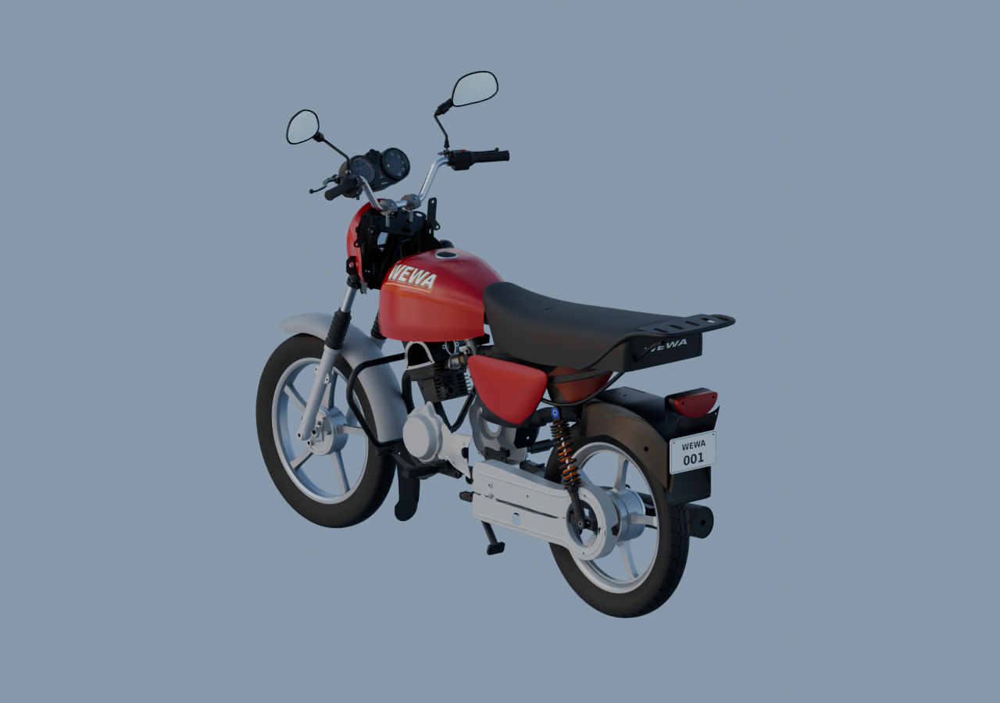

# Reprise autonome — 22 octobre 2026

La moto reste en cours. Les 199 fiches enregistrées sont des candidats, compositions et révisions partielles ; elles ne comptent pas 199 pièces physiques finies. Aucun des trente paquets ni la moto entière n’est déclaré reçu.

L’[audit global](creative/reviews/whole-exterior-coverage-v12/README.md) rassemble 91 parents natifs, avec quatre vues réellement relues. Bouchon, renfort avant, bavette arrière, cache droit normalisé et premiers éléments de commande arrière sont présents comme contexte. Les placements restent estimés.

Les [trois vues avec matériaux](creative/reviews/whole-exterior-material-preview-v5/README.md) portent sur 88 parents : selle sombre, caches rouges indépendants, feu rouge et plaque fictive WEWA001 visibles. Le [complément droit/face/arrière](creative/reviews/whole-exterior-opposite-side-v1/README.md) montre explicitement les exemplaires opposés encore absents.

La bavette JV181410, le renfort avant PF181410 et le dossier des quatre parents de frein sont sauvegardés avec rendus96 isolés et contrôles moteur. Le patin de frein est encore séparé ; aucune pose montée ni soudure cachée n’est déduite. Le cache droit conserve sa forme originale dans un dérivé de convention contrôlé. Les écarts nominaux manchon/tube et bouchon/ouverture restent signalés.

Suite active : kick existant, premier manchon passager JK113008 et une unité de repose-pied, correction d’apparence du catadioptre arrière, intégration du cockpit documenté. Le réflecteur nu avant reste insuffisamment documenté. La décision demandée sur les copies provisoires d’exemplaires reste en attente ; aucune réception artistique n’est inférée.

[Progression détaillée](creative/workflow/motorcycle-remaining-execution-2026-10-22-v3.json) · [Images, sources et contrôles](LIVRAISONS_MOTO.md)
