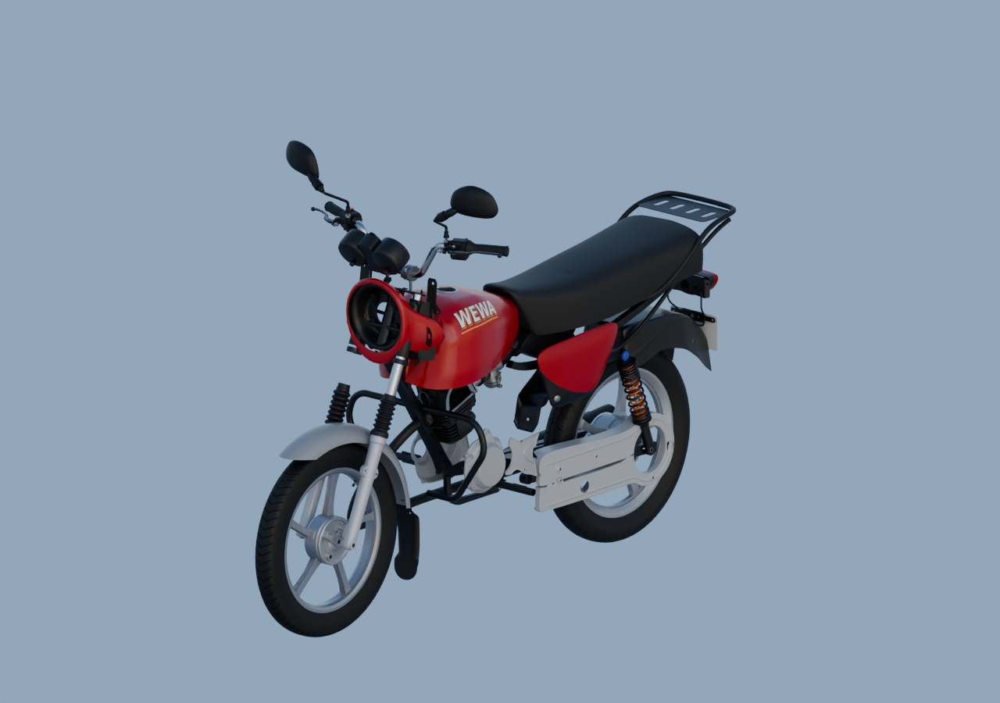

# Reprise autonome — 22 octobre 2026

La moto reste en cours. Les194 fiches enregistrées désignent des candidats partiels et essais, pas194 pièces finies. Aucune réception artistique globale n’est déclarée.

L’[audit global](creative/reviews/whole-exterior-coverage-v7/README.md) rassemble76 sources parentes natives exactes. La plaque est maintenant visible ; la bavette avant, le pare-carter et les supports métalliques des repose-pieds sont présents comme contexte. Les placements restent estimés et les attaches à contrôler.

Cet [aperçu réellement relu](creative/reviews/whole-exterior-material-preview-v3/README.md) conserve les matériaux natifs : selle sombre, garde-boue arrière noir et graphismes WEWA. Le vide de l’optique avant et les raccords incomplets de fourche restent visibles.

Le support PF121024, la structure PF121025, le flasque arrière DS151069 et un bouchon DS181012 sont sauvegardés séparément. Le kit extérieur du [sélecteur](creative/reviews/gear-selector-exterior-context-v1/) est également gelé ; sa pose sur le moteur reste inconnue. Le capuchon de fourche présente encore des écarts nominaux avec les anciens tubes et trous : aucun ajustement forcé n’est validé.

Suite ordonnée : bavette arrière JV181410 ; pose du cache droit ; protection de phare et essai du verre en contexte ; intégration des sources existantes de repose-pieds, béquilles et commande arrière ; réflecteur arrière et renfort du garde-boue. Le réflecteur nu avant reste insuffisamment documenté. Les recherches se poursuivent de manière autonome, avec pixels vendeurs privés et métadonnées publiques.

[Progression détaillée](creative/workflow/motorcycle-remaining-execution-2026-10-22-v3.json) · [Livraisons et contrôles](LIVRAISONS_MOTO.md)
