# Viva Wewa — pièces et contrôles de la moto

Cette page permet d'ouvrir les images, les sources et les contrôles directement
depuis le dépôt GitHub public. Les rendus ci-dessous sont des images sauvegardées
de Blender ; ils ne sont pas générés par GitHub au moment de la consultation.
Les liens de fichiers GLB et Blender donnent accès aux fichiers téléchargeables.

Le registre courant comporte **187 composants candidats enregistrés**, après
les premières études du cache gauche et du rail de porte-bagages. Le point Source23
historique en comportait 95 ; les livraisons ultérieures restent distinctes.
Les dix-huit ensembles restent ouverts : une source ou un contrôle technique
réussi ne vaut pas réception artistique ni validation sur iPhone.

## Fermetures de l'amortisseur : livrées dans Source21

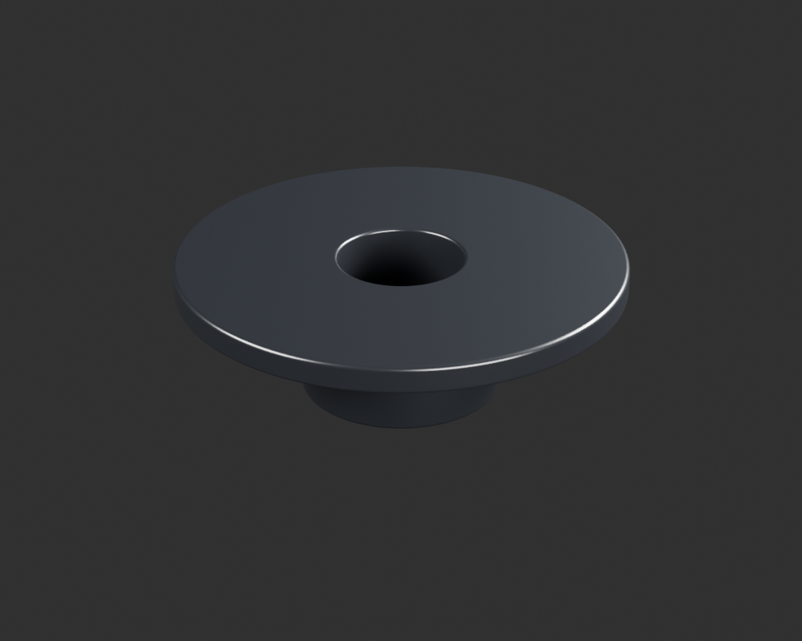

[Pièce, limites et contrôles](creative/reviews/rear-sns-opposite-end-closure-v1/)

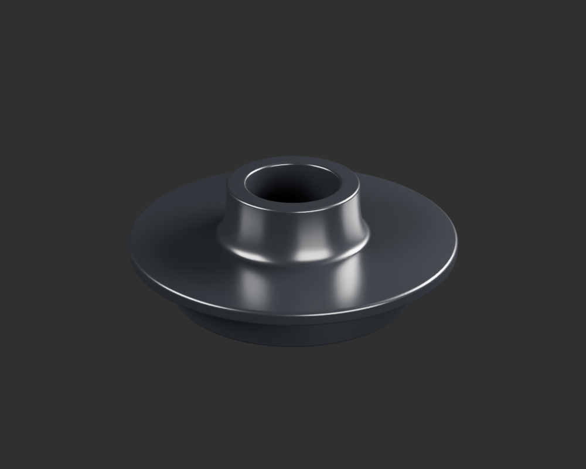

[Pièce, limites et contrôles](creative/reviews/rear-sns-body-end-closure-v1/)

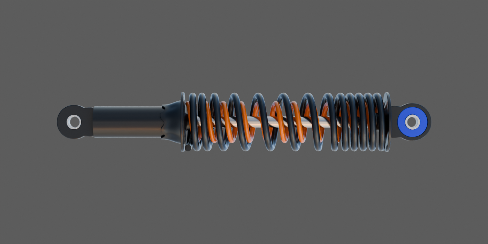

[Revue de l'ensemble à quatorze sources](creative/reviews/rear-sns-rest-assembly-v3/README.md)
· [Contrôles Source21](WEWA_Developpement_Web/validation/motorcycle18-source21-integrity.json)

## Compléments de couverture après audit global

- **LEGACY14-FORK-RH** : [fork-bellows-right-visible-v1 — sources, rendus et contrôles](creative/reviews/fork-bellows-right-visible-v1/README.md). Enfant candidat ; interfaces/paquet ouverts.

## Exécution continue des trente paquets

- **P06** : [DJ201051 visible continuous outer glazing envelope — sources et images](creative/reviews/front-completion-p06-outer-glass-front17-v1-coordination-v1/README.md). Candidat, paquet encore ouvert.
- **P18** : [MOTO-CRANKCASE-LH-MAJOR-OUTER-ENVELOPE-DONOR-001 — bounded exterior candidate — sources et images](creative/reviews/crankcase-lh-major-outer-envelope-donor-v1-coordination-v1/README.md). Candidat, paquet encore ouvert.
- **P25** : [PF121024 observed two-sleeve headlamp carrier exterior — sources et images](creative/reviews/front-completion-p25-lamp-frame-front18-v2-coordination-v1/README.md). Candidat, paquet encore ouvert.
- **P18** : [MOTO-CRANKCASE-LH-LOWER-SERVICE-PORT-001 — bounded exterior candidate — sources et images](creative/reviews/crankcase-lh-lower-service-port-v1-coordination-v1/README.md). Candidat, paquet encore ouvert.
- **P06** : [DF201058 front molded cage exposed skin — sources et images](creative/reviews/front-completion-p06-holder-cage-front16-v2-coordination-v1/README.md). Candidat, paquet encore ouvert.
- **P06** : [CL201023 stepped metal bulb-base exterior envelope — sources et images](creative/reviews/front-completion-p06-bulb-base-front16-v1-coordination-v1/README.md). Candidat, paquet encore ouvert.
- **P01** : [MOTO-SIDE-COVER-LH-WINDOW-CATCH-001 — bounded exterior candidate — sources et images](creative/reviews/side-cover-left-window-catch-v1-coordination-v1/README.md). Candidat, paquet encore ouvert.
- **P07** : [tail-lamp-perforated-outer-lens-v3 — sources, rendus et contrôles](creative/reviews/tail-lamp-perforated-outer-lens-v3/README.md). Enfant candidat ; interfaces/paquet ouverts.
- **P20** : [MOTO-AIRBOX-CARB-BOOT-PHYSICAL-002 — bounded exterior candidate — sources et images](creative/reviews/airbox-carb-boot-physical-study-v2-coordination-v1/README.md). Candidat, paquet encore ouvert.
- **P06** : [CL201023 HS1 bulb three-ear stamped locating flange — sources et images](creative/reviews/front-completion-p06-bulb-flange-front15-v4-coordination-v1/README.md). Candidat, paquet encore ouvert.
- **P13** : [seat-base-observed-underside-v2 — sources, rendus et contrôles](creative/reviews/seat-base-observed-underside-v2/README.md). Enfant candidat ; interfaces/paquet ouverts.
- **P12** : [fuel-tap-stepped-hex-cap-visible-v1 — sources, rendus et contrôles](creative/reviews/fuel-tap-stepped-hex-cap-visible-v1/README.md). Enfant candidat ; interfaces/paquet ouverts.
- **P18** : [MOTO-CRANKCASE-LH-LOWER-PERIPHERAL-WALL-001 — bounded exterior candidate — sources et images](creative/reviews/crankcase-lh-lower-peripheral-wall-v1-coordination-v1/README.md). Candidat, paquet encore ouvert.
- **P06** : [CL201023 HS1 observed capsule exterior with opaque tip — sources et images](creative/reviews/front-completion-p06-bulb-capsule-front15-v1-coordination-v1/README.md). Candidat, paquet encore ouvert.
- **P26** : [MOTO-CHAINCASE-FRONT-EAR-ROOT-002 — bounded exterior candidate — sources et images](creative/reviews/chaincase-front-ear-root-v2-coordination-v1/README.md). Candidat, paquet encore ouvert.
- **P13** : [seat-lateral-mount-lug-visible-v1 — sources, rendus et contrôles](creative/reviews/seat-lateral-mount-lug-visible-v1/README.md). Enfant candidat ; interfaces/paquet ouverts.
- **P06** : [CL201023 HS1 bulb three-ear stamped locating flange — sources et images](creative/reviews/front-completion-p06-bulb-flange-front15-v2-coordination-v1/README.md). Candidat, paquet encore ouvert.
- **P05** : [tail-lamp-collar-31201001-visible-v1 — sources, rendus et contrôles](creative/reviews/tail-lamp-collar-31201001-visible-v1/README.md). Enfant candidat ; interfaces/paquet ouverts.
- **P10** : [rear-indicator-right-stalk-v1 — sources, rendus et contrôles](creative/reviews/rear-indicator-right-stalk-v1/README.md). Enfant candidat ; interfaces/paquet ouverts.
- **P17** : [MOTO-SIDE-STAND-PIVOT-NYLOC-NUT-001 — bounded exterior candidate — sources et images](creative/reviews/side-stand-pivot-nyloc-nut-v1-coordination-v1/README.md). Candidat, paquet encore ouvert.
- **P28** : [DS181009 lower handlebar damper observed exterior skin — sources et images](creative/reviews/front-completion-p28-lower-damper-front14-v1-coordination-v1/README.md). Candidat, paquet encore ouvert.
- **P18** : [MOTO-CRANKCASE-UPPER-LAND-LH-001 — bounded exterior candidate — sources et images](creative/reviews/crankcase-upper-land-lh-v1-coordination-v1/README.md). Candidat, paquet encore ouvert.
- **P17** : [MOTO-SIDE-STAND-SPRING-COVER-001 — bounded exterior candidate — sources et images](creative/reviews/side-stand-spring-cover-v1-coordination-v1/README.md). Candidat, paquet encore ouvert.
- **P08** : [rear-plate-captive-nut-exterior-v1 — sources, rendus et contrôles](creative/reviews/rear-plate-captive-nut-exterior-v1/README.md). Enfant candidat ; interfaces/paquet ouverts.
- **P16** : [MOTO-PASSENGER-FOOTREST-STAY-RIGHT-001 — bounded exterior candidate — sources et images](creative/reviews/passenger-footrest-stay-right-v1-coordination-v1/README.md). Candidat, paquet encore ouvert.
- **P16** : [MOTO-PASSENGER-FOOTREST-STAY-LEFT-001 — bounded exterior candidate — sources et images](creative/reviews/passenger-footrest-stay-left-v1-coordination-v1/README.md). Candidat, paquet encore ouvert.
- **P17** : [MOTO-CENTRE-STAND-PIVOT-SHAFT-001 — bounded exterior candidate — sources et images](creative/reviews/centre-stand-pivot-shaft-v1-coordination-v1/README.md). Candidat, paquet encore ouvert.
- **P15** : [MOTO-BRAKE-ROD-BARREL-PIN-001 — bounded exterior candidate — sources et images](creative/reviews/brake-rod-barrel-pin-v1-coordination-v1/README.md). Candidat, paquet encore ouvert.
- **P17** : [MOTO-CENTRE-STAND-LATERAL-STUD-001 — bounded exterior candidate — sources et images](creative/reviews/centre-stand-lateral-stud-v1-coordination-v1/README.md). Candidat, paquet encore ouvert.
- **P19** : [MOTO-CARBURETTOR-VISIBLE-SLOTTED-HEAD-001 — bounded exterior candidate — sources et images](creative/reviews/carburettor-visible-slotted-head-v1-coordination-v1/README.md). Candidat, paquet encore ouvert.
- **P19** : [MOTO-CARBURETTOR-ENTRY-LOCKNUT-001 — bounded exterior candidate — sources et images](creative/reviews/carburettor-entry-locknut-v1-coordination-v1/README.md). Candidat, paquet encore ouvert.
- **P15** : [MOTO-BRAKE-LINKAGE-HEADED-PIN-001 — bounded exterior candidate — sources et images](creative/reviews/brake-linkage-headed-pin-v1-coordination-v1/README.md). Candidat, paquet encore ouvert.
- **P06** : [DF201058 loose jacket and four visible branch-insulation skins only — sources et images](creative/reviews/front-completion-p06-holder-lead-skins-front12-v2-coordination-v1/README.md). Candidat, paquet encore ouvert.
- **P06** : [Related DF201058 opaque rear bulb-holder cap exterior — sources et images](creative/reviews/front-completion-p06-holder-cap-front12-v1-coordination-v1/README.md). Candidat, paquet encore ouvert.
- **P03** : [Related DF191020 single continuous formed-wire cable guide — sources et images](creative/reviews/front-completion-p03-wire-guide-front12-v2-coordination-v1/README.md). Candidat, paquet encore ouvert.
- **P24** : [Related4gear DU151005 collar and exposed sleeve exterior — sources et images](creative/reviews/front-completion-p24-related-collar-front12-v1-coordination-v1/README.md). Candidat, paquet encore ouvert.
- **P21** : [Related DK151094 single representative cush lobe exterior — sources et images](creative/reviews/front-completion-p21-single-cush-front12-v2-coordination-v1/README.md). Candidat, paquet encore ouvert.
- **P25** : [Related DS181015 steering cap nut exterior — sources et images](creative/reviews/front-completion-p25-steering-cap-front12-v2-coordination-v1/README.md). Candidat, paquet encore ouvert.
- **P23** : [Related DJ151034 visible collar outer skin only — sources et images](creative/reviews/front-completion-p23-collar-outer-front12-v1-coordination-v1/README.md). Candidat, paquet encore ouvert.
- **P05** : [tail-support-damper-dd201011-v1 — sources, rendus et contrôles](creative/reviews/tail-support-damper-dd201011-v1/README.md). Enfant candidat ; interfaces/paquet ouverts.
- **P08** : [rear-plate-carrier-crossbar-v2 — sources, rendus et contrôles](creative/reviews/rear-plate-carrier-crossbar-v2/README.md). Enfant candidat ; interfaces/paquet ouverts.
- **P08** : [rear-plate-carrier-wire-v3 — sources, rendus et contrôles](creative/reviews/rear-plate-carrier-wire-v3/README.md). Enfant candidat ; interfaces/paquet ouverts.
- **P05** : [tail-lamp-upper-bracket-v4 — sources, rendus et contrôles](creative/reviews/tail-lamp-upper-bracket-v4/README.md). Enfant candidat ; interfaces/paquet ouverts.
- **Sources historiques retrouvées localement** : [54 fichiers exacts restaurés depuis Git](creative/research/historical-source-restoration-v1/report.json), soit27 sources Blender et27 GLB du cadre, bras oscillant, pare-moteur et amortisseurs. Aucun nouveau modèle ni réception supplémentaire.

- **P19** : [MOTO-CARBURETTOR-FLOAT-BOWL-001 — bounded exterior candidate — sources et images](creative/reviews/carburettor-float-bowl-v2-coordination-v1/README.md). Candidat, paquet encore ouvert.
- **P19** : [MOTO-CARBURETTOR-LOWER-BODY-001 — bounded exterior candidate — sources et images](creative/reviews/carburettor-lower-body-v2-coordination-v1/README.md). Candidat, paquet encore ouvert.
- **P19** : [MOTO-CARBURETTOR-CABLE-ADJUSTER-BARREL-001 — bounded exterior candidate — sources et images](creative/reviews/carburettor-cable-adjuster-barrel-v1-coordination-v1/README.md). Candidat, paquet encore ouvert.
- **P17** : [MOTO-CENTRE-STAND-OPERATING-ARM-001 — bounded exterior candidate — sources et images](creative/reviews/centre-stand-operating-arm-v1-coordination-v1/README.md). Candidat, paquet encore ouvert.
- **P05/P08 : nouvelles références du support arrière** — [contradictions documentées](creative/research/rear-cluster-reference-reconciliation-v2/contradictions-v1.json), [montagev2 conservé comme diagnostic](creative/reviews/rear-cluster-review-v2/README.md). Les formes planes antérieures restent à reprendre ; nouvelles tôles pliées et arceau déporté en préparation.

- **P11, plaque révisée** : [revue technique du dessin original](creative/reviews/license-plate-wewa-v2/DESIGN_REVIEW_V1.md) et [axes de perçages comparés aux GLB de la traverse](creative/reviews/license-plate-wewa-v2/nominal-carrier-interface-v1.json). Décalage nominal de2mm par côté supprimé dans la pose de revue ; visserie et pose véhicule restent ouvertes.

- **P11** : [license-plate-wewa-v2 — sources, rendus et contrôles](creative/reviews/license-plate-wewa-v2/README.md). Enfant candidat ; interfaces/paquet ouverts.
- **P21** : [Existing related DS151068 front: source normal and scalar roughness correction candidate — sources et images](creative/reviews/front-completion-p21-front-material-front10-v5-coordination-v1/README.md). Candidat, paquet encore ouvert.
- **P21** : [Related DS151068 reverse exterior independent study — sources et images](creative/reviews/front-completion-p21-reverse-front10-v8-coordination-v1/README.md). Candidat, paquet encore ouvert.
- **P23** : [Single related DH151029 shouldered hex bolt exterior — sources et images](creative/reviews/front-completion-p23-torque-bolt-front10-v1-coordination-v1/README.md). Candidat, paquet encore ouvert.
- **P23** : [Related DJ151036 two-cheek LH adjuster exterior — sources et images](creative/reviews/front-completion-p23-lh-adjuster-front10-v1-coordination-v1/README.md). Candidat, paquet encore ouvert.
- **P23** : [Related DJ151037 formed RH adjuster exterior — sources et images](creative/reviews/front-completion-p23-rh-adjuster-front10-v2-coordination-v1/README.md). Candidat, paquet encore ouvert.
- **P23** : [Related JW122004 pressed torque arm — sources et images](creative/reviews/front-completion-p23-torque-arm-front10-v2-coordination-v1/README.md). Candidat, paquet encore ouvert.
- **P23** : [MOTO-REAR-ADJUSTER-ENDPLATE-DJ151047-STUDY-001 — sources et images](creative/reviews/front-completion-p23-endplate-front9-v1-coordination-v1/README.md). Candidat, paquet encore ouvert.
- **P12** : [fuel-valve-visible-lever-v1 — sources, rendus et contrôles](creative/reviews/fuel-valve-visible-lever-v1/README.md). Enfant candidat ; interfaces/paquet ouverts.
- **P17** : [MOTO-SIDE-STAND-PIVOT-BOLT-001 — bounded exterior candidate — sources et images](creative/reviews/side-stand-pivot-bolt-v1-coordination-v1/README.md). Candidat, paquet encore ouvert.
- **P17** : [MOTO-SIDE-STAND-CURVED-FOOT-001 — bounded exterior candidate — sources et images](creative/reviews/side-stand-curved-foot-v3-coordination-v1/README.md). Candidat, paquet encore ouvert.
- **P17** : [MOTO-SIDE-STAND-SPRING-ANCHOR-PIN-001 — bounded exterior candidate — sources et images](creative/reviews/side-stand-spring-anchor-pin-v1-coordination-v1/README.md). Candidat, paquet encore ouvert.
- **P15** : [MOTO-BRAKE-PEDAL-TORSION-SPRING-001 — bounded exterior candidate — sources et images](creative/reviews/brake-pedal-torsion-spring-v1-coordination-v1/README.md). Candidat, paquet encore ouvert.
- **P15** : [MOTO-BRAKE-ROD-COMPRESSION-SPRING-001 — bounded exterior candidate — sources et images](creative/reviews/brake-rod-compression-spring-v1-coordination-v1/README.md). Candidat, paquet encore ouvert.
- **P19** : [MOTO-CARBURETTOR-CURVED-CONNECTOR-001 — bounded exterior candidate — sources et images](creative/reviews/carburettor-curved-connector-v1-coordination-v1/README.md). Candidat, paquet encore ouvert.
- **P19** : [MOTO-CARBURETTOR-ENTRY-BOOT-001 — bounded exterior candidate — sources et images](creative/reviews/carburettor-entry-boot-v1-coordination-v1/README.md). Candidat, paquet encore ouvert.
- **P17** : [MOTO-CENTRE-STAND-RETURN-SPRING-001 — bounded exterior candidate — sources et images](creative/reviews/centre-stand-return-spring-v1-coordination-v1/README.md). Candidat, paquet encore ouvert.
- **P17** : [MOTO-SIDE-STAND-RETURN-SPRING-001 — bounded exterior candidate — sources et images](creative/reviews/side-stand-return-spring-v1-coordination-v1/README.md). Candidat, paquet encore ouvert.
- **P15** : [MOTO-BRAKE-ROD-CLEVIS-001 — bounded exterior candidate — sources et images](creative/reviews/brake-rod-clevis-v1-coordination-v1/README.md). Candidat, paquet encore ouvert.
- **P15** : [MOTO-BRAKE-ACTUATION-ROD-001 — bounded exterior candidate — sources et images](creative/reviews/brake-actuation-rod-v1-coordination-v1/README.md). Candidat, paquet encore ouvert.
- **P19** : [MOTO-CARBURETTOR-FLOAT-BOWL-001 — bounded exterior candidate — sources et images](creative/reviews/carburettor-float-bowl-v1-coordination-v1/README.md). Candidat, paquet encore ouvert.
- **P19** : [MOTO-CARBURETTOR-LOWER-BODY-001 — bounded exterior candidate — sources et images](creative/reviews/carburettor-lower-body-v1-coordination-v1/README.md). Candidat, paquet encore ouvert.
- **P08** : [rear-plate-carrier-wire-v1 — sources, rendus et contrôles](creative/reviews/rear-plate-carrier-wire-v1/README.md). Enfant candidat ; interfaces/paquet ouverts.
[Quatorze nouvelles sauvegardes figées : train arrière, carburateur, frein et ressorts](creative/reviews/continuation-backup-v1/continuation-ready-v2.md). Sources Blender, exports et rendus conservés ; revue indépendante et réception distinctes.

### Revue du montage arrière : cinq pièces réunies

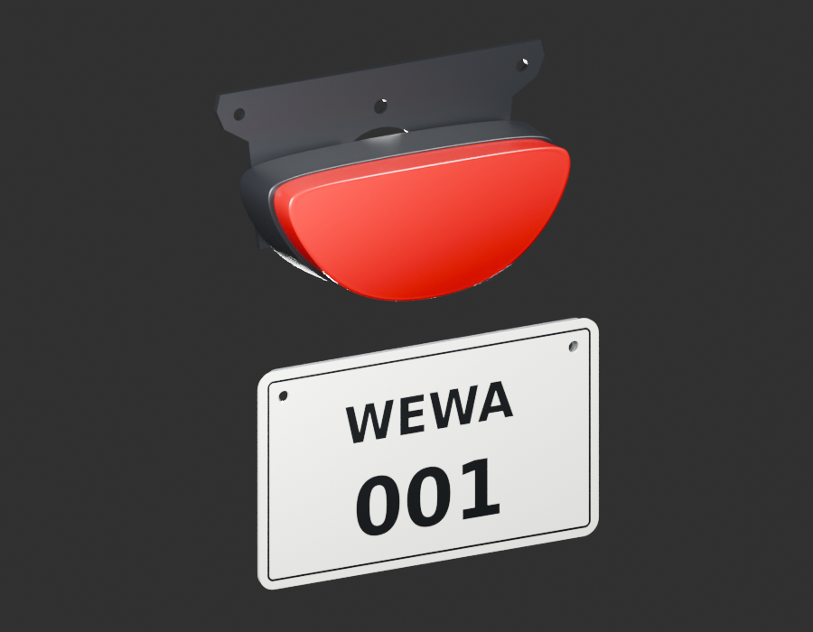

[Sources, rendus et contrôles](creative/reviews/rear-cluster-review-v1/README.md). Arceau manquant et décalage des trous de plaque de 2 mm par côté signalés. Pose provisoire ; aucun lot déclaré terminé, aucun nouveau composant ajouté.

- **P10** : [rear-indicator-left-stalk-v1 — sources, rendus et contrôles](creative/reviews/rear-indicator-left-stalk-v1/README.md). Enfant candidat ; interfaces/paquet ouverts.
- **P11** : [plaque fictive WEWA — revue technique G0 à G4](creative/reviews/license-plate-wewa-v1/DESIGN_REVIEW_V1.md). Dessin original contrôlé ; montage G5 et réception utilisateur ouverts.
- **P02** : [différence de variante du porte-bagages](creative/research/rear-rack-variant-reconciliation-v1/G1-contradiction.json), appuyée par les [nouvelles références attribuées](creative/research/exterior-completion-next-v1/source-register.json).
- **P13** : [seat-damper-pedestal-v2 — sources, rendus et contrôles](creative/reviews/seat-damper-pedestal-v2/README.md). Enfant candidat ; interfaces/paquet ouverts.
- **P17** : [MOTO-CENTRE-STAND-MAIN-FRAME-001 — bounded exterior candidate — sources et images](creative/reviews/centre-stand-main-frame-v1-coordination-v1/README.md). Candidat, paquet encore ouvert.
- **P18** : [MOTO-CRANKCASE-LH-OUTPUT-PANEL-001 — bounded exterior candidate — sources et images](creative/reviews/crankcase-lh-output-panel-v1-coordination-v1/README.md). Candidat, paquet encore ouvert.
- **P15** : [MOTO-BRAKE-PEDAL-TEXTURED-PAD-001 — bounded exterior candidate — sources et images](creative/reviews/brake-pedal-textured-pad-v1-coordination-v1/README.md). Candidat, paquet encore ouvert.
- **P11** : [license-plate-wewa — sources, rendus et contrôles](creative/reviews/license-plate-wewa-v1/README.md). Enfant candidat ; interfaces/paquet ouverts.
- **P19** : [MOTO-CARBURETTOR-UPPER-CASTING-001 — bounded exterior candidate — sources et images](creative/reviews/carburettor-upper-casting-v1-coordination-v1/README.md). Candidat, paquet encore ouvert.
- **P12** : [fuel-cap-exterior-envelope-v2 — sources, rendus et contrôles](creative/reviews/fuel-cap-exterior-envelope-v2/README.md). Enfant candidat ; interfaces/paquet ouverts.
- **P21** : [MOTO-REAR-CARRIER-DS151068-STUDY-001 — sources et images](creative/reviews/front-completion-p21-carrier-v3-coordination-v1/README.md). Candidat, paquet encore ouvert.
- **P29** : [front-completion-p29-bow-material-v1 — bounded appearance study — sources et images](creative/reviews/front-completion-p29-bow-material-v1-coordination-v1/README.md). Candidat, paquet encore ouvert.
- **P10** : [rear-indicator-mount-washer-v2 — sources, rendus et contrôles](creative/reviews/rear-indicator-mount-washer-v2/README.md). Enfant candidat ; interfaces/paquet ouverts.
- **P25** : [Related exposed fork-top cap clean-silver appearance study — sources et images](creative/reviews/front-completion-p25-cap-material-v1-coordination-v1/README.md). Candidat, paquet encore ouvert.
- **P24** : [front-completion-p24-axle-material-v1 — bounded appearance study — sources et images](creative/reviews/front-completion-p24-axle-material-v1-coordination-v1/README.md). Candidat, paquet encore ouvert.
- **P09** : [front-completion-p09-nut-material-v3 — bounded appearance study — sources et images](creative/reviews/front-completion-p09-nut-material-v3-coordination-v1/README.md). Candidat, paquet encore ouvert.
- **P08** : [rear-plate-carrier-crossbar — sources, rendus et contrôles](creative/reviews/rear-plate-carrier-crossbar-v1/README.md). Enfant candidat ; interfaces/paquet ouverts.
- **P14** : [MOTO-GEAR-SELECTOR-ARM-001 — bounded exterior candidate — sources et images](creative/reviews/gear-selector-arm-v1-coordination-v1/README.md). Candidat, paquet encore ouvert.
- **P07** : [tail-lamp-black-housing-v2 — sources, rendus et contrôles](creative/reviews/tail-lamp-black-housing-v2/README.md). Enfant candidat ; interfaces/paquet ouverts.
- **P07** : [tail-lamp-outer-lens-v2 — sources, rendus et contrôles](creative/reviews/tail-lamp-outer-lens-v2/README.md). Enfant candidat ; interfaces/paquet ouverts.
[Suivi courant des trente paquets et répartition du travail](creative/workflow/motorcycle-exterior-continuation-status-v1.json). Les dossiers et travaux de géométrie sont distingués des paquets complets ; les points ci-dessous conservent aussi les anciennes sauvegardes.

- **P04** : [MOTO-SIDE-COVER-RIGHT-SKIN-001 — bounded exterior candidate — sources et images](creative/reviews/side-cover-right-v1-coordination-v1/README.md). Candidat, paquet encore ouvert.
- **P03** : [bavette avant à trois trous — sources et images](creative/reviews/front-mudflap-coordination-v1/README.md). Variante apparentée, montage et reste du paquet ouverts.
- **P01** : [cache gauche corrigé et fixation visible, sources et images](creative/reviews/side-cover-left-v2/coordinator-delivery.md). Même identité, paquet encore ouvert.
- **P05** : [tail-lamp-upper-bracket — sources, rendus et contrôles](creative/reviews/tail-lamp-upper-bracket-v1/README.md). Enfant candidat ; interfaces/paquet ouverts.
[Sauvegarde intermédiaire de l’avant : sources grises et recherches, non livrées comme pièces terminées](creative/reviews/exterior-continuation-checkpoint-01.md).

- **P02** : [rear-rack-deck — sources, rendus et contrôles](creative/reviews/rear-rack-deck-v1/README.md). Enfant candidat ; interfaces/paquet ouverts.

## Historique — lancement de P01 et P02

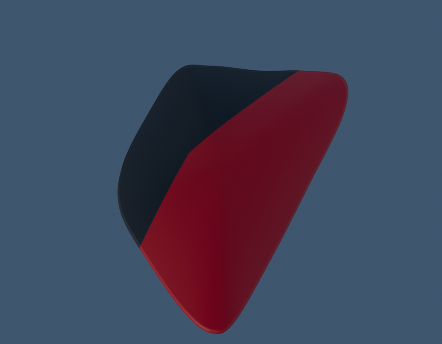

Au jalon `7ec9c4e` : **0 paquet terminé / 2 commencés / 28 non démarrés.** P01 dispose d’une première
peau extérieure Blender/GLB, de trois vues grises, deux aperçus, trois rendus
détaillés96 et quatre vues Babylon contrôlées. Les huit EXR FLOAT32 sont conservés.
La peinture en escalier a été corrigée ; l’état rejeté reste archivé.

[Ouvrir les images, sources et limites de P01](creative/reviews/side-cover-left-study-v1/README.md).
Le bombé et le retour sont estimés ; forme, fixation basse et montage restent
à terminer. Aucun cache complet ni réception artistique ne sont déclarés.
Les jalons documentaires et gris ont été poussés sous `512aa5f` et `54da5f6`.

### P02 — rail extérieur du porte-bagages

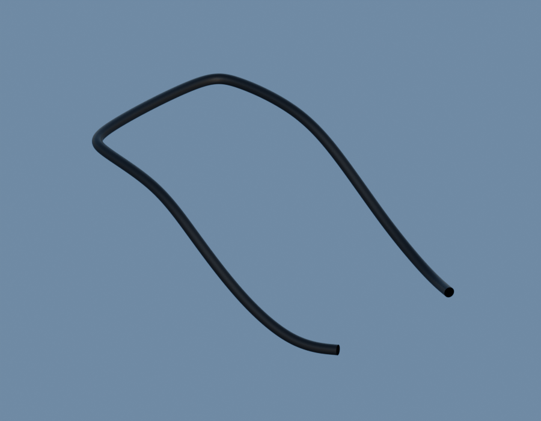

[Images, Blender/GLB, corrections et contrôles](creative/reviews/rack-outer-rail-study-v1/README.md).
Le rail extérieur a90 000 triangles contrôlés, trois vues grises, deux aperçus,
trois rendus détaillés96 et quatre vues Babylon non vides. Les huit EXR FLOAT32
sont conservés. Deux constructions rejetées sont archivées avant la version corrigée.

Les dimensions et la section restent estimées ; plateforme, terminaisons et
attaches ne sont pas encore fabriquées. P02 reste ouvert. Ses jalons documentaire
et gris ont été poussés sous `141e059` et `1ace9ea`.

## Dernières pièces livrées avec leurs contrôles

### Tige du clignotant avant droit — nouvelle fabrication

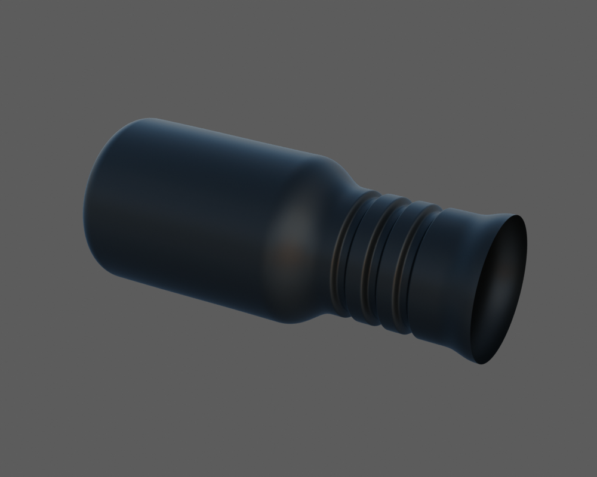

Profil indépendant lié à PF401002, avec trois rainures géométriques. La tige
gauche n'a pas été réfléchie. Les extrémités restent deux coupes de revue ; le
raccord à la coque et les fixations suivent séparément.

[Images et limites](creative/reviews/indicator-front-right-stalk-v1/README.md)
· [Revue de coordination](creative/reviews/indicator-front-right-stalk-v1/coordinator-review.json)
· [Buffers protégés entre gris et matière](creative/reviews/indicator-front-right-stalk-v1/material-transfer-check.json)
· [Contrôles Babylon](creative/reviews/indicator-front-right-stalk-v1/inspection-v3/engine-check.json)
· [Source Blender et GLB](assets-src/moto-components/indicators-front/right-stalk/)

### Face rainurée d'un tampon de selle — nouvelle fabrication

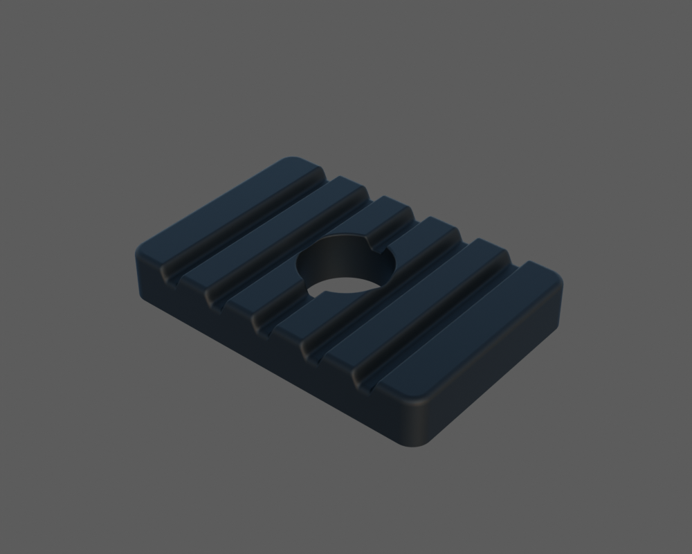

Un exemplaire lié à DP211009 : cinq vallées, contour et bouche arrondis. Le
revers, le tenon et le fond restent inconnus. Les coupes de revue ne prouvent
ni une épaisseur réelle ni un trou traversant. Les sept emplacements ne sont
pas multipliés avant revue de l'exemplaire et des interfaces.

[Images et limites](creative/reviews/seat-damper-v1/README.md)
· [Revue de coordination](creative/reviews/seat-damper-v1/coordinator-review.json)
· [Buffers protégés entre gris et matière](creative/reviews/seat-damper-v1/material-transfer-check.json)
· [Contrôles Babylon](creative/reviews/seat-damper-v1/inspection-v3/engine-check.json)
· [Source Blender et GLB](assets-src/moto-components/seat-damper/)

Les deux nouvelles pièces ont chacune trois rendus Cycles96, quatre vues
Babylon non vides et leurs sources/GLB/PNG/EXR sauvegardés. Leurs sections,
matières et interfaces restent des candidats à recevoir.

Les livraisons précédentes regroupent les trois pièces qui ont porté le registre
à 98 candidats, puis la coque du clignotant, enregistrée comme 99e candidat
après sa revue de coordination. Leurs preuves d'export et leur
rendu dans Babylon restent distincts de la lecture des rendus Blender.

### Coque noire du clignotant avant — livraison précédente

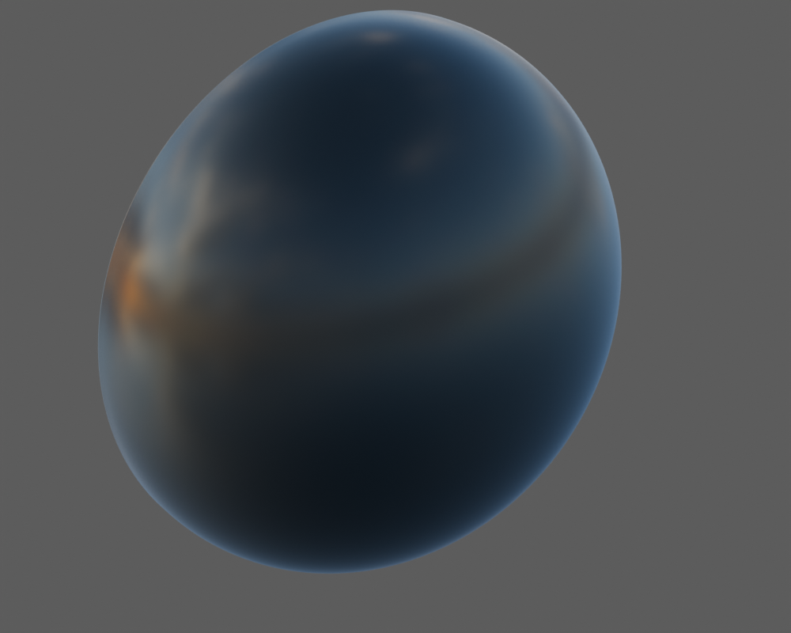

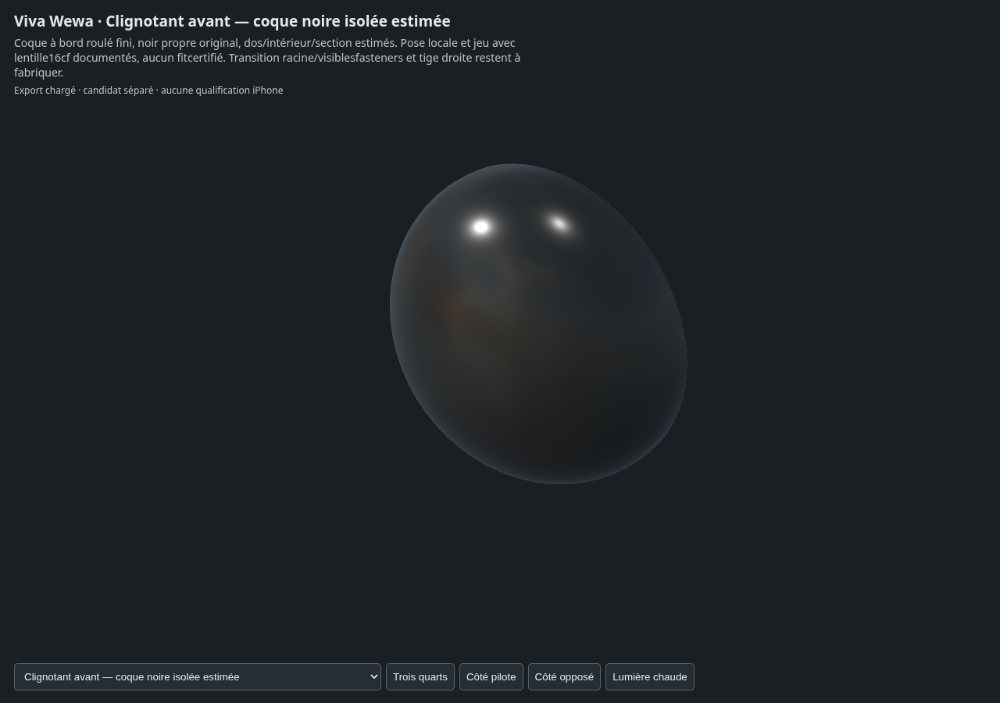

[Revue et limites](creative/reviews/indicator-front-housing-v1/README.md)
· [Lecture de coordination](creative/reviews/indicator-front-housing-v1/coordinator-review.json)
· [Contrôle de la source Blender](creative/reviews/indicator-front-housing-v1/source-geometry-check.json)
· [Vrais buffers GLB](creative/reviews/indicator-front-housing-v1/export-buffer-check.json)
· [Contrôle Babylon et pixels](creative/reviews/indicator-front-housing-v1/inspection-v3/engine-check.json)
· [Source Blender](assets-src/moto-components/indicators-front/housing/indicator-front-housing-v1.blend)
· [Export GLB](assets-src/moto-components/indicators-front/housing/indicator-front-housing-v1.glb)

La coque et sa bouche sont fabriquées. Le raccord à la tige, les petites
fixations et la tige droite restent séparés ; ce n'est pas encore un clignotant
complet. Les trois rendus Blender, le vrai export de 143 872 triangles et quatre
vues Babylon non vides ont été contrôlés ; cela ne certifie pas les dimensions
OEM ni les performances iPhone.

### Second embout du pare-moteur

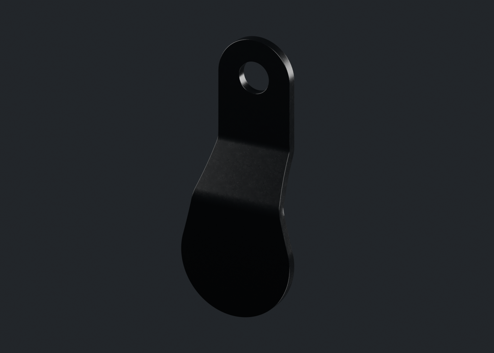

[Rendus et contrôles](creative/reviews/engine-protection-terminal-b-v1/)
· [Lecture des rendus auteur](creative/reviews/engine-protection-terminal-b-v1/source-render-review.json)
· [Sources modifiables](assets-src/moto-components/engine-protection-terminal-b/)
· [Nouveau contrôle Babylon de reprise](creative/reviews/engine-protection-terminal-b-v1/inspection-recovery-2026-10-21/engine-check.json)

### Lentille ambre du clignotant avant

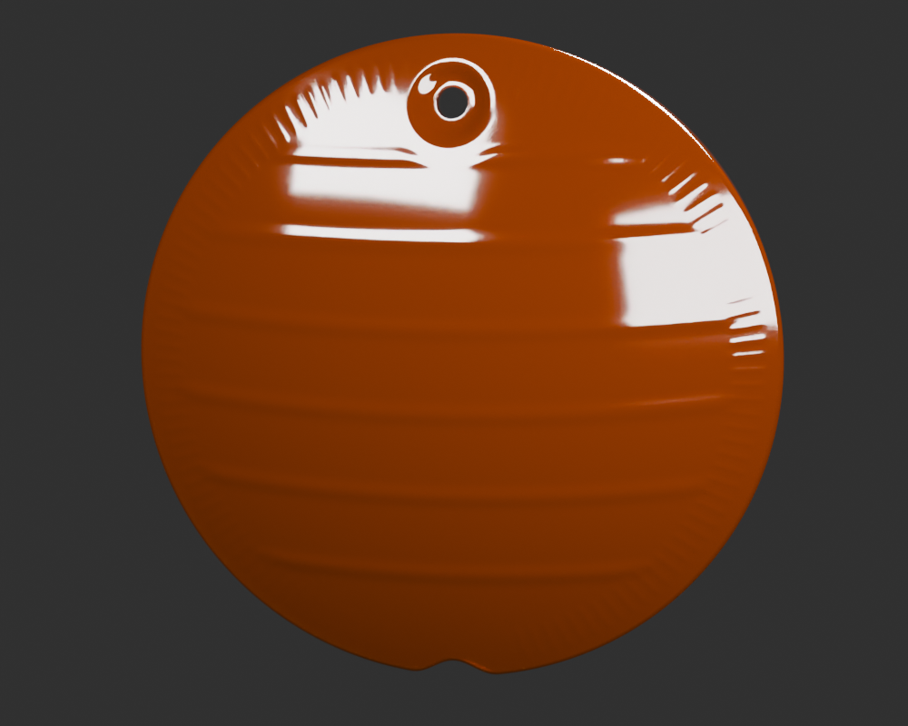

[Rendus et contrôles](creative/reviews/indicator-front-lens-v1/)
· [Rapport des rendus](creative/reviews/indicator-front-lens-v1/render-report.json)
· [Sources modifiables](assets-src/moto-components/indicators-front/lens/)
· [Nouveau contrôle Babylon de reprise](creative/reviews/indicator-front-lens-v1/inspection-recovery-2026-10-21/engine-check.json)

### Coque du connecteur d'allumage

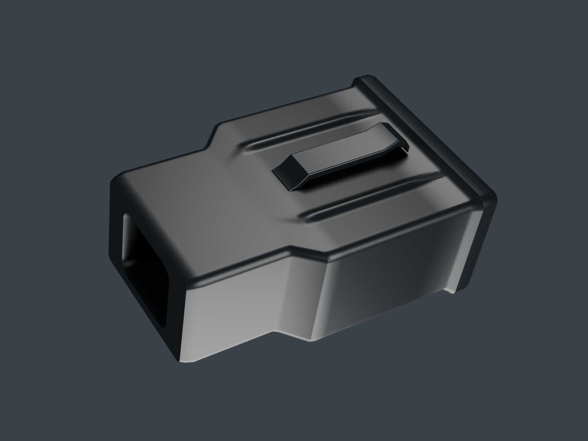

[Rendus et contrôles](creative/reviews/ignition-connector-v2/)
· [Lecture des rendus auteur](creative/reviews/ignition-connector-v2/completion-review.json)
· [Sources modifiables](assets-src/moto-components/ignition-connector/)
· [Nouveau contrôle Babylon de reprise](creative/reviews/ignition-connector-v2/inspection-recovery-2026-10-21/engine-check.json)

## Planifier la suite

[Ordre de fabrication des éléments extérieurs et sauvegardes GitHub](creative/workflow/MOTORCYCLE_EXTERIOR_COMPLETION.md) · [File de travail et dépendances](creative/workflow/motorcycle-exterior-completion-v1.json).

## Retrouver toute la progression

- [Une image par composant](creative/reviews/motorcycle18-components.md)
- [Point de revue 21](creative/reviews/motorcycle18-checkpoint-21.md)
- [État et vérifications de la publication complète Source23](WEWA_Developpement_Web/validation/motorcycle18-source23-integrity.json)
- [Plan des dix-huit ensembles](creative/workflow/motorcycle-execution-18.json)
- [Registre des composants](creative/library/component-production.json)

Les deux études grises de la session de récupération sont aussi sauvegardées
sur [leur branche d'archive](https://github.com/Mobutoo/wewa/tree/codex/sns-end-closure-studies/creative/reviews/rear-sns-end-closures-study-v1).
Elles restent des alternatives provisoires à ne pas confondre avec les
fermetures Source21 déjà publiées. Leur sauvegarde ne remplace aucune source
historique et ne modifie pas les comptes du registre.

## Sauvegarde et plan de finition — 22 octobre 2026

[Plan des trente paquets](creative/workflow/motorcycle-remaining-plan-2026-10-22-v1/PLAN.md) · [Plan structuré](creative/workflow/motorcycle-remaining-plan-2026-10-22-v1/plan.json) · [Manifestes de sauvegarde des travaux en cours](creative/reviews/pending-work-backup-2026-10-22-v1/).

Sources, rendus et essais partiels/refusés sauvegardés sans nouvelle réception. La gaine de ressort latérale reste en cours : trois rendus96 non relus et macro interrompue. La traverse arrière formée v2 attend sa revue des aperçus et ses preuves détaillées. Les supports passagers gauche/droite et les nouvelles études front12 existent ; leurs contrôles indépendants restent planifiés.

L’enchaînement prioritaire termine ces preuves, traite un silentbloc documenté, prépare le fragment de carter, puis déroule les pièces restantes selon les références disponibles. Une attache avant du carter supérieur reste explicitement manquante. Aucun paquet ni moto entière déclaré terminé ; aucun nouveau déploiement.

- **P05/P07/P08/P11 — revue arrière v3** : [diagnostic des contacts](creative/reviews/rear-cluster-review-v3/README.md), six parents corrigés conservés sans déformation ; pose et pièces de liaison encore ouvertes.

- **P05/P07/P08/P11 — revue arrière v4** : [six sources corrigées, rendus96 et export](creative/reviews/rear-cluster-review-v4/README.md). Jeux d’affichage explicites après le diagnostic v3 ; montage réel, fixations et soudures ouverts.

## Bilan de finition — exécution du 22 octobre 2026

[Bilan des 30 paquets et vues manquantes](creative/workflow/FINITIONS_MOTO_2026-10-22.md) · [Bloc arrière en revue](creative/reviews/rear-cluster-review-v4/README.md).

Huit révisions fabriquées/reprises ou achevées en candidat,19 contrôles indépendants de candidats gelés et23 livraisons techniques dans ce passage. Certaines révisions se recoupent avec les contrôles ; ce ne sont pas 27 pièces physiques distinctes terminées.170 identités candidates/études enregistrées ; aucun paquet intégralement clôturé. La file documentée est épuisée et les formes/variantes bloquantes sont indiquées pour chaque paquet. L’attache avant manquante est celle du carter de chaîne supérieur P26.
