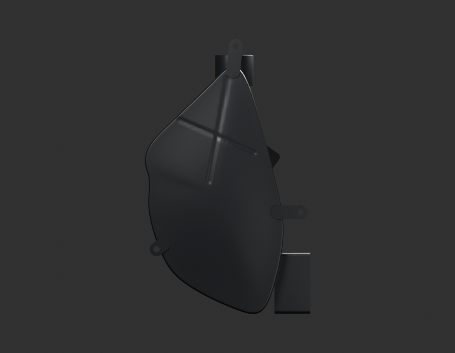
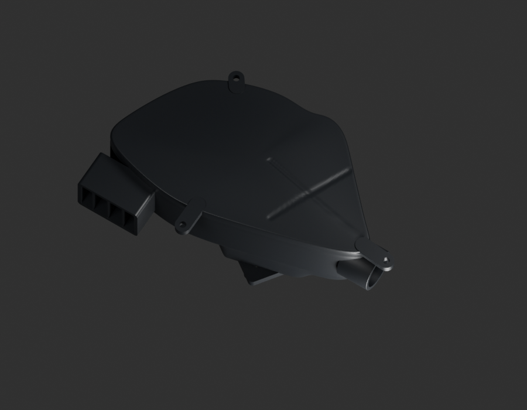
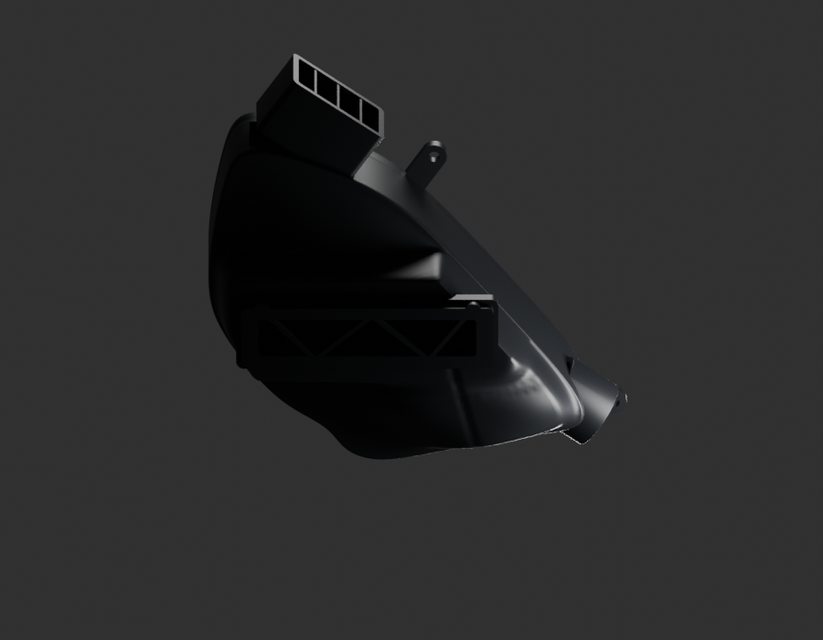
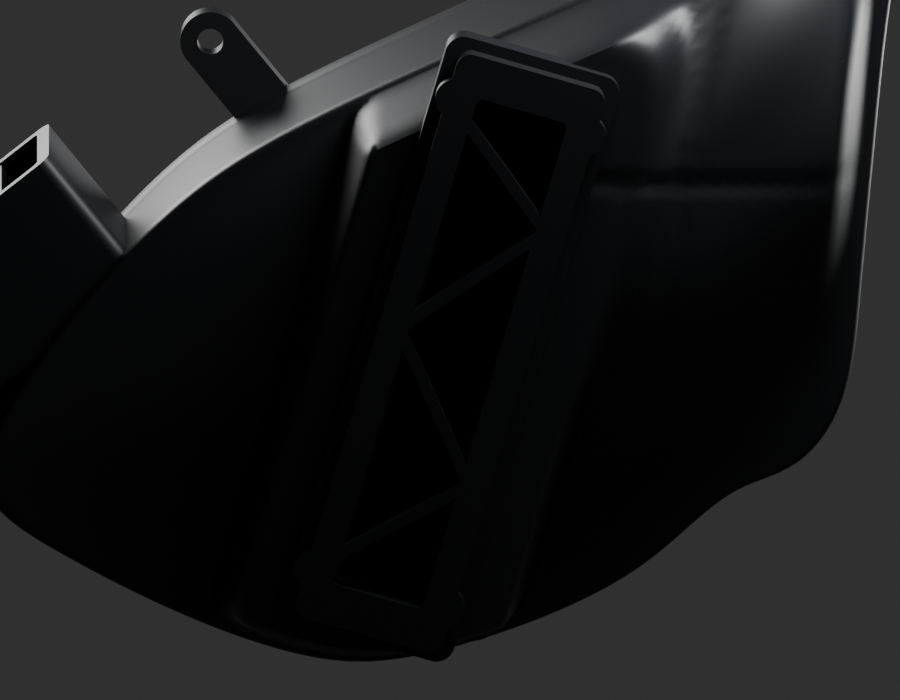

# P20 — MOTO-AIR-CLEANER-BOX-OUTER-BODY-PF581003-001 — bounded exterior candidate

[Source Blender](../../../assets-src/moto-components/air-cleaner-box-outer-body-pf581003-v1/child-candidate.blend) · [GLB](../../../assets-src/moto-components/air-cleaner-box-outer-body-pf581003-v1/child-candidate.glb) · [Dossier](../../../creative/research/air-cleaner-box-outer-body-pf581003-v1-coordination-v1/G0-G2-plan-v1.json) · [Étude auteur](../air-cleaner-box-outer-body-pf581003-v1/delivery.json)

[Source rouverte](source-geometry-check.json), [export réel](export-buffer-check.json), [rendus96 associés à la source figée](render-report.json), [EXR FLOAT32](raw-render-check.json), [quatre vues Babylon de coordination](inspection-v5/engine-check.json), [lecture réelle](coordinator-review.json), [manifestes](production-manifest.json). Les images et rapports auteur restent inchangés. Leur association à la source est vérifiée dans le lot figé. Une éventuelle vue indépendante `coordination-neutral` est identifiée séparément avec sa provenance ; elle ne modifie pas la source.

Corps de boîte à air PF581003 : grande enveloppe photographiée, trois œillets, bouche rectangulaire à trois séparateurs, sortie ronde du petit côté et couvercle visibles. Quatre natifs96, dont neutre/macro, et Babylon relus. G4 reste ouvert pour ondulations du reflet arrière et couvercle trop sombre. Fermeture technique de 1,2mm du modèle explicitement estimée, aucun filtre, partition fonctionnelle, tuyau ou raccord caché certifié. Soufflet séparé et montage RDC125 non reçus. Les itérations refusées sont conservées.

Les dimensions et interfaces restent estimées. Aucune réception artistique ou qualification matérielle n’est transmise. Le paquet reste ouvert pour ses enfants et raccords manquants.
