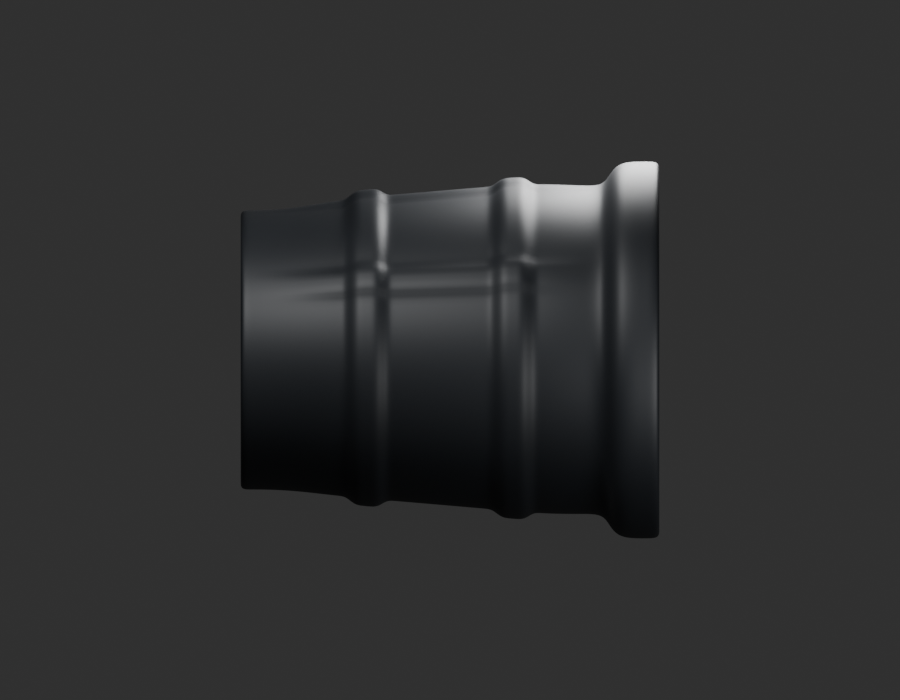
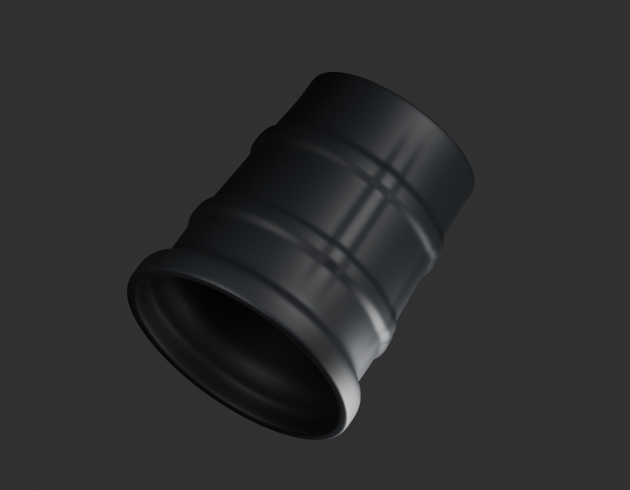
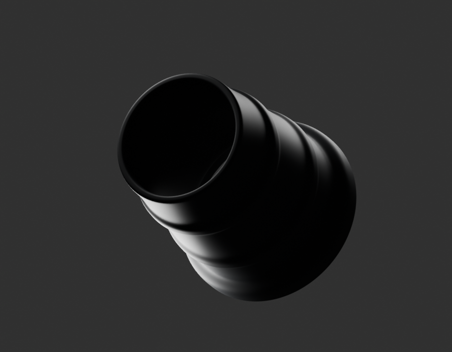
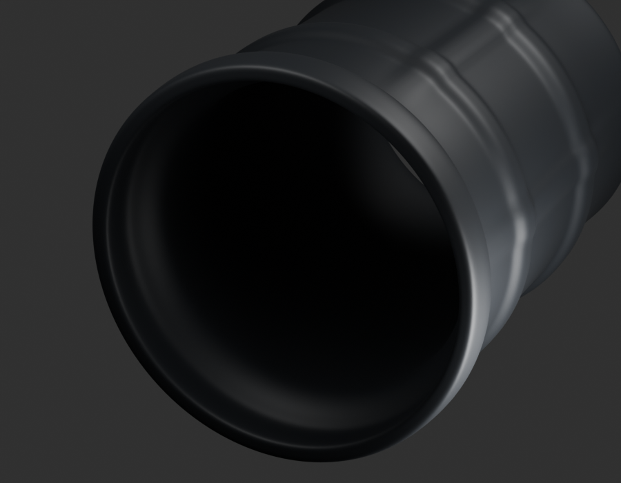

# P20 — MOTO-AIRBOX-CARB-BOOT-PHYSICAL-002 — bounded exterior candidate

[Source Blender](../../../assets-src/moto-components/airbox-carb-boot-physical-study-v2/child-candidate.blend) · [GLB](../../../assets-src/moto-components/airbox-carb-boot-physical-study-v2/child-candidate.glb) · [Dossier](../../../creative/research/airbox-carb-boot-physical-study-v2-coordination-v1/G0-G2-plan-v1.json) · [Étude auteur](../airbox-carb-boot-physical-study-v2/delivery.json)

[Source rouverte](source-geometry-check.json), [export réel](export-buffer-check.json), [rendus96 associés à la source figée](render-report.json), [EXR FLOAT32](raw-render-check.json), [quatre vues Babylon de coordination](inspection-v5/engine-check.json), [lecture réelle](coordinator-review.json), [manifestes](production-manifest.json). Les images et rapports auteur restent inchangés. Leur association à la source est vérifiée dans le lot figé. Une éventuelle vue indépendante `coordination-neutral` est identifiée séparément avec sa provenance ; elle ne modifie pas la source.

Manchon court boîte à air/carburateur : silhouette effilée, deux bandes, bouche et deux reliefs longitudinaux visibles relus en quatre natifs96 et Babylon. Source physique nouvelle, alternative à ancien intake-duct-study, jamais deux manchons en série. Code propre non établi, PF581003 désigne la boîte. Axe, diamètre interne, retenue cachée et collier restent non qualifiés ; aucune répétition cachée des reliefs.

Les dimensions et interfaces restent estimées. Aucune réception artistique ou qualification matérielle n’est transmise. Le paquet reste ouvert pour ses enfants et raccords manquants.
