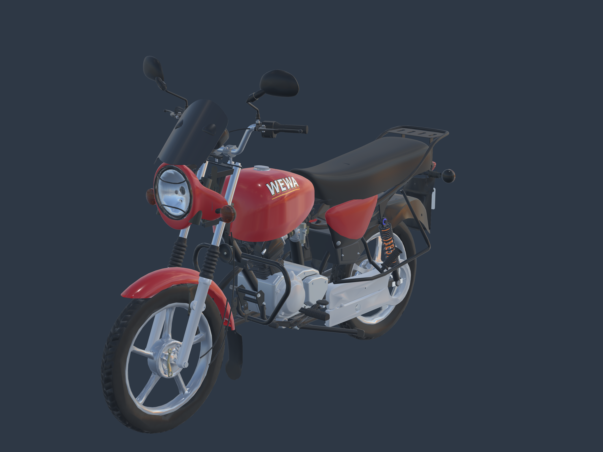

# Recalage des raccords extérieurs — Art. 015

Candidat du 23 octobre 2026, comparé aux [photos officielles de la Boxer 125 HD RDC](https://www.bajajauto.com/fr-cd/bikes/boxer-125hd). Les raccords visibles ont été repris sur le modèle 3D : phare/visière, caches/selle, longeron droit, supports du feu arrière et attaches de repose-pied. La plaque conserve **Art.** puis **015**, sur deux lignes.

[Arrière — 3840 × 2880](rear-high-resolution.png) · [Sous selle/réservoir — 2560 × 1920](centre-high-resolution.png) · [Plaque — 2560 × 1920](plate-high-resolution.png) · [Profil gauche](left-high-resolution.png) · [Profil droit](right-high-resolution.png) · [Face](head-high-resolution.png) · [Dos](tail-high-resolution.png).

Captures réelles Babylon.js aux résolutions indiquées, sans génération d’image ni agrandissement. Les gros plans recadrent volontairement la moto ; les vues générales montrent le véhicule entier. [Visionneuse locale](../../../tools/assembly-alignment-review-v1/index.html), à servir avec Vite depuis la racine du dépôt ; `?before=1` charge la version précédente.

## Comparaison et corrections

| Zone observée dans les photos officielles | Écart du candidat précédent | Correction de cette révision |
|---|---|---|
| Visière jointe au haut du phare, vues 00–04 | Bloc phare trop reculé vers le réservoir ; visière séparée en profil | Bloc phare, verre, protection et clignotants avancés ensemble de 150 mm ; lèvre de visière rapprochée de 12 mm ; pattes internes resserrées et supports vers la fourche ajoutés |
| Cache rouge immédiatement sous le bord de selle, vues 00/04 | Cache écarté de la selle et trop extérieur | Gauche remonté de 25 mm, droite de 20 mm ; rentrée latérale de 14 mm par côté |
| Sous-selle et fixation au cadre, vues obliques | Longerons latéralement dissymétriques ; appuis disjoints | Longerons rapprochés de la symétrie mesurée, patte de selle et tampon recalés ; appuis de selle et goussets d’amortisseurs ajoutés |
| Cache et supports latéraux, vues 04/05 | Barre traversant la face rouge ; support de repose-pied coupé sans raccord | Barre intérieure rentrée ; supports rentrés puis prolongés jusqu’aux surfaces du cadre et de la protection latérale |
| Batterie masquée par le cache droit | Boîtier et bande dépassant la carrosserie | Ensemble batterie/support déplacé ensemble de 35 mm vers l’intérieur |
| Feu et clignotants sous porte-bagages, vues 05–07 | Ensemble arrière visuellement suspendu | Ensemble feu/clignotants/plaque/bavette remonté de 60 mm avec leurs fixations ; portage vers le porte-bagages ajouté |
| Visière noire, vues 00–03 | Matière transmissive laissant voir le poste de conduite | Polymère charbon opaque, forme d’origine conservée |

Ces déplacements sont des **ajustements du candidat**, pas des cotes publiées par Bajaj. Les positions générales sont estimées d’après les photos, avec une incertitude de l’ordre de 15–25 mm. Les supports cachés sont des reconstructions visuelles. Les profils des pièces restent ceux des sources précédentes. Le protocole n’est pas une photogrammétrie calibrée et ne fournit pas de score de fidélité.

Avant : [profil gauche](before-left-preview.png), [profil droit](before-right-preview.png), [trois quarts](before-front-preview.png), [dos](before-tail-preview.png). Ces images montrent bien la version `seat-plate-v2`, avec les mêmes caméras générales.

Sous le réservoir se trouvent surtout le moteur et l’admission. Sous la selle se trouvent notamment la boîte à air et la batterie. La boîte de vitesses est dans les carters inférieurs ; la transmission finale passe sur le côté vers la roue arrière. Les ouvertures restantes ne sont donc pas toutes des pièces absentes et n’ont pas été bouchées par un panneau inventé.

## Sources et contrôles

- [Plan, transformations et incertitudes](../../research/assembly-alignment-v1/plan.json) ; [registre des originaux Bajaj, URL et empreintes](../../research/under-tank-completion-v1/sources.json). Originaux documentaires conservés hors du dépôt public ; aucun utilisé comme texture.
- [GLB autonome](../../../assets-src/moto-components/assembly-alignment-v1/motorcycle-aligned.glb), [Blender complet éditable](../../../assets-src/moto-components/assembly-alignment-v1/motorcycle-aligned.blend), [supports ajoutés seuls](../../../assets-src/moto-components/assembly-alignment-v1/alignment-mounts.glb).
- 47 transformations explicites ; buffers de géométrie et textures antérieurs conservés octet pour octet. Seule la matière de visière est remplacée. 29 nouveaux maillages, 8 428 triangles ; surfaces natives fermées et volumes positifs.
- Zéro erreur glTF, aucun nouvel avertissement par rapport à la source. Huit captures sans erreur JavaScript/HTTP ; plaque, deux profils et vues générales relus. [Export](export-check.json), [surfaces natives](native-surface-check.json), [composition](composition-check.json), [captures](browser-check.json), [empreintes](manifest.json).
- Les mesures de proximité selle/caches sont des distances non signées vers des surfaces courbes : elles ne prouvent ni une absence d’intersection ni un jeu uniforme. Elles sont conservées sans les transformer en tolérance constructeur.

Les raccords principaux signalés sont corrigés pour la présentation statique. La réception artistique de l’ensemble reste ouverte, ainsi que les débattements mécaniques, certains détails de variante et la qualification Safari physique. Cette révision ne remplace pas le modèle du jeu public.
