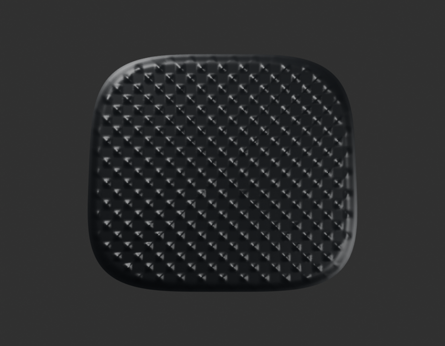
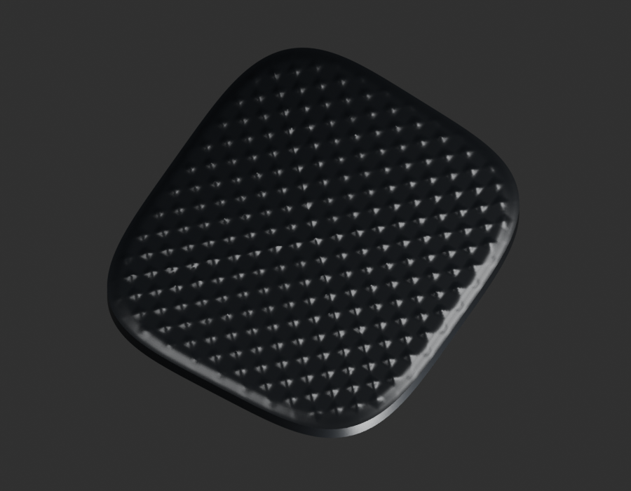
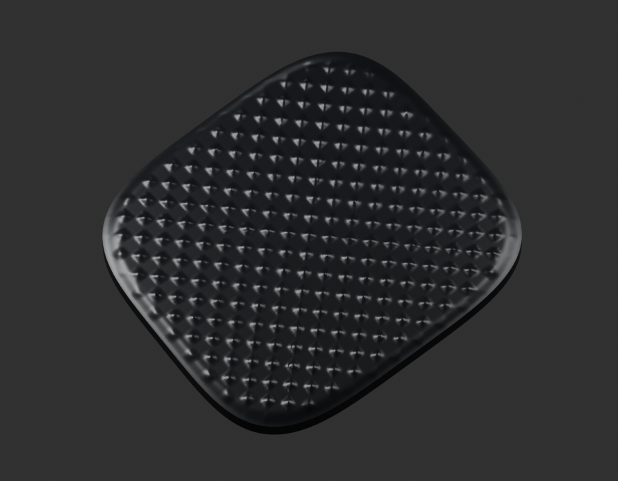

# P15 — MOTO-BRAKE-PEDAL-TEXTURED-PAD-001 — bounded exterior candidate

[Source Blender](../../../assets-src/moto-components/brake-pedal-textured-pad-v1/child-candidate.blend) · [GLB](../../../assets-src/moto-components/brake-pedal-textured-pad-v1/child-candidate.glb) · [Dossier](../../../creative/research/brake-pedal-textured-pad-v1-coordination-v1/G0-G2-plan-v1.json) · [Étude auteur](../brake-pedal-textured-pad-v1/delivery.json)

[Source rouverte](source-geometry-check.json), [export réel](export-buffer-check.json), [rendus96 associés à la source figée](render-report.json), [EXR FLOAT32](raw-render-check.json), [quatre vues Babylon de coordination](inspection-v5/engine-check.json), [lecture réelle](coordinator-review.json), [manifestes](production-manifest.json). Les images et rapports auteur restent inchangés. Leur association à la source est vérifiée dans le lot figé. Une éventuelle vue indépendante `coordination-neutral` est identifiée séparément avec sa provenance ; elle ne modifie pas la source.

Patin de pédale isolé: relief géométrique du motif et bord roulé relus. Photo PF161002 voisine: pas, nombre et section du motif approximatifs; dos, soudure au bras et débattement non résolus. Exemplaire candidat de patin, aucune répétition reçue ni adhérence certifiée.

Les dimensions et interfaces restent estimées. Aucune réception artistique ou qualification matérielle n’est transmise. Le paquet reste ouvert pour ses enfants et raccords manquants.
