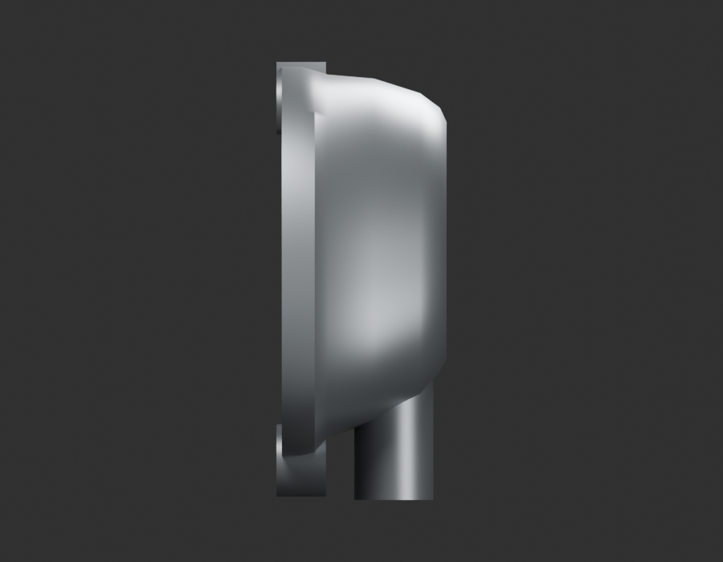
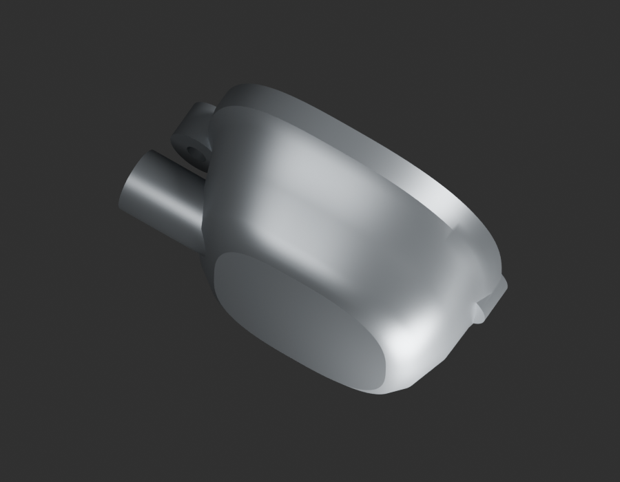
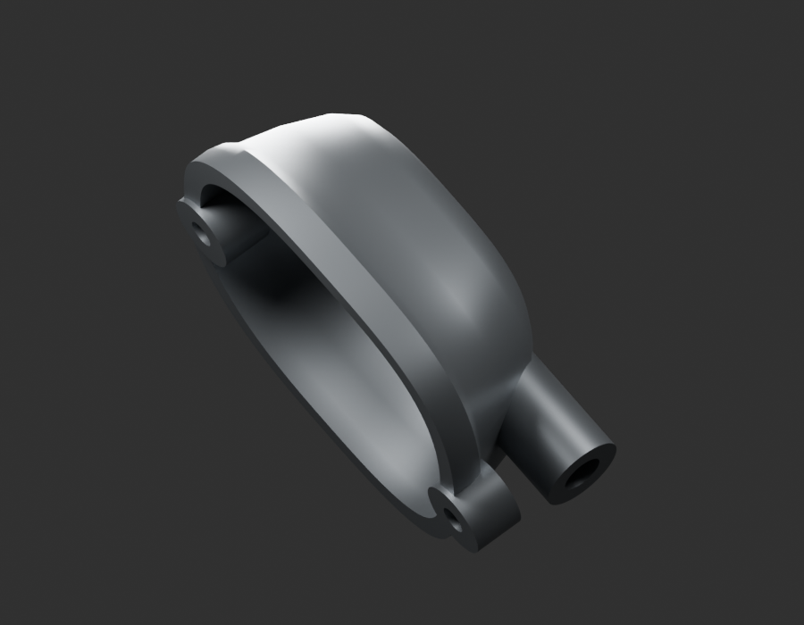

# P19 — MOTO-CARBURETTOR-FLOAT-BOWL-001 — bounded exterior candidate

[Source Blender](../../../assets-src/moto-components/carburettor-float-bowl-v1/child-candidate.blend) · [GLB](../../../assets-src/moto-components/carburettor-float-bowl-v1/child-candidate.glb) · [Dossier](../../../creative/research/powertrain-completion-p19-v1/float-bowl-plan-v5.json) · [Étude auteur](../carburettor-float-bowl-v1/delivery.json)

[Source rouverte](source-geometry-check.json), [export réel](export-buffer-check.json), [rendus96 associés à la source figée](render-report.json), [EXR FLOAT32](raw-render-check.json), [quatre vues Babylon de coordination](inspection-v5/engine-check.json), [lecture réelle](coordinator-review.json), [manifestes](production-manifest.json). Les images et rapports auteur restent inchangés. Leur association à la source est vérifiée dans le lot figé. Une éventuelle vue indépendante `coordination-neutral` est identifiée séparément avec sa provenance ; elle ne modifie pas la source.

Cuve isolée, rebord et sièges percés visibles. Facettes et transitions de coque restent à reprendre ; épaisseur, dessous et raccord au corps non mesurés. Aucun carburateur complet déclaré.

Les dimensions et interfaces restent estimées. Aucune réception artistique ou qualification matérielle n’est transmise. Le paquet reste ouvert pour ses enfants et raccords manquants.
