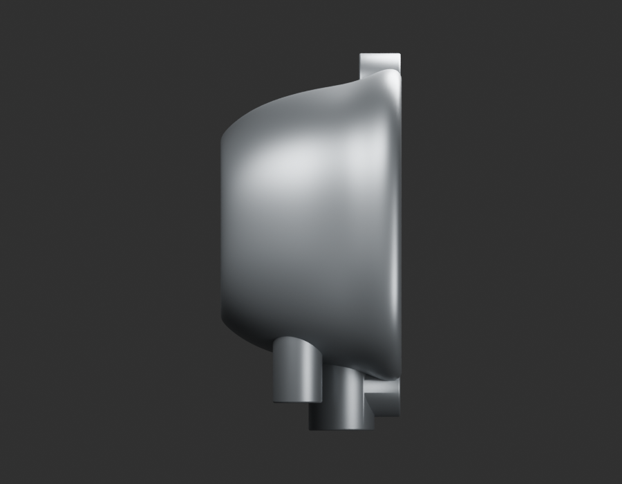
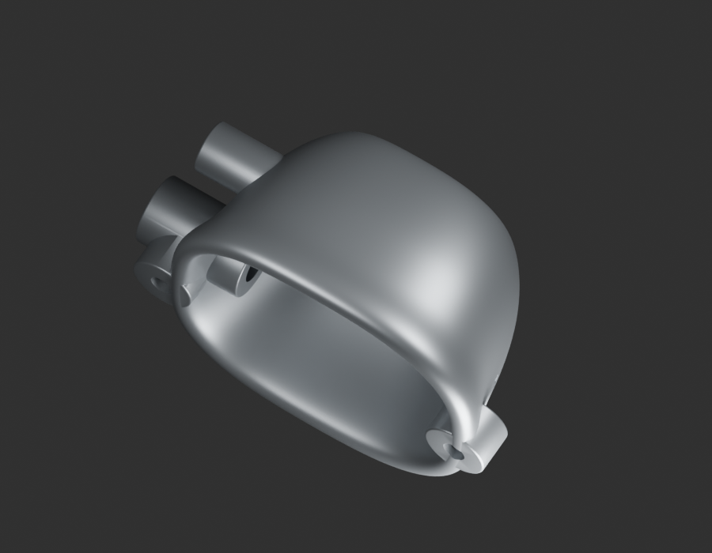
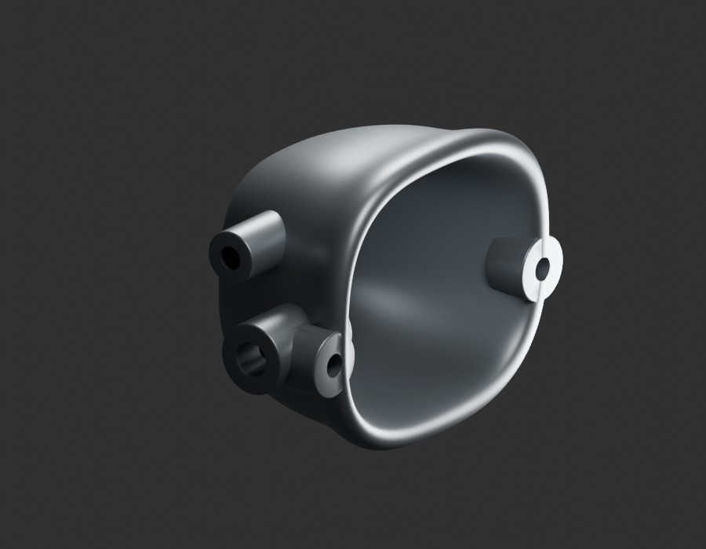

# P19 — MOTO-CARBURETTOR-LOWER-BODY-001 — bounded exterior candidate

[Source Blender](../../../assets-src/moto-components/carburettor-lower-body-v2/child-candidate.blend) · [GLB](../../../assets-src/moto-components/carburettor-lower-body-v2/child-candidate.glb) · [Dossier](../../../creative/research/powertrain-completion-p19-v1/lower-body-rework-plan-v9.json) · [Étude auteur](../carburettor-lower-body-v2/delivery.json)

[Source rouverte](source-geometry-check.json), [export réel](export-buffer-check.json), [rendus96 associés à la source figée](render-report.json), [EXR FLOAT32](raw-render-check.json), [quatre vues Babylon de coordination](inspection-v5/engine-check.json), [lecture réelle](coordinator-review.json), [manifestes](production-manifest.json). Les images et rapports auteur restent inchangés. Leur association à la source est vérifiée dans le lot figé. Une éventuelle vue indépendante `coordination-neutral` est identifiée séparément avec sa provenance ; elle ne modifie pas la source.

Nouvelle coque inférieure : transitions et bord continus relus, grande fermeture circulaire du premier essai retirée. Les deux faces opposées ne sont pas mesurées ; bossages, épaisseur et raccord aux autres corps restent non reçus.

Les dimensions et interfaces restent estimées. Aucune réception artistique ou qualification matérielle n’est transmise. Le paquet reste ouvert pour ses enfants et raccords manquants.
