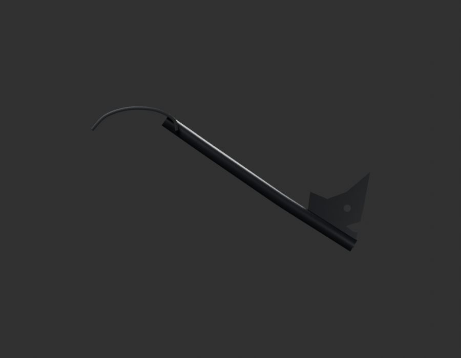
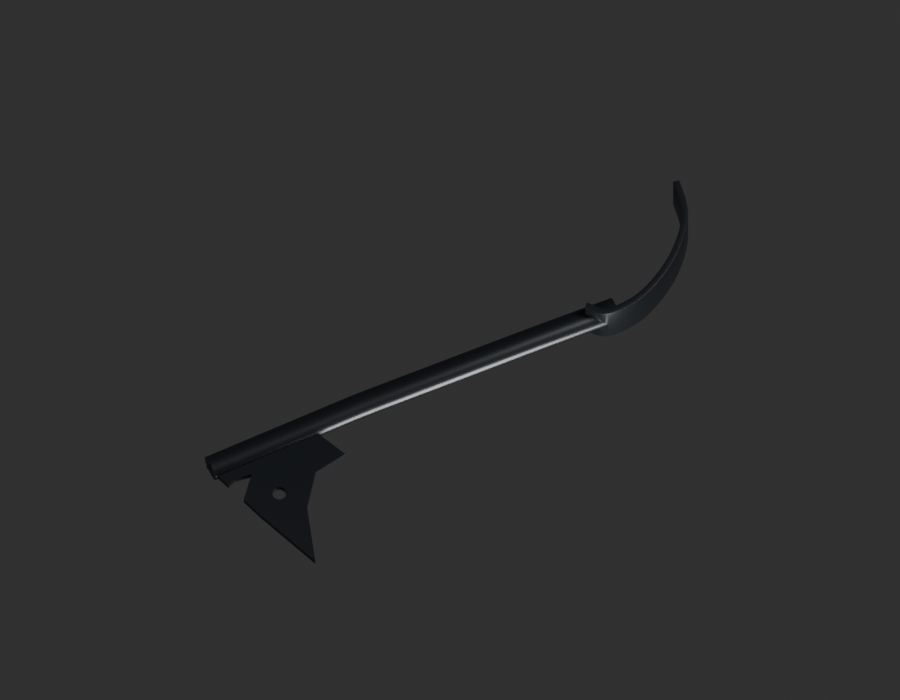
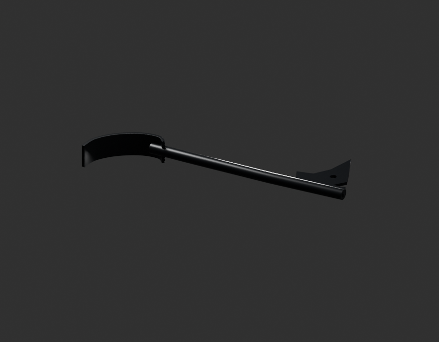

# P17 — MOTO-CENTRE-STAND-OPERATING-ARM-001 — bounded exterior candidate

[Source Blender](../../../assets-src/moto-components/centre-stand-operating-arm-v1/child-candidate.blend) · [GLB](../../../assets-src/moto-components/centre-stand-operating-arm-v1/child-candidate.glb) · [Dossier](../../../creative/research/powertrain-completion-p17-v1/centre-operating-arm-plan-v14.json) · [Étude auteur](../centre-stand-operating-arm-v1/delivery.json)

[Source rouverte](source-geometry-check.json), [export réel](export-buffer-check.json), [rendus96 associés à la source figée](render-report.json), [EXR FLOAT32](raw-render-check.json), [quatre vues Babylon de coordination](inspection-v5/engine-check.json), [lecture réelle](coordinator-review.json), [manifestes](production-manifest.json). Les images et rapports auteur restent inchangés. Leur association à la source est vérifiée dans le lot figé. Une éventuelle vue indépendante `coordination-neutral` est identifiée séparément avec sa provenance ; elle ne modifie pas la source.

Bras de manœuvre isolé de la béquille centrale : levier, appui courbe et patte percée visibles. Soudures, section cachée, angle sur le cadre et débattement restent ouverts.

Les dimensions et interfaces restent estimées. Aucune réception artistique ou qualification matérielle n’est transmise. Le paquet reste ouvert pour ses enfants et raccords manquants.
