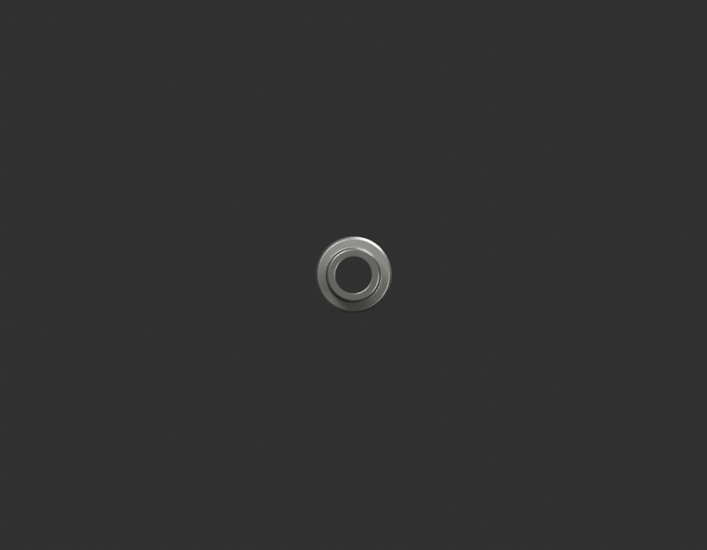
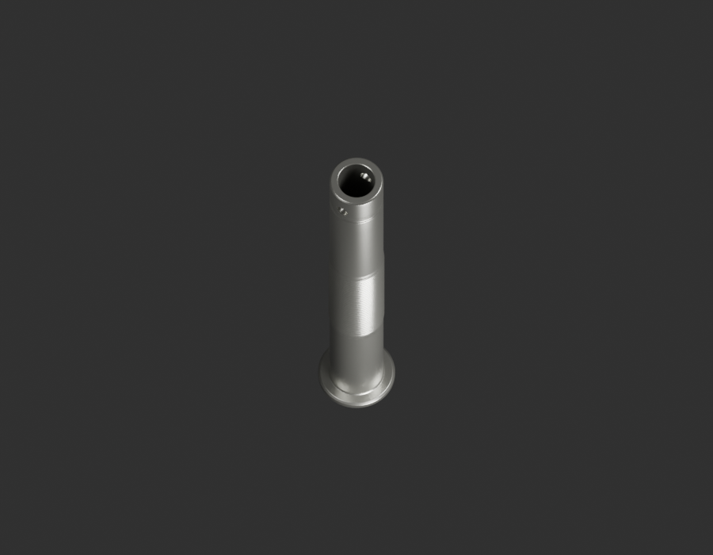
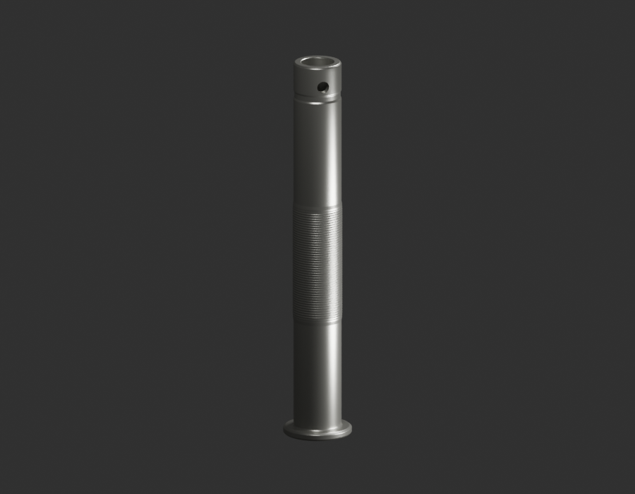
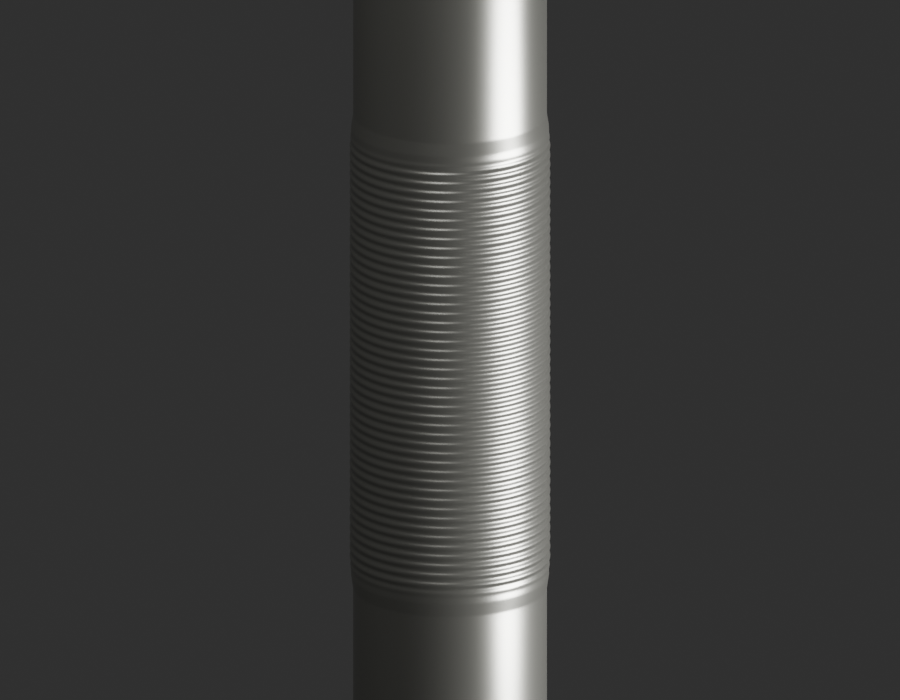

# P17 — MOTO-CENTRE-STAND-PIVOT-SHAFT-001 — bounded exterior candidate

[Source Blender](../../../assets-src/moto-components/centre-stand-pivot-shaft-v1/child-candidate.blend) · [GLB](../../../assets-src/moto-components/centre-stand-pivot-shaft-v1/child-candidate.glb) · [Dossier](../../../creative/research/centre-stand-pivot-shaft-v1-coordination-v1/G0-G2-plan-v1.json) · [Étude auteur](../centre-stand-pivot-shaft-v1/delivery.json)

[Source rouverte](source-geometry-check.json), [export réel](export-buffer-check.json), [rendus96 associés à la source figée](render-report.json), [EXR FLOAT32](raw-render-check.json), [quatre vues Babylon de coordination](inspection-v5/engine-check.json), [lecture réelle](coordinator-review.json), [manifestes](production-manifest.json). Les images et rapports auteur restent inchangés. Leur association à la source est vérifiée dans le lot figé. Une éventuelle vue indépendante `coordination-neutral` est identifiée séparément avec sa provenance ; elle ne modifie pas la source.

Axe de béquille JA113201 : collerette, ouverture d’extrémité et stries relues, y compris macro. Le profil axial est petit dans la vue de bout mais complété par les quarts ; terminaison cachée et traversée complète non prouvées.

Les dimensions et interfaces restent estimées. Aucune réception artistique ou qualification matérielle n’est transmise. Le paquet reste ouvert pour ses enfants et raccords manquants.
