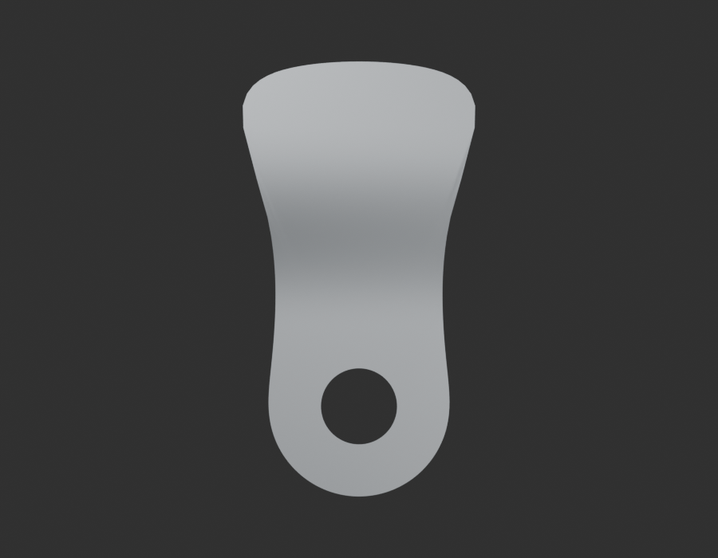
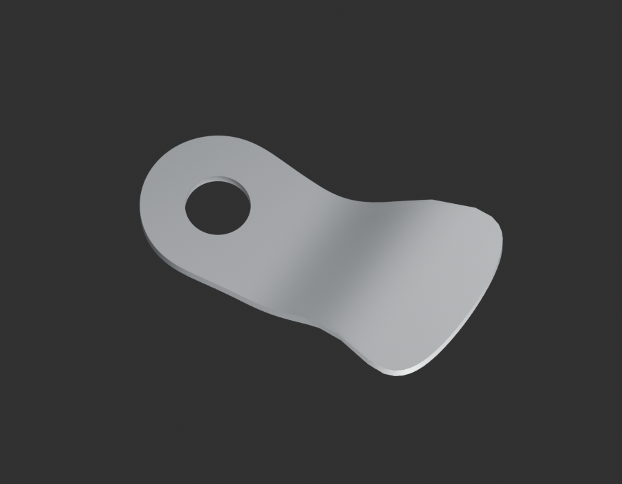
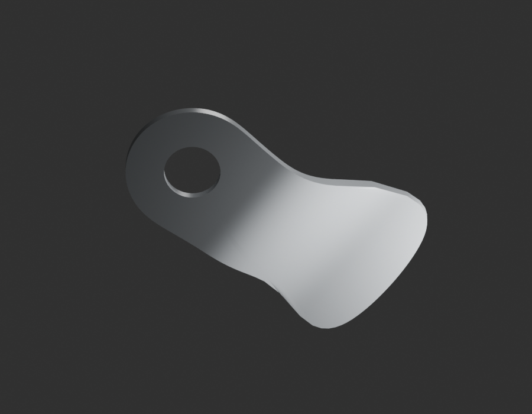
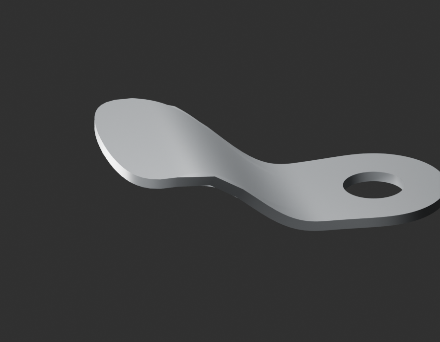

# P26 — MOTO-CHAINCASE-FRONT-EAR-ROOT-002 — bounded exterior candidate

[Source Blender](../../../assets-src/moto-components/chaincase-front-ear-root-v2/child-candidate.blend) · [GLB](../../../assets-src/moto-components/chaincase-front-ear-root-v2/child-candidate.glb) · [Dossier](../../../creative/research/chaincase-front-ear-root-v2-coordination-v1/G0-G2-plan-v1.json) · [Étude auteur](../chaincase-front-ear-root-v2/delivery.json)

[Source rouverte](source-geometry-check.json), [export réel](export-buffer-check.json), [rendus96 associés à la source figée](render-report.json), [EXR FLOAT32](raw-render-check.json), [quatre vues Babylon de coordination](inspection-v5/engine-check.json), [lecture réelle](coordinator-review.json), [manifestes](production-manifest.json). Les images et rapports auteur restent inchangés. Leur association à la source est vérifiée dans le lot figé. Une éventuelle vue indépendante `coordination-neutral` est identifiée séparément avec sa provenance ; elle ne modifie pas la source.

Attache avant du carter de chaîne : œillet ouvert et racine formée continue relus en quatre natifs96, macro et Babylon. Nouvelle variante documentée, alternative à l’ancienne étude, sans cumul des deux attaches. Aucune rondelle, soudure cachée, épaisseur OEM ou pose sur la coque historique ne sont reçues.

Les dimensions et interfaces restent estimées. Aucune réception artistique ou qualification matérielle n’est transmise. Le paquet reste ouvert pour ses enfants et raccords manquants.
