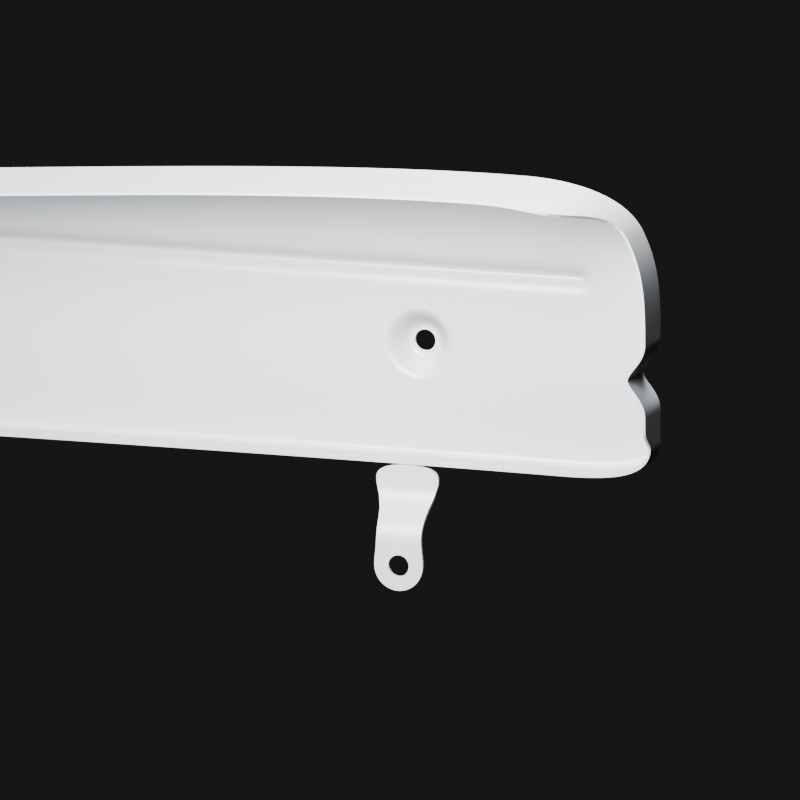

# Oreille avant du carter supérieur — raccord visuel v3

La pièce percée et sa racine déjà documentées dans quatre photographies physiques opposées sont maintenant rattachées au retour inférieur interne du carter. Les formes originales des deux sources restent inchangées ; seule la pose rigide est nouvelle. Le fragment ajoute une seule oreille, aucune seconde variante.

Le premier essai sur le retour supérieur a été rejeté après comparaison aux photographies ; il est conservé dans `rejected-upper-return/`. Les trois autres vues sont des macros de contexte : elles recadrent le bas de l’oreille. `ear-complete.png` montre la pièce entière, à96 échantillons800×800, exposition−1,7 ; les EXR32 sont conservés et vérifiés.

[G0–G2 et distances réelles](../../research/chaincase-front-registration-v3/G0-G2-registration.json) · [Ajout à l’assemblage](add-only-fragment.json) · [Source liée](../../../assets-src/moto-components/chaincase-front-registration-v3/linked-registration.blend).

Sur106 points du bord de racine, distance à la coque estimée0,116–1,483mm. Il s’agit d’un calage visuel borné : ±15mm longitudinal, ±8mm profondeur, ±10mm hauteur. Ce n’est pas une cote constructeur ni une soudure ou un axe de fixation commun certifié. Le contact microscopique, la vis et la variante actuelle restent ouverts ; aucune géométrie cachée n’est inventée. G8 non reçu.
