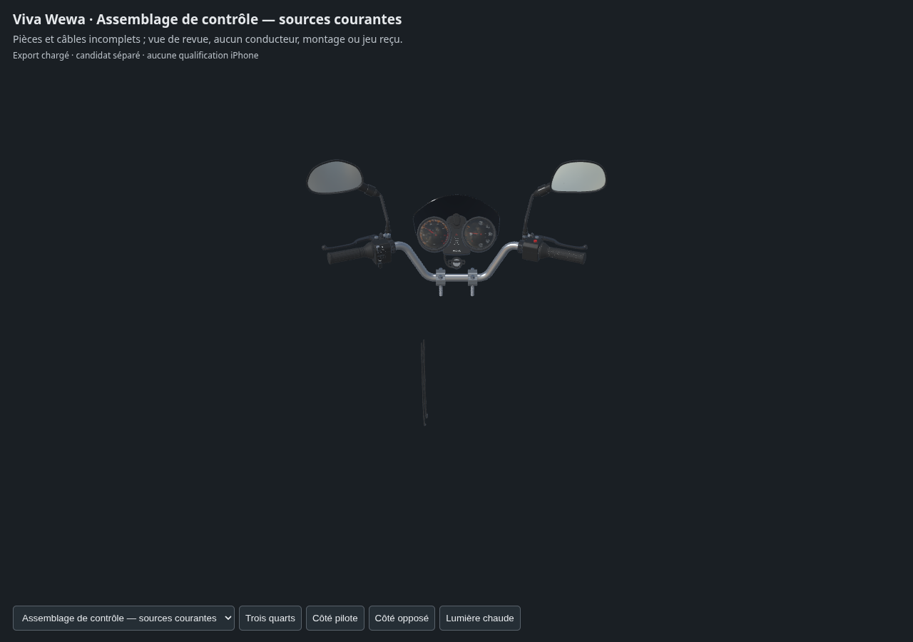

# Poste de conduite — assemblage de contrôle des sources courantes

Quatorze sources Blender sont liées sans nouveau placement : guidon, poignées v3, pontets, manchon, deux commodos, deux leviers v2, deux miroirs corrigés, contact, gaines partielles, compteurs v3 et visière. Il s’agit d’un assemblage d’examen sans conducteur. Support de compteurs, tés, écrous et rondelles isolés sont exclus : leur origine locale ne définit pas une pose installée.

Le [contrôle indépendant du montage](../../research/cockpit-fit-preparation-v1/README.md) renouvelle177 tests ciblés. Il trouve32 paires de triangles traversants entre le petit faisceau du contact et le cache central ; les176 autres tests ciblés sont sans croisement. Les deux gaines basses ne sont pas des câbles continus jusqu’aux commandes. La correction de la boucle est confiée à une source de gaines distincte ; cette revue ne reçoit pas le montage.

Seule la copie de poignée droite est rattachée au rotor. Le test de rotation50° déplace réellement son sommet témoin de11,99 mm ; poignée gauche et guide restent fixes. La copie de l’aiguille utilise l’axe déclaré et un angle relatif−81° : convention d’affichage42 km/h, sans calibration constructeur ou raccord au gameplay. Les14 sources restent inchangées.

L’export détaillé contient1 446 736 triangles ; les [buffers effectivement relus](export-buffer-check.json) et les [trois captures WebGL](inspection-linked-v1/engine-check.json) sont des preuves techniques. La [session de catalogue explicite](inspection-linked-v1/session-catalog.json) charge cet assemblage sans l’ajouter au registre des pièces physiques. Aucun contrôle de conduite, réglage de miroir ou course de levier n’est exercé dans ces trois captures statiques.

Le premier export brut conserve des tangentes inutilisées, dont certaines sont invalides. La livraison d’inspectionv2 retire uniquement leurs références sur les primitives sans carte normale : tous les autres champs JSON et tous les octets binaires restent identiques. Les tangentes utiles restent intactes. Le [rapport de correction](unused-tangent-removal-v2.json) et le [lien source/livraison](source-geometry-check-delivery-v2.json) distinguent ces deux fichiers ; l’export brut n’est pas la livraison qualifiée par le contrôle de buffers.

Les deux images natives utilisent12 échantillons, une caméra perspective22 mm et une exposition référencée par carte diffuse18 %. Le [protocole et ses checkpoints](../cockpit-current-review-material-lighting-v1/report.json) gardent les matières d’origine. Le [correctif de libellé](../cockpit-current-review-material-lighting-v1/scope-correction-v1.json) précise que la phrase «orthographic» héritée du script précédent est erronée : la caméra effective est bien perspective. Ni cette exposition ni le shader Babylon ne constituent une calibration photographique ou une parité optique certifiée.

Les sources d’inspection restent trop détaillées pour être déclarées un LOD mobile. Aucun test iPhone physique, FPS soutenu, réception artistique, publication du jeu ou moto complète n’est déduit de cette revue.
