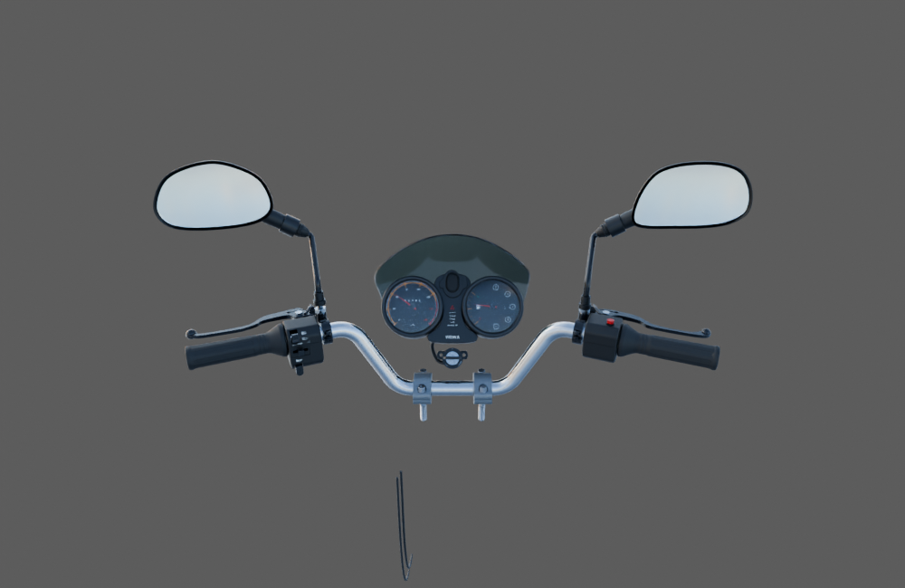
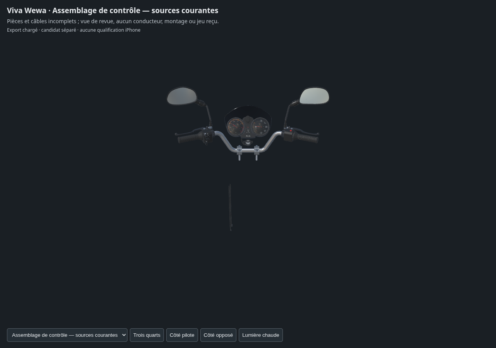

# Poste de conduite — correction du départ de contact

Cette révision lie les mêmes quatorze familles que la [revue précédente](../cockpit-current-review-v1/README.md). Seule la bibliothèque de gaines passe en v2 ; les treize autres empreintes sont identiques. Deux points de la petite boucle ont été abaissés de4 et8 mm. Les deux gaines basses conservent leurs buffers, transformations et matières.

Le [contrôle indépendant des sources actuelles](../../research/cockpit-fit-preparation-v2/README.md) trouve zéro croisement sur177 tests. Le témoin historique reproduit ses32 paires de triangles. Les segments dans les deux sens et les points échantillonnés dans trois directions ne révèlent pas d’intersection ou d’inclusion. Le minimum échantillonné sommet/surface de3,873598 mm n’est pas le jeu exact entre les surfaces. Les tentatives numériques rejetées restent documentées.

La [preuve source/livraison](source-geometry-check-delivery-v1.json), le [contrôle des buffers](export-buffer-check.json) et les [trois captures WebGL](inspection-linked-v1/engine-check.json) distinguent le nouvel assemblage de l’ancien. Le [contrôle indépendant du nouvel assemblage](../../research/cockpit-fit-preparation-v2-assembly-addendum-v1/README.md) relie les cibles de la passe de contacts aux nouvelles copies et aux65 596 triangles GLB concernés : boucle et visière concordent exactement ; le cache a un écart numérique maximal de31,729 nm avec la source fraîche, sans parent resté à l’origine. Les copies de poignée droite et d’aiguille conservent les mêmes liaisons de revue et angle de démonstration ; aucune des sources liées n’est sauvegardée ou déplacée.

L’export brut est un intermédiaire. La [correction de livraison](unused-tangent-removal-v1.json) retire seulement166 références de tangentes inutilisées : tous les autres champs JSON et tous les octets binaires restent identiques. La livraison relue contient1 446 736 triangles, sans erreur glTF, triangle nul ou UV de carte normale effondré. Il s’agit d’une source détaillée d’inspection.

Les deux rendus natifs sont de vrais aperçus Blender de12 échantillons avec caméra perspective22 mm et carte diffuse18 %. Le [rapport d’éclairage](../cockpit-current-review-material-lighting-v2/report.json) donne le type de caméra réellement utilisé. Les différences de présentation avec Babylon ne sont pas une parité optique certifiée.

Connecteur, câbles supérieurs, trajets masqués, supports installés et braquage complet restent à fabriquer ou raccorder. Aucun poste complet, rendu photographique, LOD mobile, essai iPhone physique ou réception artistique n’est déclaré. Le jeu public reste inchangé.
