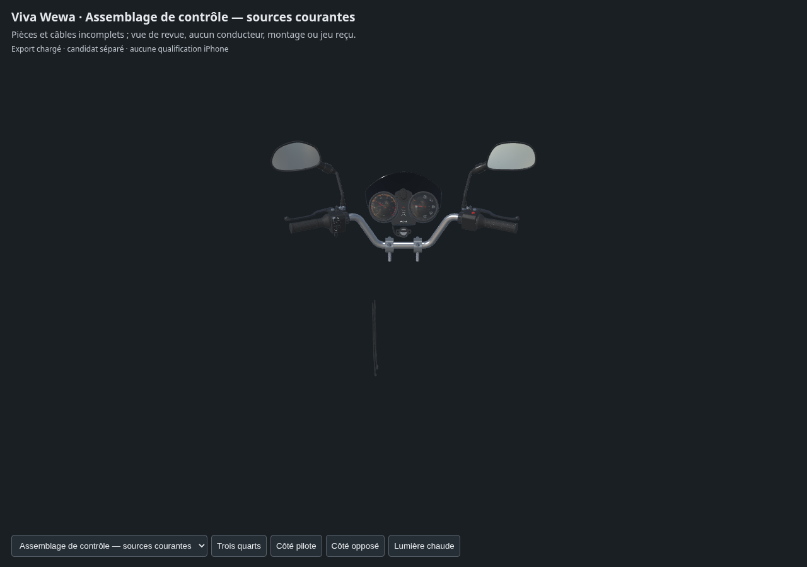

# Poste de conduite — compteurs révisés dans l'assemblage courant

Cette revue remplace uniquement les compteurs v3 par les compteurs v5. Les treize autres bibliothèques, leurs placements et les liaisons restent identiques à la [revue v2](../cockpit-current-review-v2/README.md). La petite boucle du contact reste en v2. La correction des normales du cache et des fonds de boîtiers conserve la géométrie et les matières ; les anciennes révisions restent consultables.

Le [contrôle indépendant sur le nouvel assemblage](../../research/cockpit-fit-preparation-v3-assembly-addendum-v1/README.md) recalcule 177 tests de paires/poses : aucun croisement. Il contrôle les vraies bibliothèques chargées et les normales locales de neuf corps physiques des compteurs ; les onze cibles boucle/visière/corps concordent avec les copies courantes. Les 85 948 triangles GLB concernés correspondent aux sources et aux copies, avec un écart numérique maximal de sommet de 33,7703 nm. Cette vérification ne porte pas sur la parité optique de toutes les surfaces.

Les segments réels dans les deux sens et l'inclusion de sommets/centroïdes sont recalculés. Le minimum sommet/surface échantillonné de 3,873598 mm n'est pas le jeu exact. Le témoin historique des 32 paires est réemployé avec son empreinte, sans être présenté comme recalculé ici.

La [preuve source/livraison](source-geometry-check-delivery-v1.json), le [contrôle des buffers](export-buffer-check.json) et les [trois captures WebGL](inspection-linked-v1/engine-check.json) portent sur cette nouvelle révision. La livraison contient 1 446 736 triangles, sans erreur glTF, triangle nul ou UV de carte normale effondré. Le [traitement des attributs inutilisés](unused-tangent-removal-v1.json) retire 166 références de tangentes sans changer les autres champs JSON ou les octets binaires. Aucun attribut de tangente utilisé par une carte normale n'est modifié.

Les [deux aperçus natifs](../cockpit-current-review-material-lighting-v3/README.md) sont des rendus Blender de 12 échantillons, avec caméra perspective de 22 mm et carte diffuse à 18 %. La présentation Babylon est distincte ; aucune équivalence optique n'est certifiée.

Connecteur, câbles supérieurs, trajets masqués, fixations installées et braquage complet restent ouverts. Les deux gaines basses séparées sont visibles dans la revue. Aucun poste complet, rendu photographique reçu, LOD mobile ou essai iPhone physique n'est déclaré. Aucun conducteur ajouté ; le jeu public reste inchangé.
