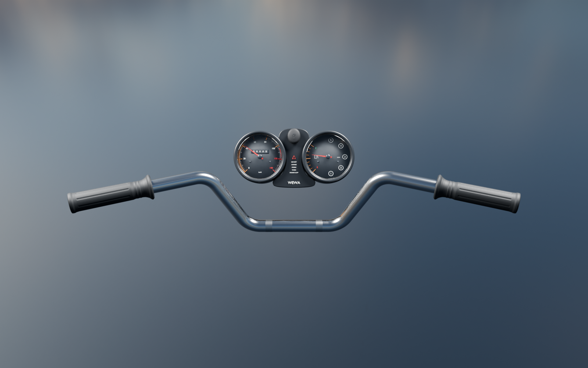
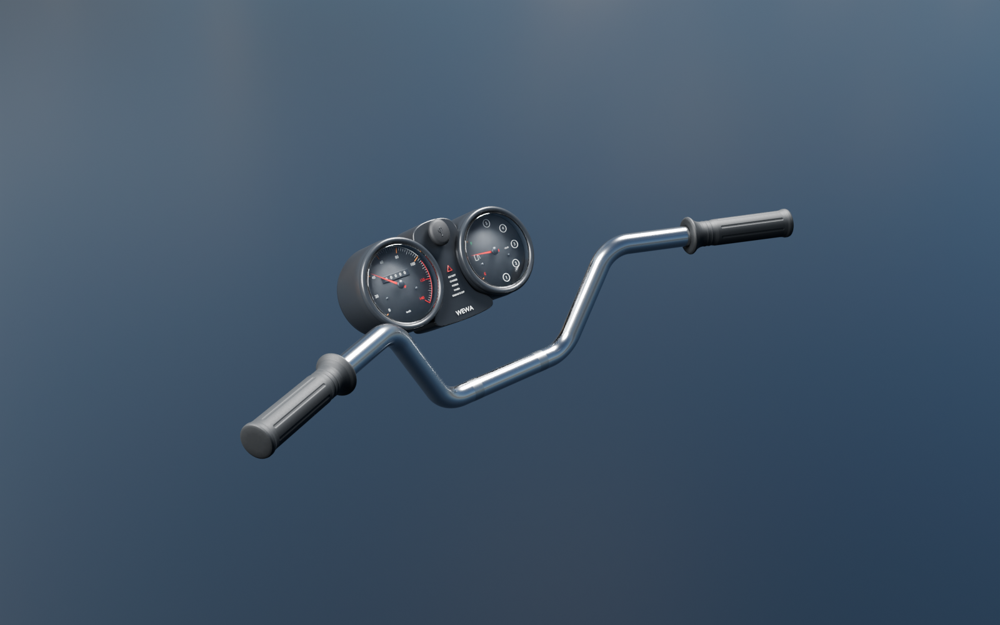
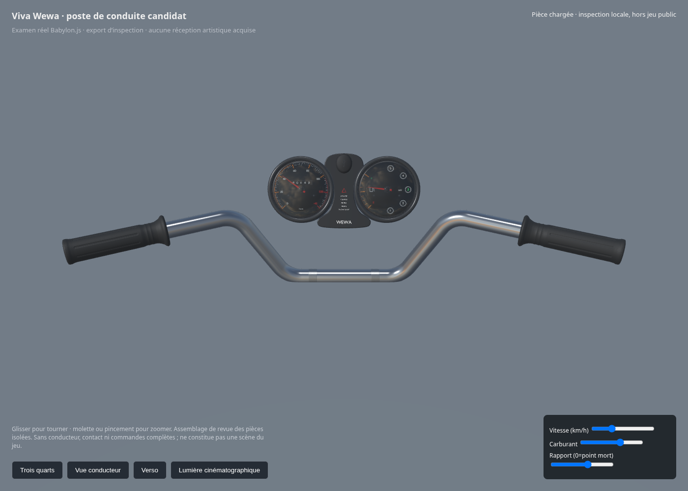

# Poste de conduite — assemblage de revue

Ce dossier réunit trois candidats fabriqués et contrôlés séparément : **guidon, enveloppes de poignées et compteurs**. Il permet d’examiner leur disposition depuis la place du conducteur. Ce n’est ni une capture du jeu public, ni une réception de la moto.

La [source liée](../../../assets-src/moto-components/cockpit-review/cockpit-review-v1.blend) référence les fichiers de chaque composant par chemins relatifs. Les poses de revue changent les copies locales des aiguilles sans modifier les composants. Le [contrôle source](source-geometry-check.json) conserve leurs empreintes et vérifie l’absence de croisement des surfaces du tube avec les poignées et les corps des compteurs.

Ce contrôle ne réceptionne pas le montage : pontets, support des compteurs, manchon d’accélérateur, commodos, leviers, câbles, rétroviseurs, contact et visière restent à fabriquer/documenter. Les dimensions et le placement sont provisoires. Aucun conducteur n’est ajouté.

Les captures moteur importent réellement les trois GLB et commandent les aiguilles. [Rapport navigateur](engine-check.json), dont une vue844×390 ; rendu logiciel Chromium, aucun FPS matériel ou Safari physique mesuré. Les ombres réfractives des vitres ne sont pas simulées. La source HDR de studio déjà créditée au projet ne représente pas un décor relevé de Kinshasa.

[Guidon seul](../handlebar-v1/README.md) · [poignées seules](../handlebar-grips-v1/README.md) · [compteurs seuls](../instruments-v1/README.md). L’assemblage et chaque composant restent candidats sans réception artistique.
