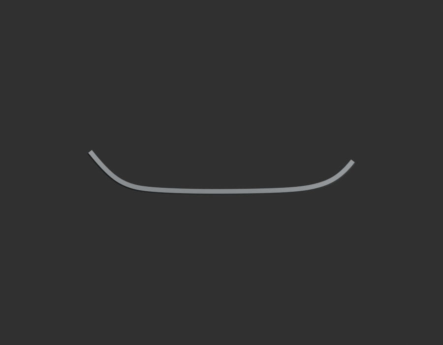
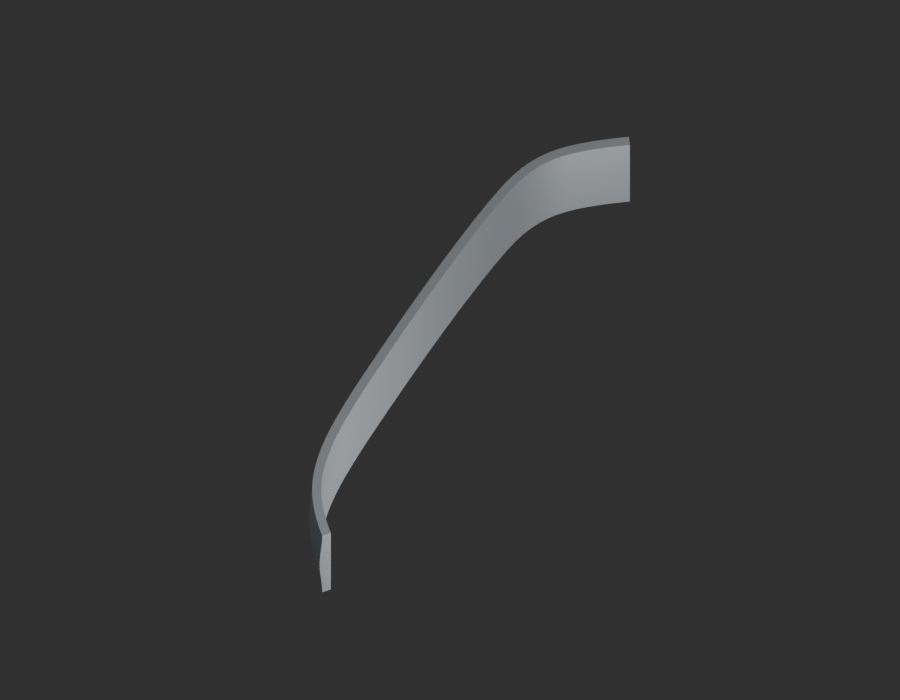
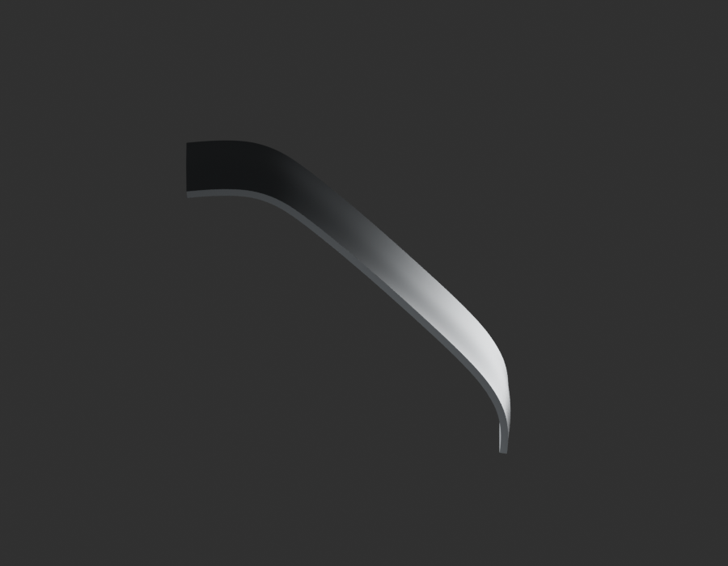
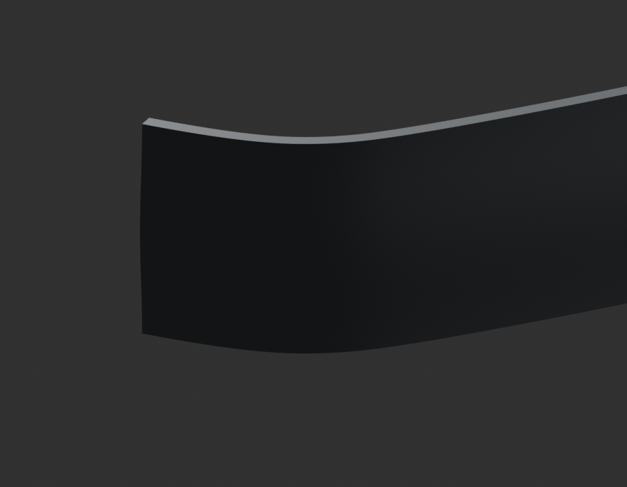

# P18 — MOTO-CRANKCASE-LH-LOWER-PERIPHERAL-WALL-001 — bounded exterior candidate

[Source Blender](../../../assets-src/moto-components/crankcase-lh-lower-peripheral-wall-v1/child-candidate.blend) · [GLB](../../../assets-src/moto-components/crankcase-lh-lower-peripheral-wall-v1/child-candidate.glb) · [Dossier](../../../creative/research/crankcase-lh-lower-peripheral-wall-v1-coordination-v1/G0-G2-plan-v1.json) · [Étude auteur](../crankcase-lh-lower-peripheral-wall-v1/delivery.json)

[Source rouverte](source-geometry-check.json), [export réel](export-buffer-check.json), [rendus96 associés à la source figée](render-report.json), [EXR FLOAT32](raw-render-check.json), [quatre vues Babylon de coordination](inspection-v5/engine-check.json), [lecture réelle](coordinator-review.json), [manifestes](production-manifest.json). Les images et rapports auteur restent inchangés. Leur association à la source est vérifiée dans le lot figé. Une éventuelle vue indépendante `coordination-neutral` est identifiée séparément avec sa provenance ; elle ne modifie pas la source.

Paroi périphérique inférieure gauche du carter : contour, raccord de fond et coupe de revue relus en quatre natifs96, macro et Babylon. Simple portion de peau extérieure depuis une photo de fonderie JE541038 ; équivalence à la pièce finie RDC non établie. Aucun carter complet, bossage de service, intérieur ou raccord étanche inventé. Profondeur axiale et épaisseur estimées.

Les dimensions et interfaces restent estimées. Aucune réception artistique ou qualification matérielle n’est transmise. Le paquet reste ouvert pour ses enfants et raccords manquants.
