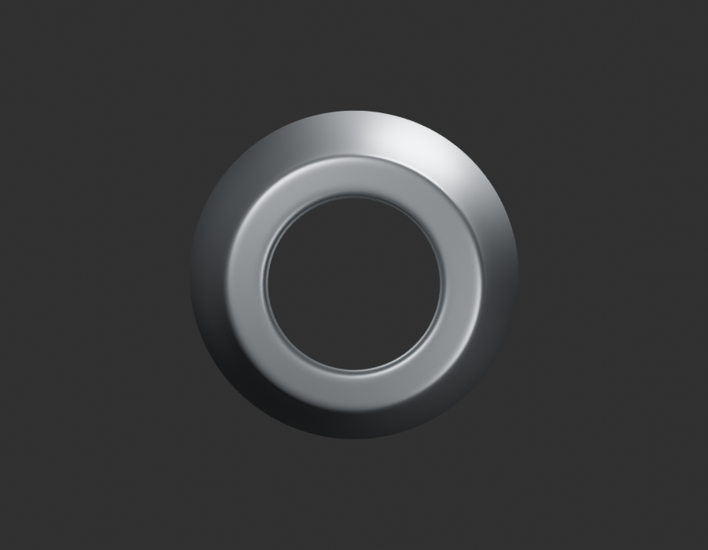
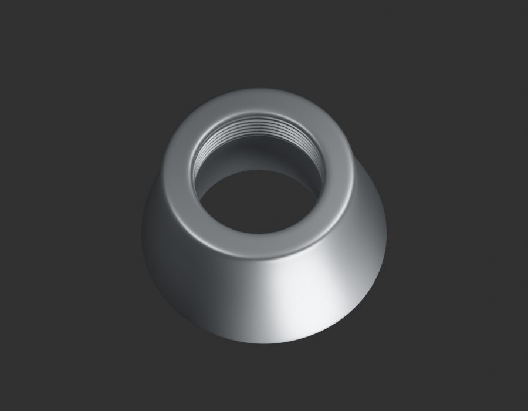
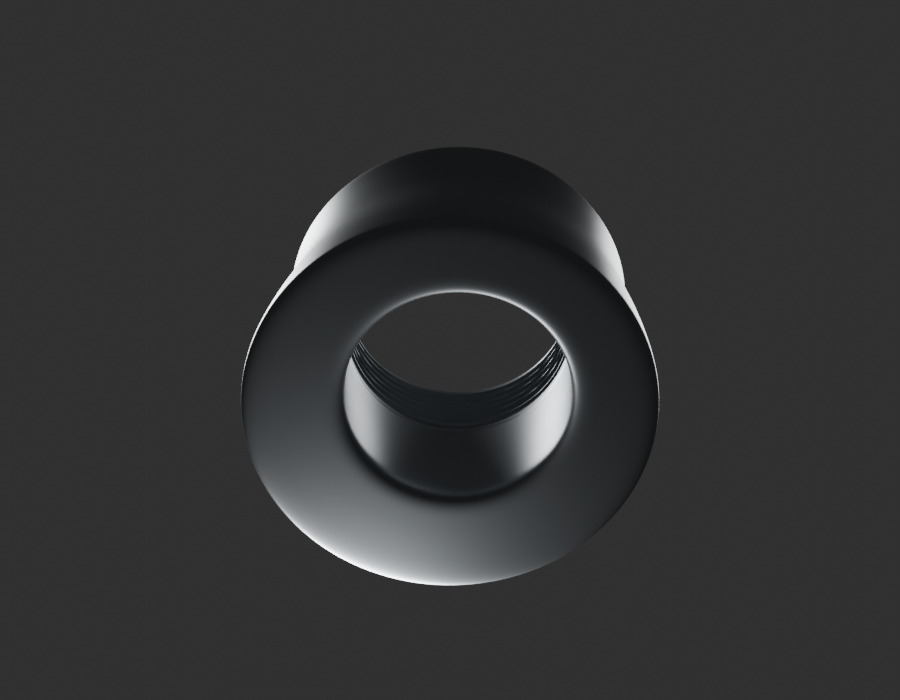
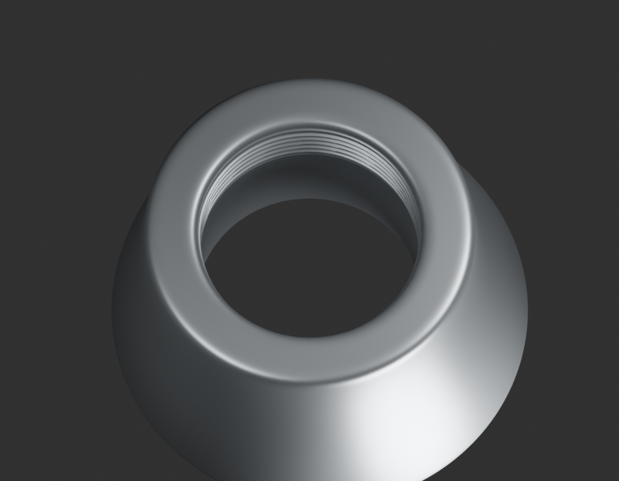

# P18 — MOTO-CRANKCASE-LH-LOWER-SERVICE-PORT-001 — bounded exterior candidate

[Source Blender](../../../assets-src/moto-components/crankcase-lh-lower-service-port-v1/child-candidate.blend) · [GLB](../../../assets-src/moto-components/crankcase-lh-lower-service-port-v1/child-candidate.glb) · [Dossier](../../../creative/research/crankcase-lh-lower-service-port-v1-coordination-v1/G0-G2-plan-v1.json) · [Étude auteur](../crankcase-lh-lower-service-port-v1/delivery.json)

[Source rouverte](source-geometry-check.json), [export réel](export-buffer-check.json), [rendus96 associés à la source figée](render-report.json), [EXR FLOAT32](raw-render-check.json), [quatre vues Babylon de coordination](inspection-v5/engine-check.json), [lecture réelle](coordinator-review.json), [manifestes](production-manifest.json). Les images et rapports auteur restent inchangés. Leur association à la source est vérifiée dans le lot figé. Une éventuelle vue indépendante `coordination-neutral` est identifiée séparément avec sa provenance ; elle ne modifie pas la source.

Col d’accès du carter gauche : bouche, peau externe et courte zone de filetage visible relues en quatre natifs96, macro et Babylon. Pas, section et cotes de travail non mesurés ; fonction non affectée, pas de bouchon/joint/filtre inventé. Donneur BM150JE541038 conditionnel, équivalenceRDC non acquise.

Les dimensions et interfaces restent estimées. Aucune réception artistique ou qualification matérielle n’est transmise. Le paquet reste ouvert pour ses enfants et raccords manquants.
