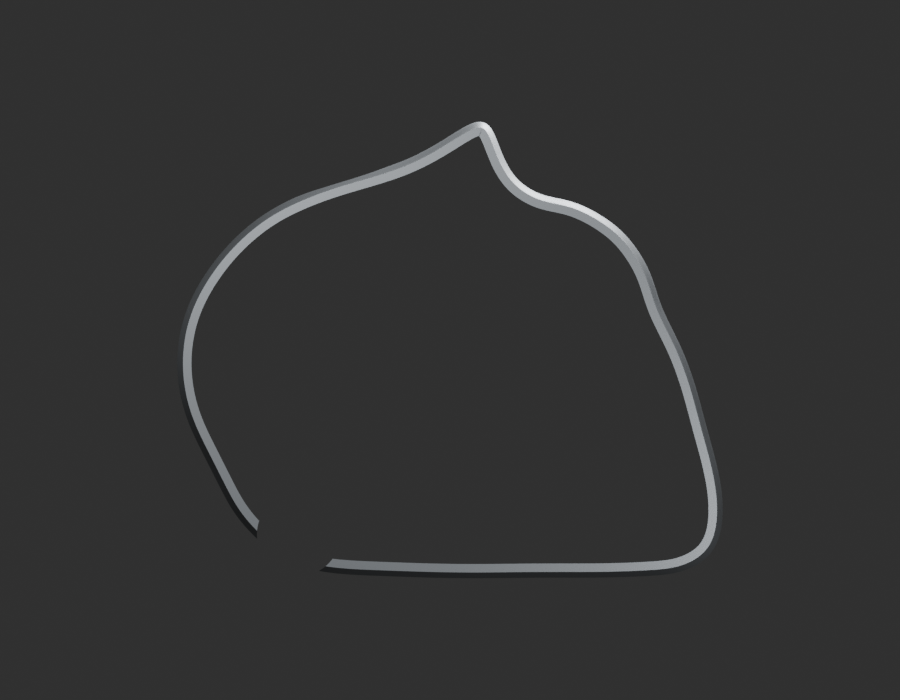
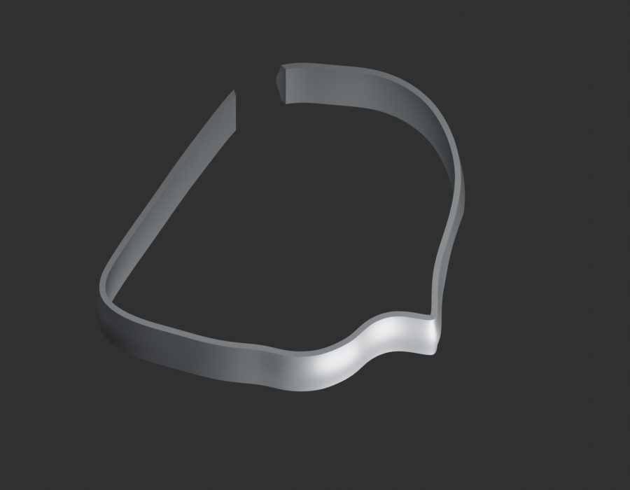
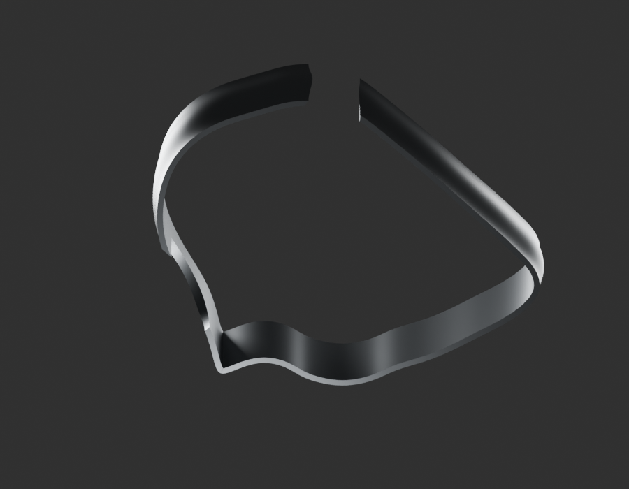
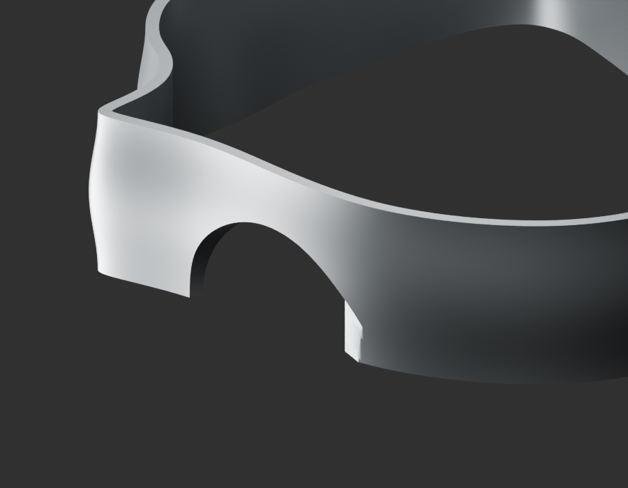

# P18 — MOTO-CRANKCASE-LH-MAJOR-OUTER-ENVELOPE-DONOR-001 — bounded exterior candidate

[Source Blender](../../../assets-src/moto-components/crankcase-lh-major-outer-envelope-donor-v1/child-candidate.blend) · [GLB](../../../assets-src/moto-components/crankcase-lh-major-outer-envelope-donor-v1/child-candidate.glb) · [Dossier](../../../creative/research/crankcase-lh-major-outer-envelope-donor-v1-coordination-v1/G0-G2-plan-v1.json) · [Étude auteur](../crankcase-lh-major-outer-envelope-donor-v1/delivery.json)

[Source rouverte](source-geometry-check.json), [export réel](export-buffer-check.json), [rendus96 associés à la source figée](render-report.json), [EXR FLOAT32](raw-render-check.json), [quatre vues Babylon de coordination](inspection-v5/engine-check.json), [lecture réelle](coordinator-review.json), [manifestes](production-manifest.json). Les images et rapports auteur restent inchangés. Leur association à la source est vérifiée dans le lot figé. Une éventuelle vue indépendante `coordination-neutral` est identifiée séparément avec sa provenance ; elle ne modifie pas la source.

Paroi périphérique gauche JE541038 : silhouette porteuse de profondeur, ouverture centrale et demi-ouverture supérieure visibles. Quatre natifs96 dont macro et Babylon relus. Cette bande de carter reste partielle : aucune face de fermeture, nervure interne ou portée masquée inventée. Donneur BM150 conditionnel ; aucune équivalence moteur RDC125 ou jonction aux couvercles reçue. Alternative à la bande inférieure antérieure, jamais superposée comme seconde paroi.

Les dimensions et interfaces restent estimées. Aucune réception artistique ou qualification matérielle n’est transmise. Le paquet reste ouvert pour ses enfants et raccords manquants.
