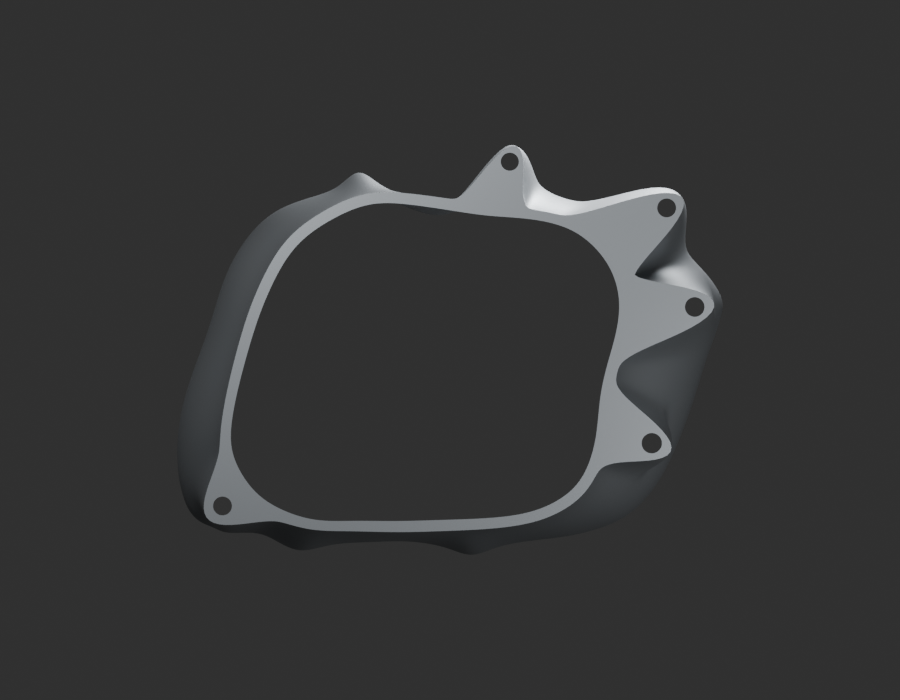
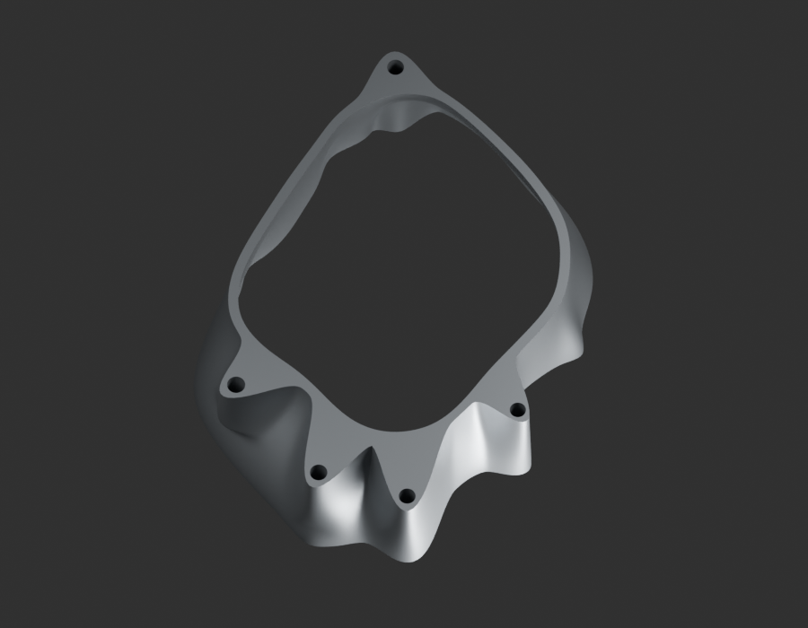
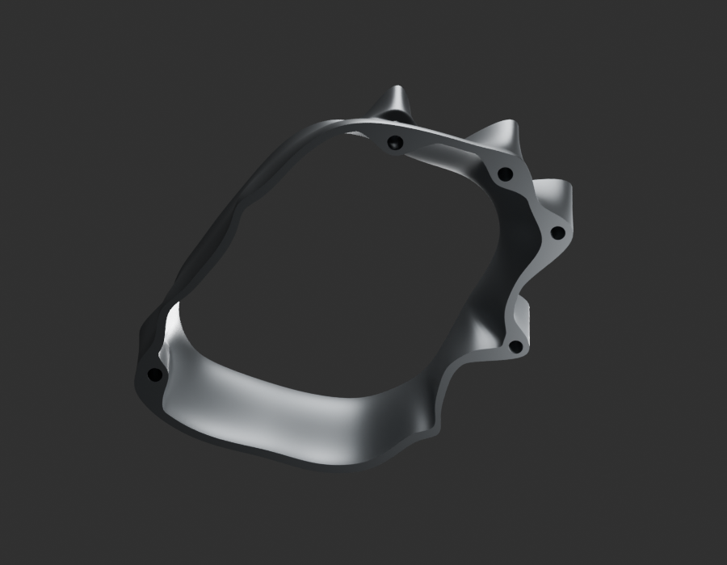
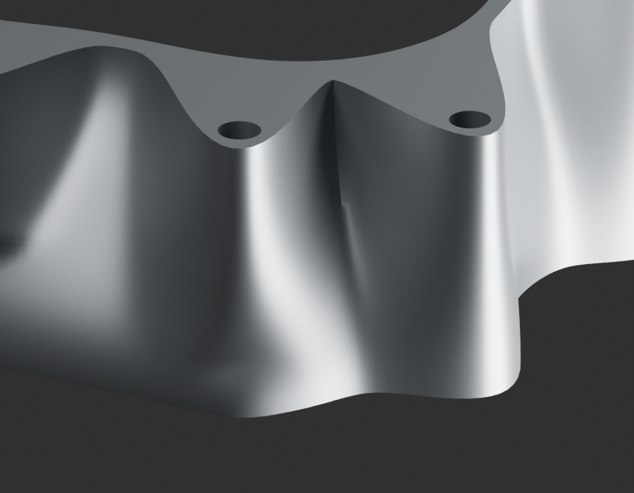

# P18 — MOTO-CRANKCASE-RH-MAJOR-OUTER-ENVELOPE-DONOR-001 — bounded exterior candidate

[Source Blender](../../../assets-src/moto-components/crankcase-rh-major-outer-envelope-donor-v1/child-candidate.blend) · [GLB](../../../assets-src/moto-components/crankcase-rh-major-outer-envelope-donor-v1/child-candidate.glb) · [Dossier](../../../creative/research/crankcase-rh-major-outer-envelope-donor-v1-coordination-v1/G0-G2-plan-v1.json) · [Étude auteur](../crankcase-rh-major-outer-envelope-donor-v1/delivery.json)

[Source rouverte](source-geometry-check.json), [export réel](export-buffer-check.json), [rendus96 associés à la source figée](render-report.json), [EXR FLOAT32](raw-render-check.json), [quatre vues Babylon de coordination](inspection-v5/engine-check.json), [lecture réelle](coordinator-review.json), [manifestes](production-manifest.json). Les images et rapports auteur restent inchangés. Leur association à la source est vérifiée dans le lot figé. Une éventuelle vue indépendante `coordination-neutral` est identifiée séparément avec sa provenance ; elle ne modifie pas la source.

Grandes parois périphériques droites et cinq stations percées observées. Quatre natifs96 dont neutre et macro et Babylon relus. Racines/bossages et courbures locales restent approximatifs, G3 ouvert ; aucune fermeture de cavité, galerie, roulement ou interne moteur inventé. Donneur BM150 PF54100? conditionnel ; appariement au gauche JE541038 et identité moteur RDC125 non établis. Les sources/couvercles antérieurs sont conservés ; pas un carter complet reçu.

Les dimensions et interfaces restent estimées. Aucune réception artistique ou qualification matérielle n’est transmise. Le paquet reste ouvert pour ses enfants et raccords manquants.
