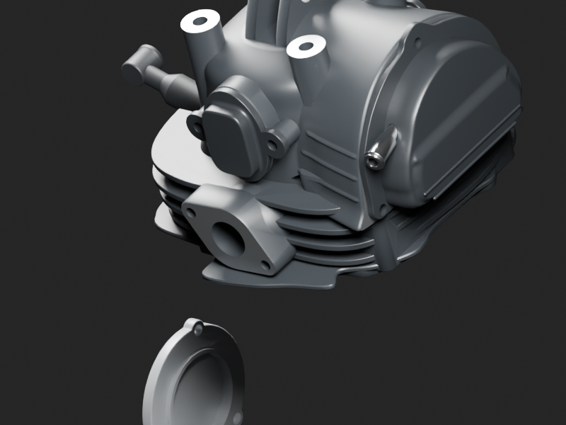

# Réintégration des sources moteur et départs de gaines existants

Six familles sources déjà fabriquées étaient absentes de la moto globale : bougie v2, capuchon v2 portable, bouchon de filtre v2, deux couvercles de visite, corps de couvercle OHC et son embout. Leurs datums restent strictement ceux des maîtres documentés, sans changement de géométrie ni matière. La culasse globale est bien v3 : son dossier corrigeait déjà les anciens conflits avec les trois couvercles, contrôlés à0/0/0. L’ancien texte négatif des couvercles concernait la culasse v2, pas cette composition. Les références et variantes restent conditionnelles.

[Six ajouts moteur](add-only-fragment.json) · [Deux courts départs supérieurs de gaines](upper-sheaths-add-only.json) · [Source de contexte liée](../../../assets-src/moto-components/engine-ignition-exterior-reuse-v1/linked-ignition-context.blend).

Les gaines supérieures d’embrayage/frein sont deux sources historiques distinctes, replacées par la même translation de cockpit que leurs commandes. Leurs coupes distales restent explicites, sans route cachée ou connexion inférieure inventée. Le tronçon inférieur A et sa nouvelle continuation observée restent distincts.

La figure est une macro de la culasse, pas une preuve de cadrage intégral du filtre inférieur. Le premier cadrage calculé sur des matrices non évaluées était vide ; conservé dans `rejected-unevaluated-camera/`, corrigé par lecture des vraies instances évaluées. L’état avant réintégration des couvercles est conservé dans `before-head-covers/`. Les vues détaillées96 originales restent celles des sources historiques ; le nouveau détail de contexte est à16 échantillons. L’assemblage global final fournit les nouvelles vues96 avec ces pièces réellement présentes.

Sources et GLB récupérés octet pour octet depuis Git ; aucune nouvelle pièce physique comptée et aucune répétition supplémentaire. Aucune résistance, bobine HT, électrode enfouie, distribution ou usinage caché inventés. Pas de G8 ni de certification mécanique ou de variante RDC.
