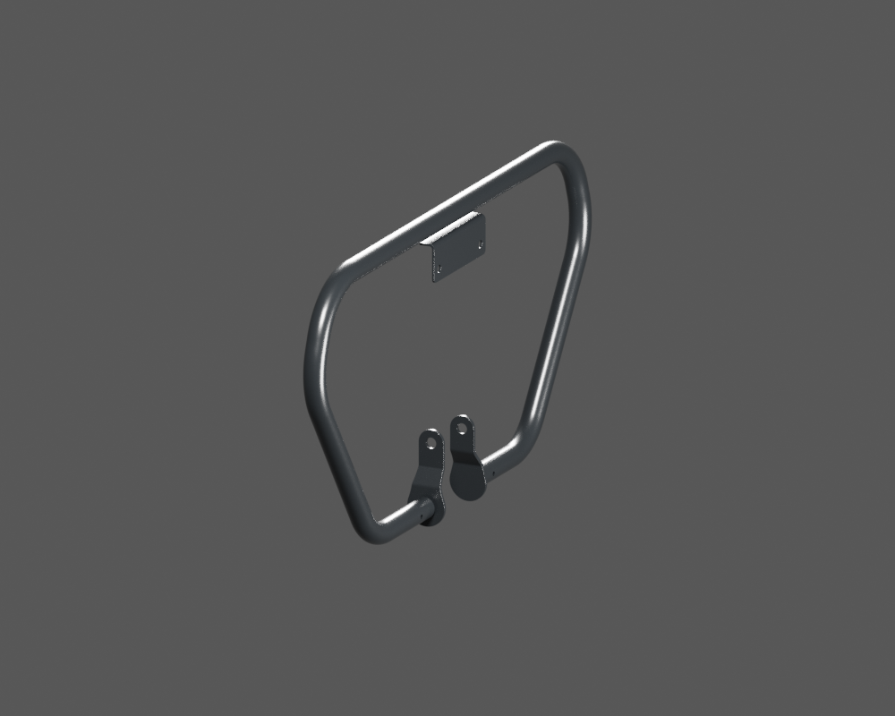
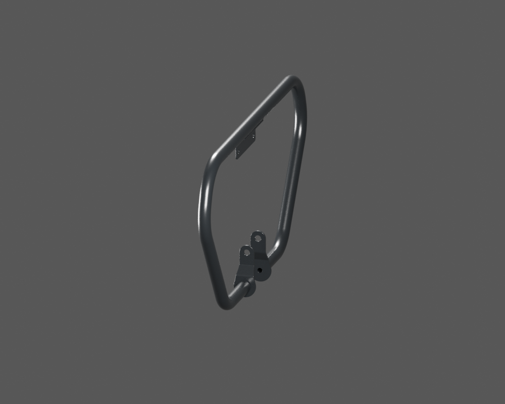
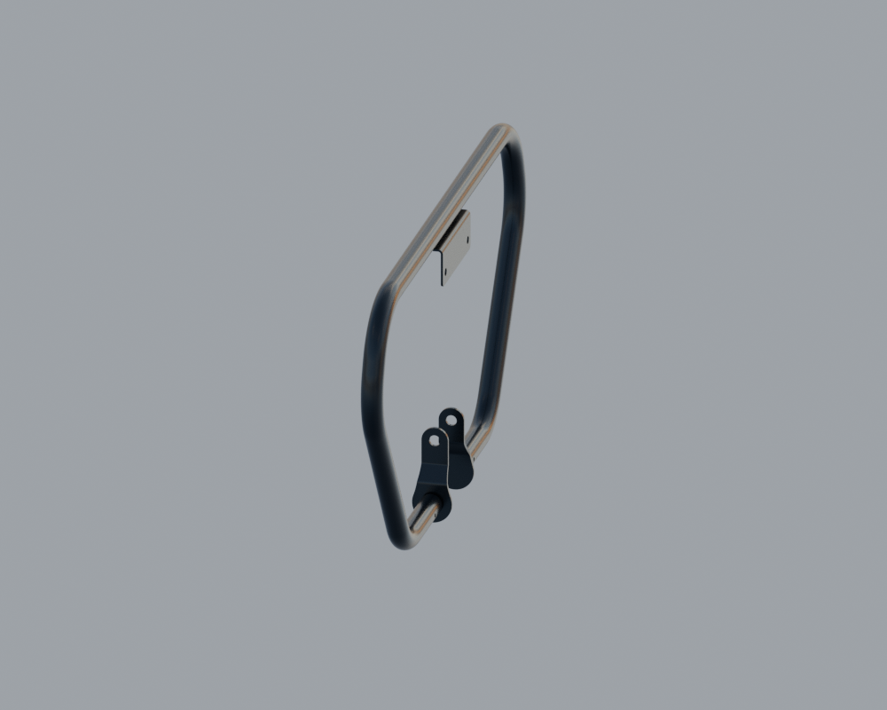

# P26 — Existing engine guard kit — rigid guide context with open review joints

[Source Blender](../../../assets-src/moto-components/engine-protection-exterior-context-v2/integration-wrapper.blend) · [GLB](../../../assets-src/moto-components/engine-protection-exterior-context-v2/engine-protection-exterior-context-v2-inspection.glb) · [Dossier](../../../creative/research/engine-protection-exterior-context-v2-coordination-v1/G0-G2-plan-v1.json) · [Étude auteur](../engine-protection-exterior-context-v2/README.md)

[Source rouverte](source-geometry-check.json), [export réel](export-buffer-check.json), [rendus96 associés à la source figée](render-report.json), [EXR FLOAT32](raw-render-check.json), [quatre vues Babylon de coordination](inspection-v5/engine-check.json), [lecture réelle](coordinator-review.json), [manifestes](production-manifest.json). Les images et rapports auteur restent inchangés. Leur association à la source est vérifiée dans le lot figé. Une éventuelle vue indépendante `coordination-neutral` est identifiée séparément avec sa provenance ; elle ne modifie pas la source.

Kit de quatre parents existants : tube conservé exact, plaque centrale et terminaux en poses rigides héritées du guide ; trois jeux nominaux3mm laissés ouverts pour revue. Les trois natifs96 montrent le revêtement sombre et des reflets de studio/HDR différents. Les quatre captures engine réelles montrent le même kit et ses ouvertures ; éclairages et cadrages distincts, sans parité photométrique. Ces jeux ne sont ni une cote OEM ni une soudure/contact reçu. Aucune nouvelle identité physique, aucun fit ou G4/G5/G8 reçu.

Les dimensions et interfaces restent estimées. Aucune réception artistique ou qualification matérielle n’est transmise. Le paquet reste ouvert pour ses enfants et raccords manquants.

## Clôture coordination

Catalogue root du kit, checker strict, captures réelles, finalizerV8, réconciliation et [gatecheck](gatecheck.json) terminés. [État root](../../research/engine-protection-exterior-context-v2-coordination-v1/root-finalization.json), [deux manifestesSHA](manifest-integrity-check.json). Gel auteur87 conservé, tube exact, trois jeux nominaux3mm de revue ; aucun fit/G4/G5/G8 reçu. Quatre parents existants, zéro nouvelle identité physique. Aucun Git ni RR3 modifié. Arrêt des écritures après cette clôture.
