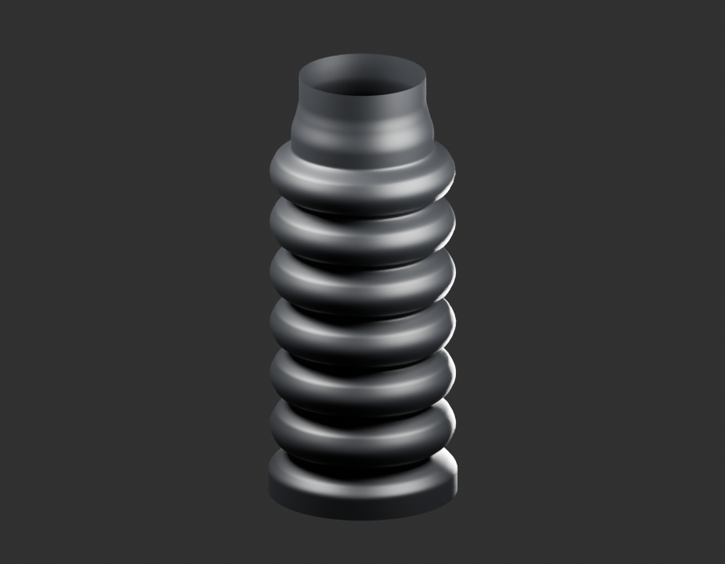
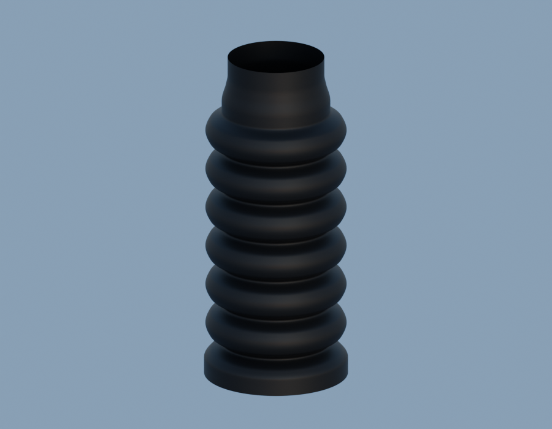
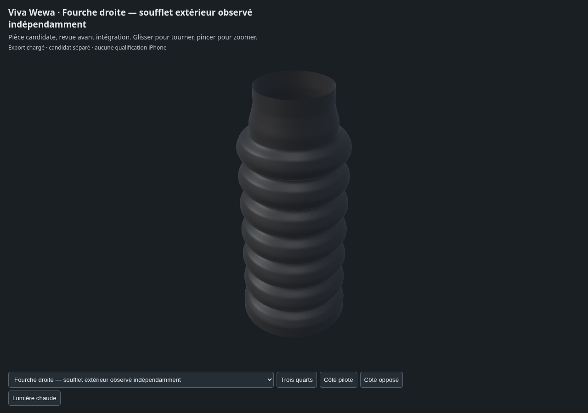

# LEGACY14-FORK-RH — fork-bellows-right-visible-v1

**Un enfant candidat, pas un paquet terminé ni réceptionné.** Independently authored photographed right-front fork bellows exterior interval, six-fold working hypothesis from official RDC right profile and front view. Not copied/mirrored from existing generic bellows mesh or parameters. Open observation cuts; inner wall, bore, compressed section, hidden cuff seat and exact manufactured dimensions omitted. No actual LH/RH dimensional difference claimed.

[Sources Blender/GLB et paramètres](../../../assets-src/moto-components/fork-bellows-right-visible-v1/README.md) · [Dossier documentaire](../../../creative/research/fork-bellows-right-visible-v1/G0-G2-plan-v1.json).

Gris réellement relus : [face](gray-front.png), [trois-quarts](gray-quarter.png), [revers](gray-reverse.png), [décision](gray-review.json). Aperçus : [studio](preview-studio.png), [neutre](preview-neutral.png), [décision](preview-review.json).

[Triangles/normales/UV/topologie réels](independent-export-check.json), [transfert source](source-geometry-check.json), [rendus96](render-report.json), [canaux EXR](raw-render-check.json), [quatre vues Babylon](inspection-v3/engine-check.json), [revue](coordinator-review.json), [manifestes](production-manifest.json).

Exposition0, gamma1, AgX Medium High Contrast et HDRI artistique0,65 ; pas d’étalonnage colorimétrique. Dimensions, sections et interfaces restent estimées. Aucune réception artistique, pose certifiée ou mesure iPhone.
