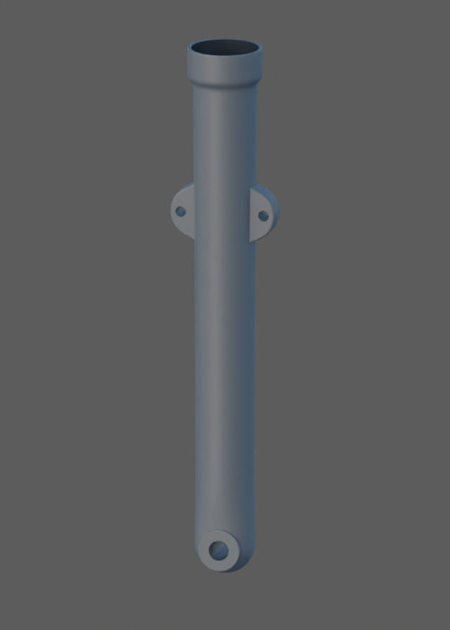
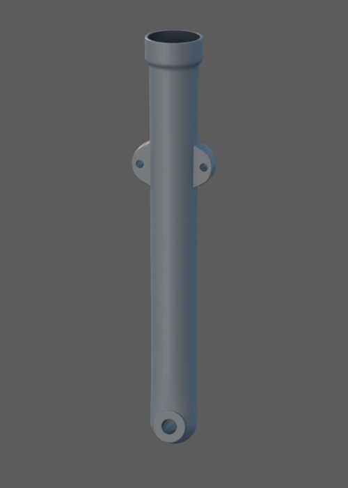

# Fourreau gauche — comparaison d’éclairage sur source inchangée

Ces deux aperçus proviennent réellement de Blender, sur la même source et les mêmes matériaux que le candidat détaillé. La caméra est commune aux deux vues : HDR extérieur neutre, puis ajout d’un soleil chaud. Le fichier source n’est pas sauvegardé. Les paramètres, empreintes et contrôles de cadrage sont dans [le rapport](report.json) et [le protocole](../../research/front-fork/outer-left-material-lighting-v1.json).

Lecture réelle des deux PNG : le corps paraît plus sombre et bleuté que sous les grandes sources du studio. L’ajout du soleil modifie surtout les petits reflets des lèvres et oreilles ; il ne donne pas à lui seul une teinte dorée à toute la pièce. Aucun matériau n’a été éclairci ou modifié pour compenser cette réponse. La cavité supérieure reste ouverte et sombre ; le cadrage conserve l’ensemble.

Il s’agit d’une étude isolée à 12 échantillons, 500 × 700 pixels, avec débruitage. Lumière non calibrée, sans photographie de la pièce dans ce même environnement : ces images ne valident ni la couleur réelle, ni l’exposition finale du jeu, ni le style photographique demandé. Les cinq [rendus de contrôle détaillés](../fork-outer-left-v1/README.md) restent séparés. Aucune réception artistique, conformité OEM ou mesure sur iPhone n’est acquise.
