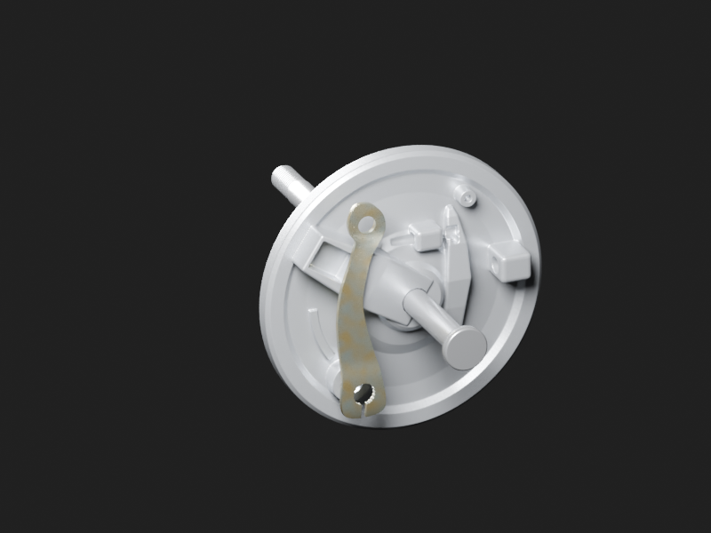
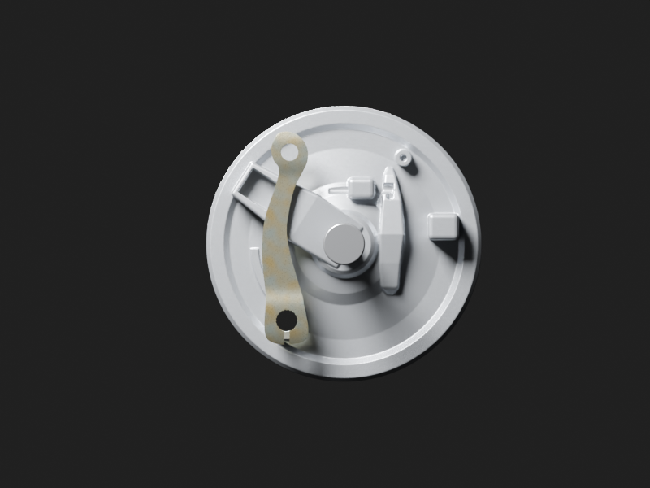
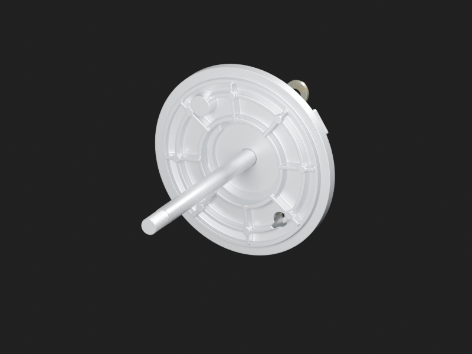

# Axe avant et levier de came — complément extérieur v2

Le levier JA131607 historiquement fabriqué mais absent de l’ensemble est réutilisé sans modification de géométrie ou matière. Son siège est placé sur l’axe estimé du flasque JA existant ; œillet dirigé vers le haut par rotation rigide de180°. Son export évalué porte le nom exact de l’objet source. Le premier essai trop rentré traversait un relief du flasque : conservé dans `rejected-inboard-lever/`, remplacé par une translation axiale de11mm. L’enveloppe évaluée du levier est maintenant entièrement à l’extérieur du plan maximal du flasque, marge conservatrice1,750mm. Aucune qualification de course ou fixation n’est déduite de ce contrôle.

L’axe reprend l’enveloppe photographique apparentée DJ151041 avec un fût de225mm au lieu de205mm, dans la plage de travail préexistante180–240mm. Cette longueur répond à la composition des fourreaux ; ce n’est pas une mesure du véhicule RDC. La tête, le diamètre et la proposition de filetage restent identiques. Le générateur original n’est pas modifié ; les nouvelles sources gris/matière restent séparées. Aucun écrou ou mécanisme caché ajouté sans source.

[Fragment de deux ajouts](add-only-fragment.json) · [Source de contexte liée](../../../assets-src/moto-components/front-axle-envelope-v2/linked-front-context.blend) · [Plan et provenance](../../research/front-wheel-exterior-completion-v2/G0-G2-plan.json) · [Contrôle de dégagement](../../research/front-wheel-exterior-completion-v2/axial-clearance-check.json).

Trois rendus natifs800×600 à96 échantillons et EXR32 vérifiés ; deux exports GLB validés sans erreur. Les photographies restent privées ; la photo d’axe a été rouverte, le levier réutilise son dossier historique. Variantes et cotes estimées, câble et serrage restent à qualifier. Aucun G8 ou test mobile reçu.
