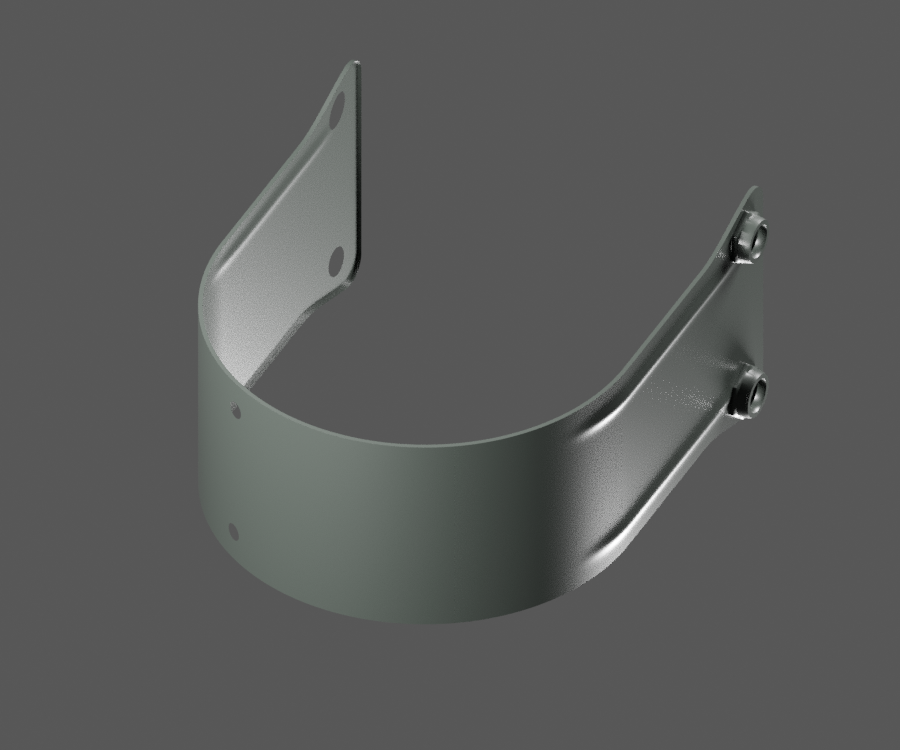
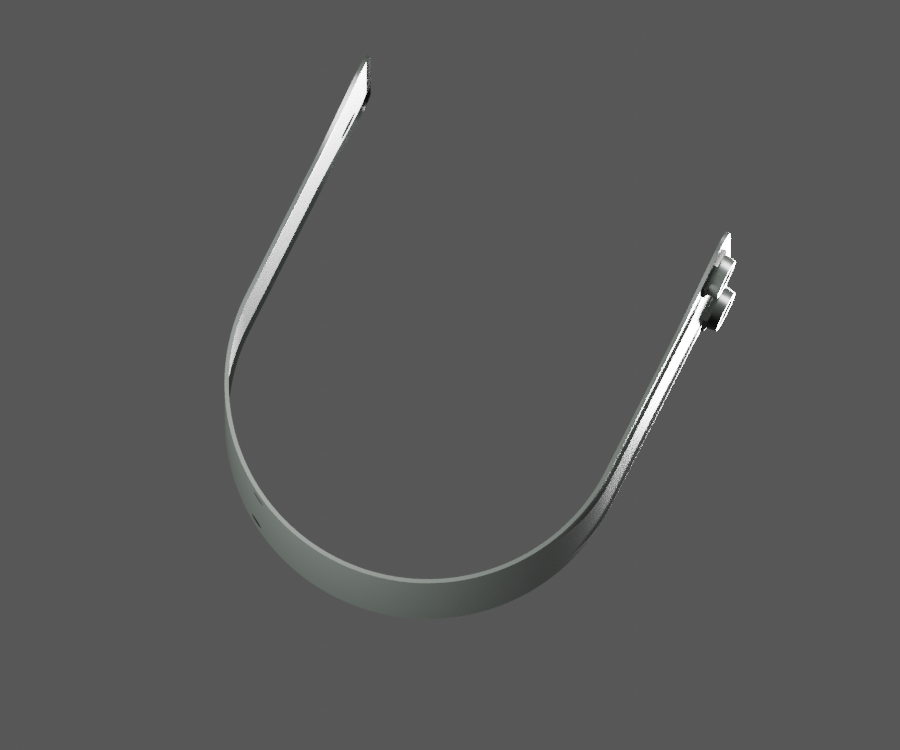
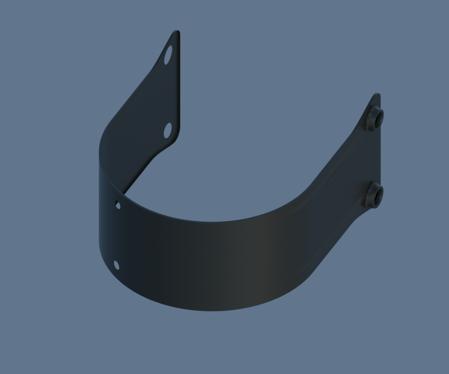
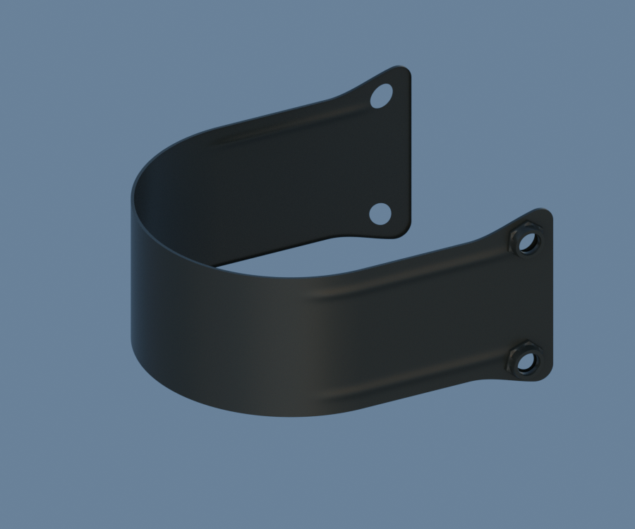

# LEGACY15-FRONT-BRACE — PF181410 FRONT fender brace visible exterior study

[Source Blender](../../../assets-src/moto-components/front-brace-pf181410-visible-front23-v2/front-brace-material.blend) · [GLB](../../../assets-src/moto-components/front-brace-pf181410-visible-front23-v2/front-brace-material.glb) · [Dossier](../../../creative/research/front-brace-pf181410-visible-front23-v2-coordination-v1/G0-G2-plan-v1.json) · [Étude auteur](../front-brace-pf181410-visible-front23-v2/README.md)

[Source rouverte](source-geometry-check.json), [export réel](export-buffer-check.json), [rendus96 associés à la source figée](render-report.json), [EXR FLOAT32](raw-render-check.json), [quatre vues Babylon de coordination](inspection-v5/engine-check.json), [lecture réelle](coordinator-review.json), [manifestes](production-manifest.json). Les images et rapports auteur restent inchangés. Leur association à la source est vérifiée dans le lot figé. Une éventuelle vue indépendante `coordination-neutral` est identifiée séparément avec sa provenance ; elle ne modifie pas la source.

PF181410 avant : bande en U, six passages et reliefs continus, deux peaux de collets extérieurs observés lisibles. Les trous restent ouverts ; intérieur/filetage des collets non interprété. Reflets studio plus clairs, ciel neutre sombre. Chant, épaisseur, matière exacte et montage non reçus ; pièce distincte de la bavette arrière JV181410.

Les dimensions et interfaces restent estimées. Aucune réception artistique ou qualification matérielle n’est transmise. Le paquet reste ouvert pour ses enfants et raccords manquants.
