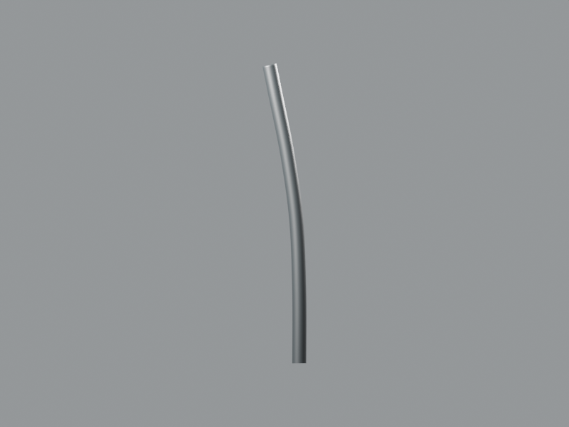
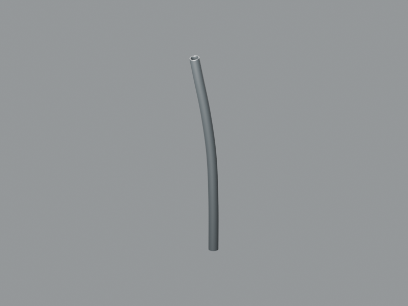

# P29 — prolongement supérieur visible de la gaine A

**11,64cm de gaine supplémentaire construits, Blender et GLB livrés.** Ce seul tronçon prolonge l’extrémité supérieure réelle de l’ancienneA jusqu’à la première occlusion sous le phare. Il n’ajoute aucun départ au guidon et ne constitue pas un câble commande–levier achevé.

[Blender](../../../assets-src/moto-components/front-brake-cable-visible-continuity-v1/visible-continuation-v1.blend) · [GLB](../../../assets-src/moto-components/front-brake-cable-visible-continuity-v1/visible-continuation-v1.glb) · [Fragment](integration-fragment.json) · [Sources et recherches](../../research/front-brake-cable-visible-continuity-v1/source-register.json)

Le dossierA/B antérieur a été relu avant recherche. La source constructeur RDC04, contre-vérifiée par03, permet de prolonger la ligne depuis[316,348] jusqu’à[311,298], avant l’occlusion. Les contrôles et incertitudes sont fixés dans `G0-G2-plan.json` : pointé±4px, échelle2,309mm/px±10%, profondeur±15mm, diamètre5,5mm bornes4–8mm. Ces estimations ne sont pas des cotes mesurées.

La [nouvelle galerie PF161213](https://fdrautogarage.co.ke/product/bajaj-boxer-125cc-150cc-brake-cable/) montre effectivement le câble et un sachet étiquetéPF161213, avec soufflet, âme apparente et terminaison filetée/trunnion. Cela identifie un câble de frein apparenté125/150, sans établir que notreA est précisément cette révision RDC ni révéler son trajet monté. Les nouvelles photos officielles roue/suspension montrent l’autre côté ; elles n’autorisent aucun trajet caché. Les pixels restent privés et ne sont pas utilisés comme texture.

Le nouveau source utilise le même repère natif queA. Son anneau de départ reprend seulement les64positions réelles de l’anneau terminal original, y compris sa très faible inclinaison d’échantillonnage. Aucun tronçon longitudinal ancien n’est copié ; aucun capuchon annulaire bas supplémentaire n’est ajouté sur le capuchon ancien. A etB gardent leurs SHA d’origine. Le polymère reprend exactement les paramètres de matièreA : basecolorlinéaire0,009/0,011/0,012, rugosité0,43, métal0.

Le fragment apporte **un parent**, avec le mêmeT queA : `[0.12,-0.3137818277,-0.7723272443]`, R0/S1. Bounds centraux monde approximatifs : départ `[0.12,-0.1729273,-0.3982545]`, arrivée `[0.12,-0.1844727,-0.2828000]`. Il ne touche pas les deux courts départs supérieurs au guidon (`T[0,-.0975,0]`), ne remplace ni ne dupliqueA/B. Le compteur151→152 du fragment représente son seuldelta+1 sur l’inventairev20 ; le coordinateur compose ce delta avec ses autres ajoutsv21. Zéro nouvelle pièce OEM comptée : c’est une portion supplémentaire de la famille existante.

Les deux vues natives800×600/Cycles96 débruitées sont réellement ouvertes. Les EXRFLOAT32 originaux sont conservés, avec vérification des en-têtes. Quatre captures Babylon réelles sont dans `inspection-v5/`, sans erreur page/HTTP et avec canvas non vide. La source a été rouverte ; les positions GLB correspondent à0,1µm d’arrondi. Le raccord aux64points anciens est vérifié dans les deux sources, sans recouvrement longitudinal. Les buffers contiennent7744triangles, zéro triangle dégénéré/normale de longueur invalide ; minimum de produit scalaire face/normale0,995. Le validateur glTF ne signale aucune erreur ni avertissement.

Restent hors portée : parcours derrière le carénage, attribution exacte du câble installé, raccord inférieur au levierJA131607, embouts montés, flexion et direction. Aucun trajet caché n’est ajouté pour masquer ces inconnues. Pas de réception artistique, qualification optique ou mobile ; aucun Git modifié par ce propriétaire.
