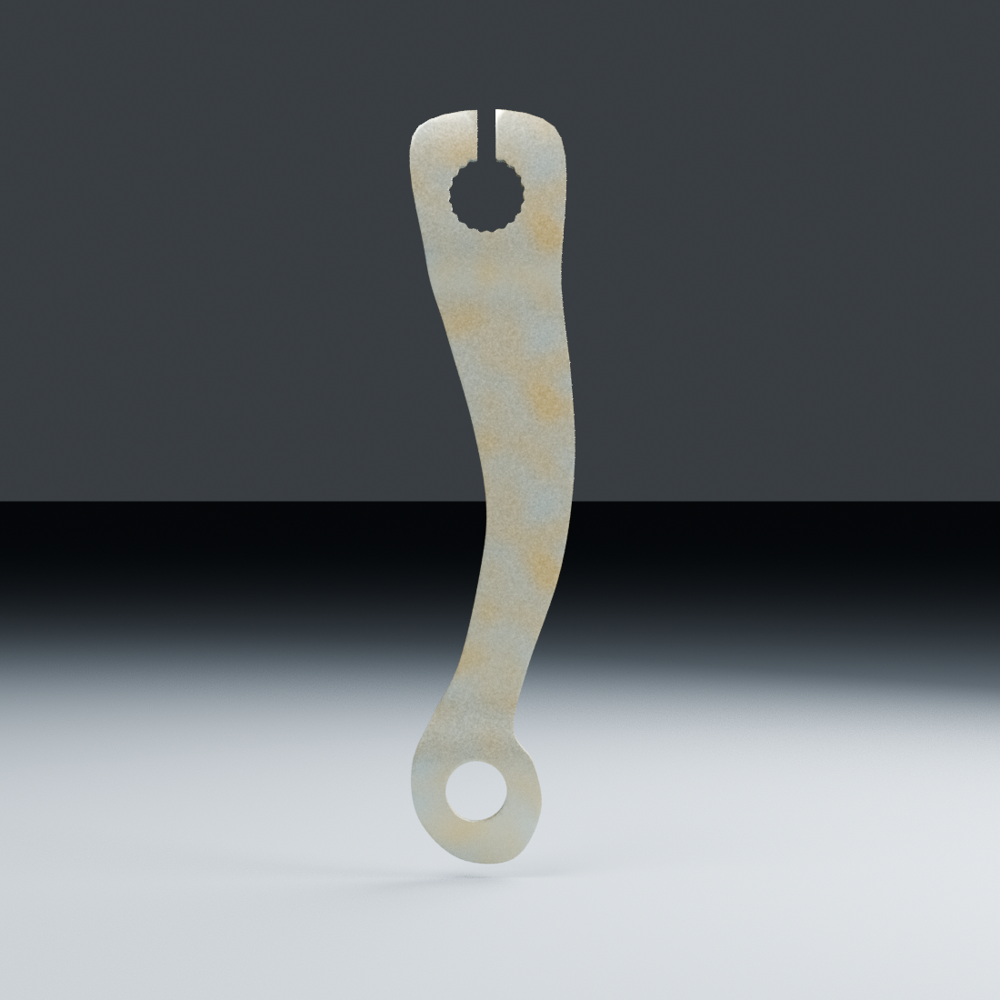
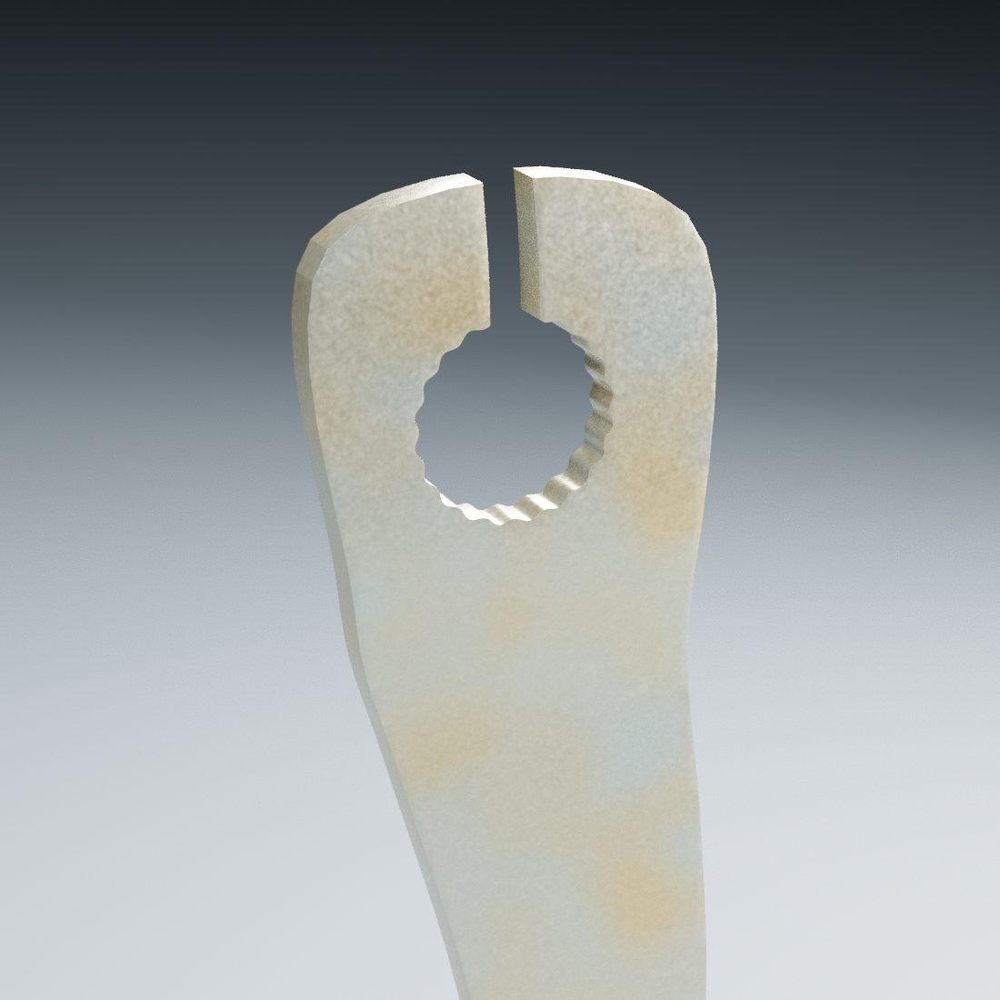
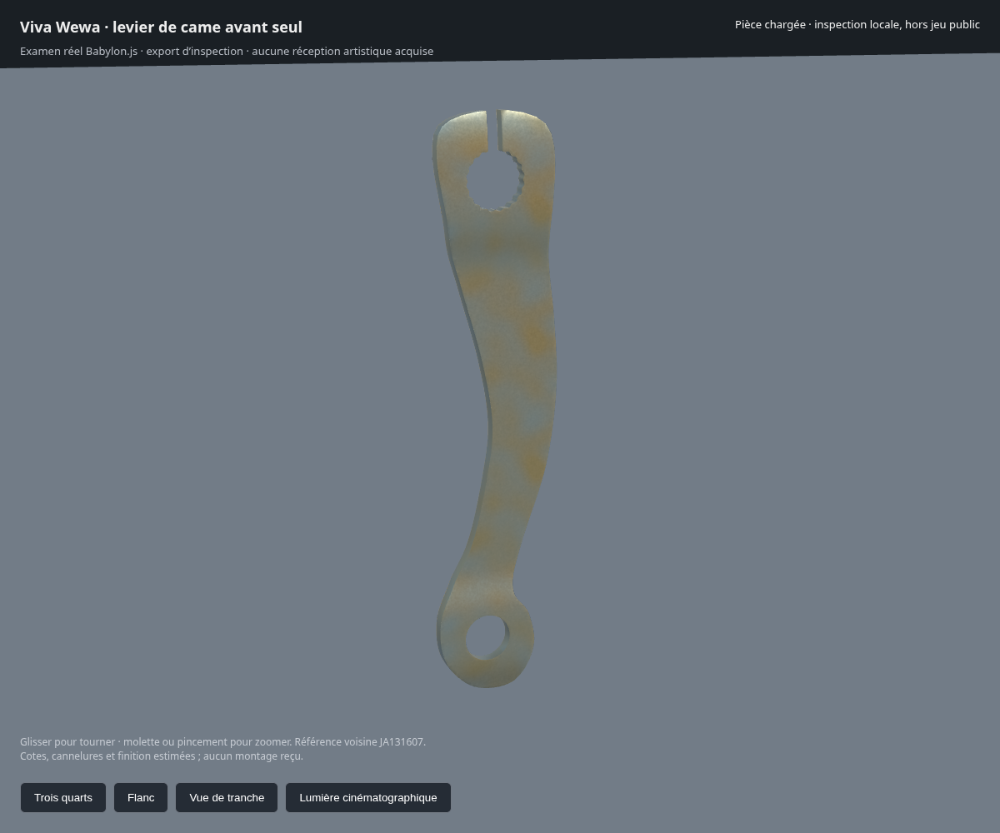

# Levier avant seul — revue v1

**Rendus réels de la source Blender**, séparés des intentions générées de la moto complète. Candidat non reçu, construit d’après la référence voisine JA131607.

Formes construites : lame courbe, déports d’épaisseur, siège d’arbre cannelé ouvert et œillet. Un premier essai à grandes faces non planes a été rejeté après apparition de cassures diagonales ; le maillage actuel répartit les sections avant courbure et conserve le contour. Les [photos et observations](../../../assets-src/moto-components/front-brake-lever/reference-observations.json) ont été distinguées du mauvais levier arrière JW131601. Deux angles du côté visible sont disponibles ; la face arrière et les sections sont à documenter.

Le [contrôle source](source-geometry-check.json) et le [contrôle des buffers exportés](geometry-check.json) vérifient une coque fermée de volume positif, le dégagement des ouvertures et la présence des cartes de couleur/métal/rugosité. Le contrôle export tient compte de la translation réelle du nœud, pas seulement de ses sommets locaux. Les captures Babylon.js emploient Chromium avec rendu logiciel : aucun résultat de performance iPhone n’en découle.

**À reprendre avant réception** : dimensions, nombre/profil des cannelures, sections et déports mesurés, matière observée sous lumière contrôlée, identité RDC et interfaces avec came/câble. Les 88 mm d’entraxe, 2,5 mm d’épaisseur et 20 cannelures sont provisoires. L’aspect du revêtement est une approximation statique ; il manque notamment sa variation avec l’angle. Aucun montage fonctionnel n’est présenté.

[Source éditable](../../../assets-src/moto-components/front-brake-lever/front-brake-lever-v1.blend) · [paramètres et incertitudes](../../../assets-src/moto-components/front-brake-lever/parameters.json) · [rendu verso](rear.png).
