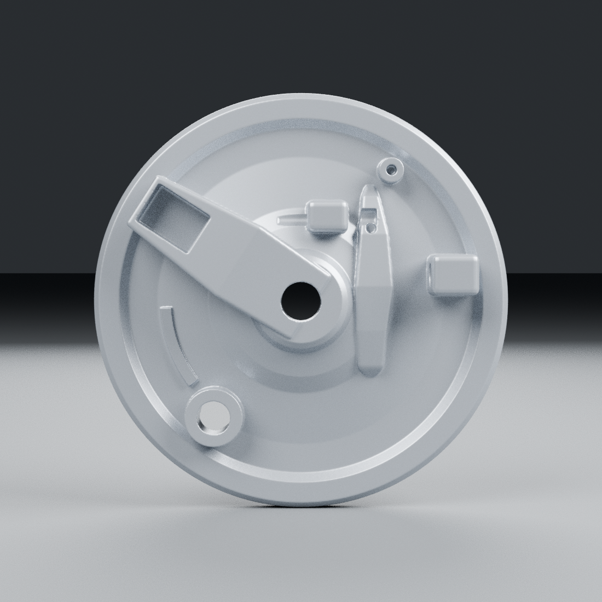
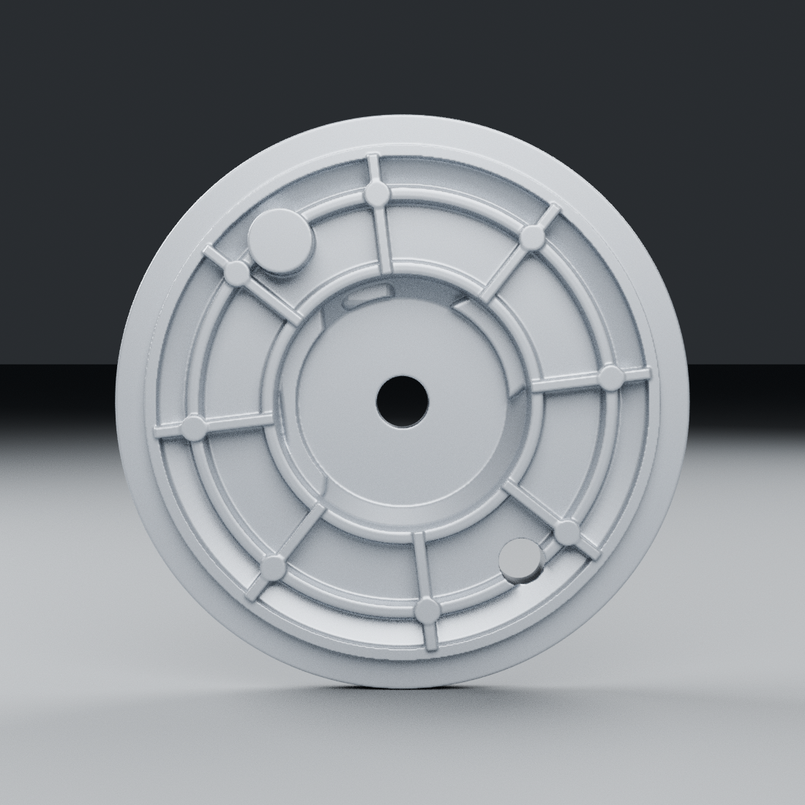
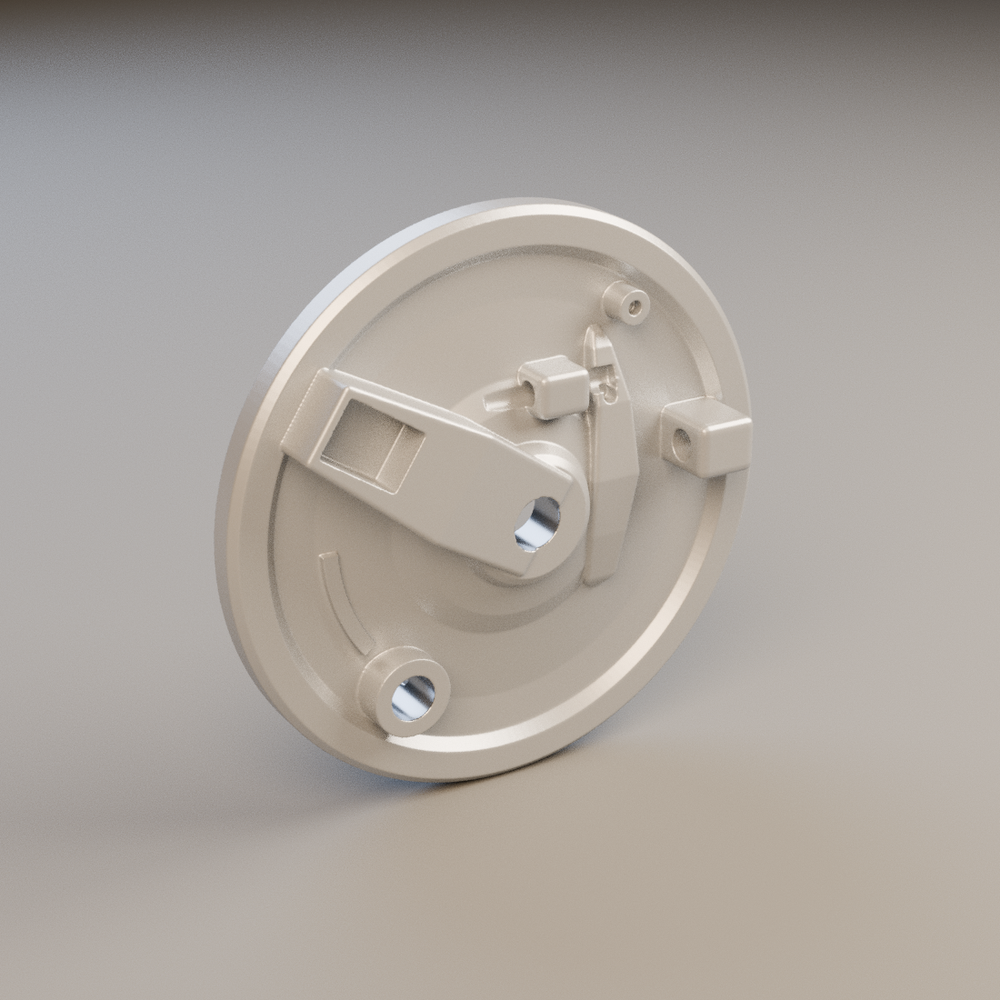

# Flasque avant — corps moulé isolé, candidat v1

20 octobre 2026. [Source et méthode](../../../assets-src/moto-components/front-brake-plate/README.md), [fiche de fabrication](../../workflow/records/moto-brake-plate-front-001.json), [direction choisie](../../GRAPHIC_STYLE.md). Aucune réception artistique acquise.

## Ce qui est réellement fabriqué

Un corps de flasque seul : coupelle et anneaux intégrés à la section, huit nervures arrière, bossage axial, passage de came, butée oblique avec logement rectangulaire, petits bossages percés et relief effilé. Les volumes de construction, le maillage issu de leurs opérations et l’export réduit restent disponibles. Le levier, l’axe, les garnitures, les ressorts et les pièces rapportées visibles dans certaines photos ne sont pas fabriqués par cette pièce.

Les photographies recto/verso **JA131605** sont rapprochées du catalogue BM125UG feuille44. Les vendeurs reprennent les mêmes clichés ; cinq fichiers téléchargés ne constituent pas cinq captures indépendantes. Le montage actuel RDC et les cotes propres au flasque ne sont pas confirmés. Aucun pixel de ces photos n’est incorporé aux matériaux.

## Vues réelles Blender

`quarter.png` présente le relief sous lumière neutre ; `fit-neutral.png` montre le raccord provisoire aux précédents candidats de roue, avec leur géométrie d’inspection liée. La [moto entière portant WEWA](../../direction/motorcycle-wewa-style-02-generated-reference.png) reste une cible artistique générée distincte de ces rendus Blender.

## Défauts trouvés et corrections

| Point | Correction exécutée | Limite |
|---|---|---|
| Section centrale | Suppression d’un croisement de section près du contre-alésage ; vérification des segments avant construction | Profondeur et dimensions encore estimées |
| Fusion des renforts | Unions Blender générant des arêtes non jointives et des fragments internes refusées ; anneaux dans la section et opérations de solides Manifold contrôlées | Pas un plan CAD constructeur |
| Forme des reliefs | Nervure et butée reprises par sections effilées arrondies | Comparaison photo sous caméra calibrée encore ouverte |
| Passages | Contrôles réels du passage d’axe, de came, des deux petites ouvertures et du fond du logement de butée | Diamètres de travail, pas des tolérances de montage certifiées |
| Raccord au moyeu | Aucune traversée de surfaces dans la pose candidate testée | Orientation autour de l’axe, joints, roulements et installation réelle non validés |
| Matière | Revêtement argent et alésages usinés distincts dans la source et l’export | Micrograin, finition et réponse photographique non reçus |

`source-geometry-check.json` vérifie le corps connecté, le volume orienté, les ouvertures et le raccord géométrique. `geometry-check.json` inspecte les vrais buffers glTF. Les captures `engine-plate-*` et `engine-wheelpanel-*` proviennent du chargement réel dans Babylon.js et Chromium ; elles ne mesurent ni Safari physique, ni les performances du jeu complet.

## Encore à faire

Confirmer la variante RDC, calibrer la comparaison et obtenir ou borner les cotes critiques ; affiner la finition et les détails de fonderie, puis traiter le levier et l’axe comme pièces séparées. Les trois candidats pneu/jante/flasque restent sans réception utilisateur. La moto seule précède toujours le conducteur.
