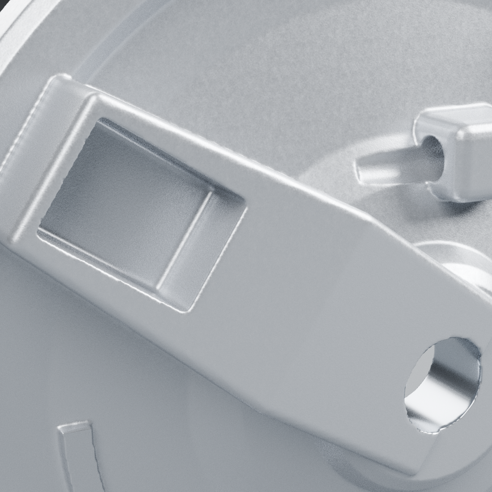
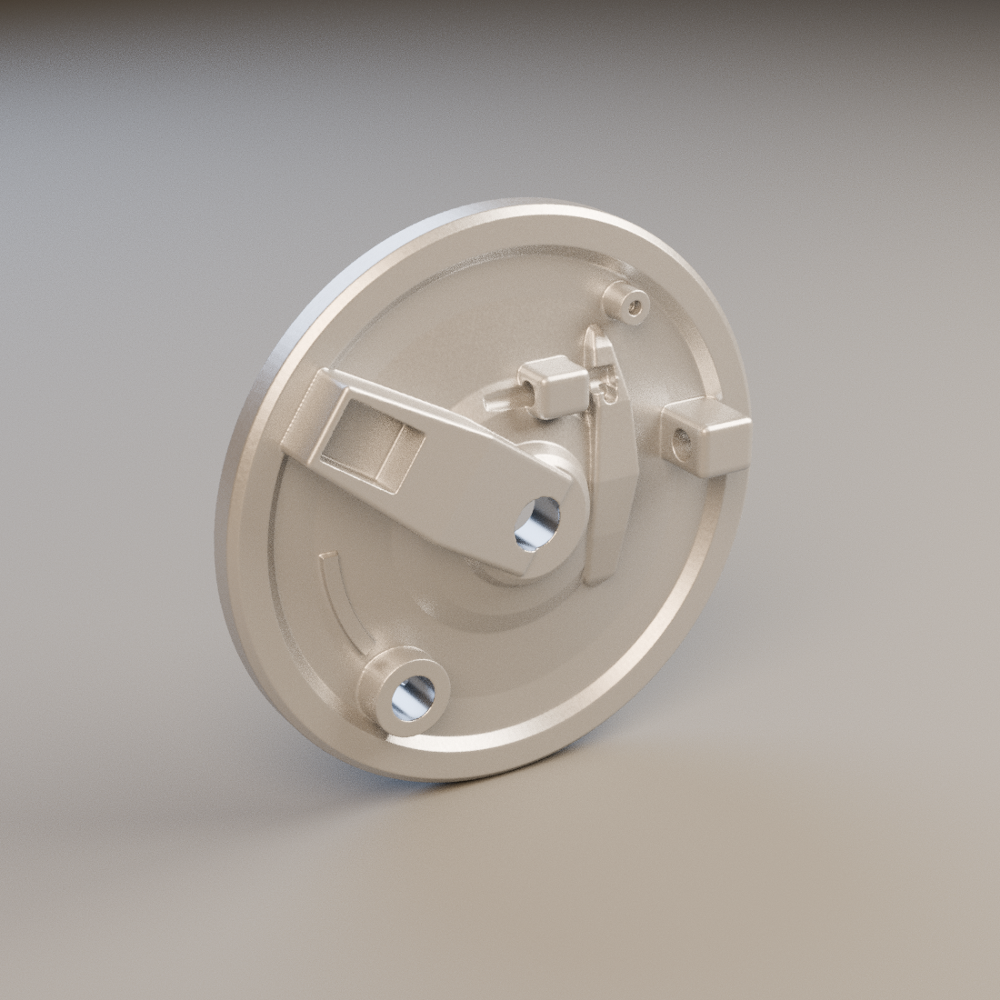
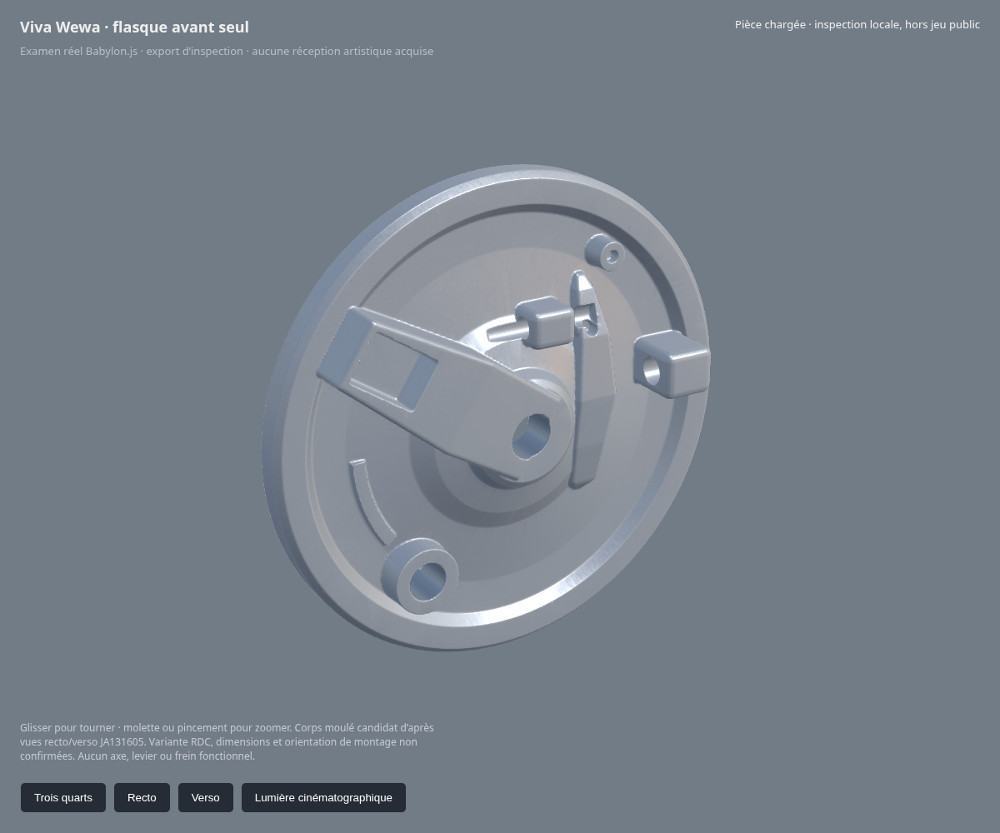

# Flasque avant — révision matière v2

**Rendus réels Blender/Cycles, pas une image générée du jeu.** La géométrie v1 est conservée ; cette révision travaille la matière argentée et la continuité des données vers Babylon.js. Aucune réception artistique acquise.

Les nouvelles cartes originales contiennent un relief microscopique périodique et une rugosité variable. Leur tuile couvre 10 mm ; le champ de hauteur a un écart-type d’environ 1,52 µm. Ce sont des estimations artistiques, sans mesure de la fonderie réelle. Les alésages gardent une matière usinée distincte. Aucun pixel de photographie constructeur ou vendeur n’est utilisé comme texture.

Le [contrôle des cartes](material-parity-check.json) compare les pixels des PNG sources aux images réellement incluses dans le GLB : mêmes valeurs, mêmes canaux et intensité normale 0,65. Le chargement des deux textures dans Babylon.js est vérifié. Cela prouve le transfert des données ; les lumières et le rendu des deux logiciels diffèrent, et leur équivalence visuelle reste à examiner. La projection UV par faces peut laisser des raccords locaux à corriger. Le GLB conserve une alerte sur le repère tangent calculé par le moteur ; sa portabilité reste à vérifier. Les gros plans montrent aussi des contours encore facettés sur certains alésages et du bruit de rendu Cycles : le détail de fonderie et l’usinage restent à reprendre.

Le [contrôle source](source-geometry-check.json) retrouve une seule coque fermée, les passages ouverts et aucun croisement des surfaces avec le moyeu candidat. Le [contrôle glTF](geometry-check.json) vérifie les deux exports. Les vues recto et verso sont disponibles dans [front.png](front.png) et [rear.png](rear.png). Les preuves de [v1](../front-brake-plate-v1/README.md) restent intactes.

La variante RDC, les dimensions du flasque, la profondeur des reliefs, l’orientation installée et la calibration photographique restent ouvertes. Cette révision n’est ni un frein fonctionnel, ni un LOD mobile reçu, ni un test Safari sur iPhone physique. La moto complète et son conducteur ne sont pas fabriqués.

Source : [front-brake-plate-v2.blend](../../../assets-src/moto-components/front-brake-plate/front-brake-plate-v2.blend). Reconstruction matière : [material_v2.py](../../../assets-src/moto-components/front-brake-plate/material_v2.py). Les volumes et modificateurs v1 sont retenus cachés ; la surface visible évaluée reçoit les UV pour la matière v2.
