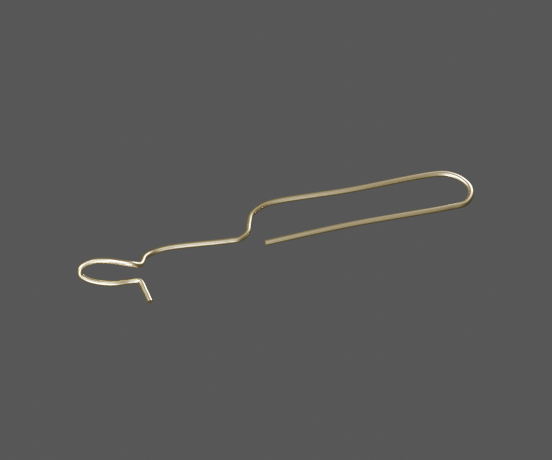
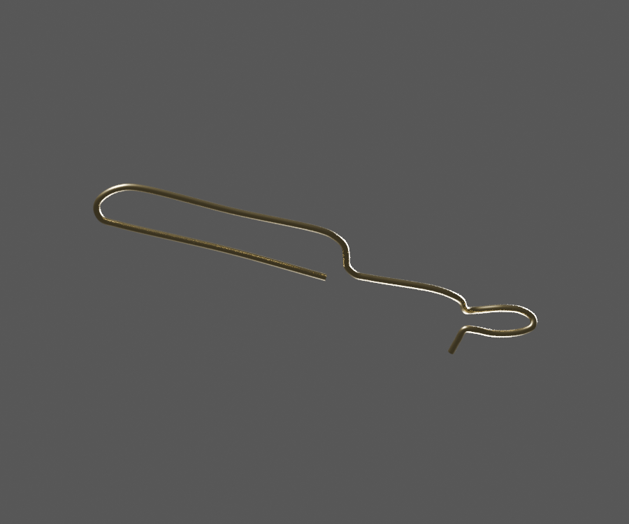
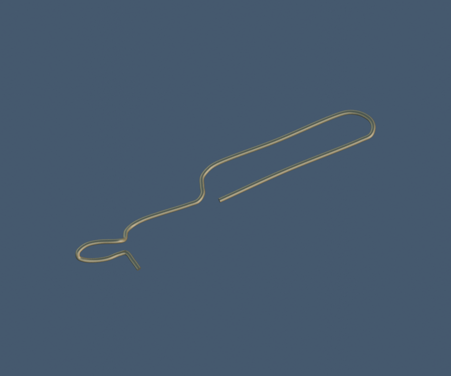

# P03 — Related DF191020 single continuous formed-wire cable guide

[Source Blender](../../../assets-src/moto-components/front-completion-p03-wire-guide-front12-v2/wire-guide-material.blend) · [GLB](../../../assets-src/moto-components/front-completion-p03-wire-guide-front12-v2/wire-guide-material.glb) · [Dossier](../../../creative/research/front-completion-p03-wire-guide-front12-v2-coordination-v1/G0-G2-plan-v1.json) · [Étude auteur](../front-completion-p03-wire-guide-front12-v2/delivery.json)

[Source rouverte](source-geometry-check.json), [export réel](export-buffer-check.json), [rendus96 associés à la source figée](render-report.json), [EXR FLOAT32](raw-render-check.json), [quatre vues Babylon de coordination](inspection-v5/engine-check.json), [lecture réelle](coordinator-review.json), [manifestes](production-manifest.json). Les images et rapports auteur restent inchangés. Leur association à la source est vérifiée dans le lot figé. Une éventuelle vue indépendante `coordination-neutral` est identifiée séparément avec sa provenance ; elle ne modifie pas la source.

Guide DF191020 : un fil continu avec boucle et retour distincts, relu sous neutre et moteur. Coudes 3D, station montée, clips et contact restent estimés.

Les dimensions et interfaces restent estimées. Aucune réception artistique ou qualification matérielle n’est transmise. Le paquet reste ouvert pour ses enfants et raccords manquants.
