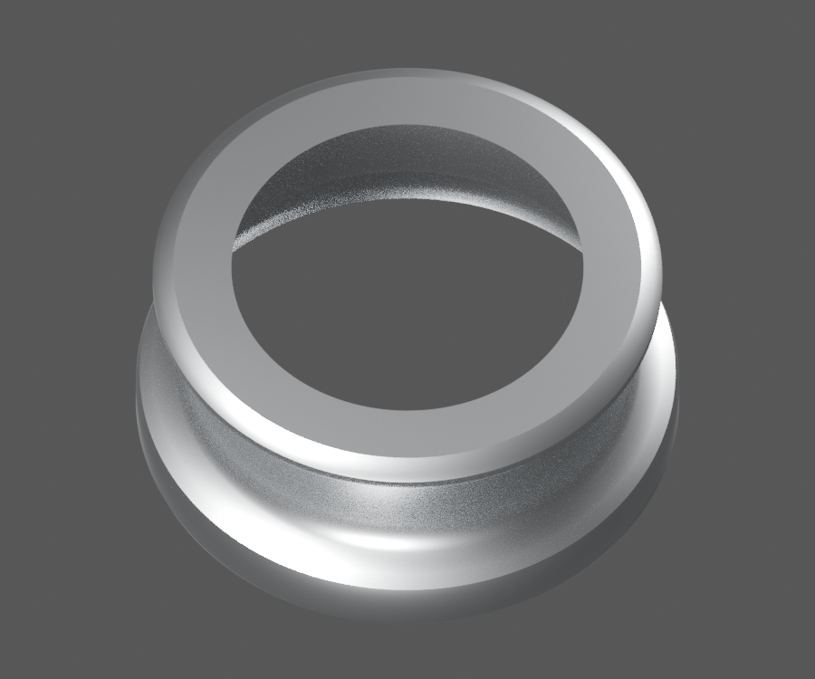
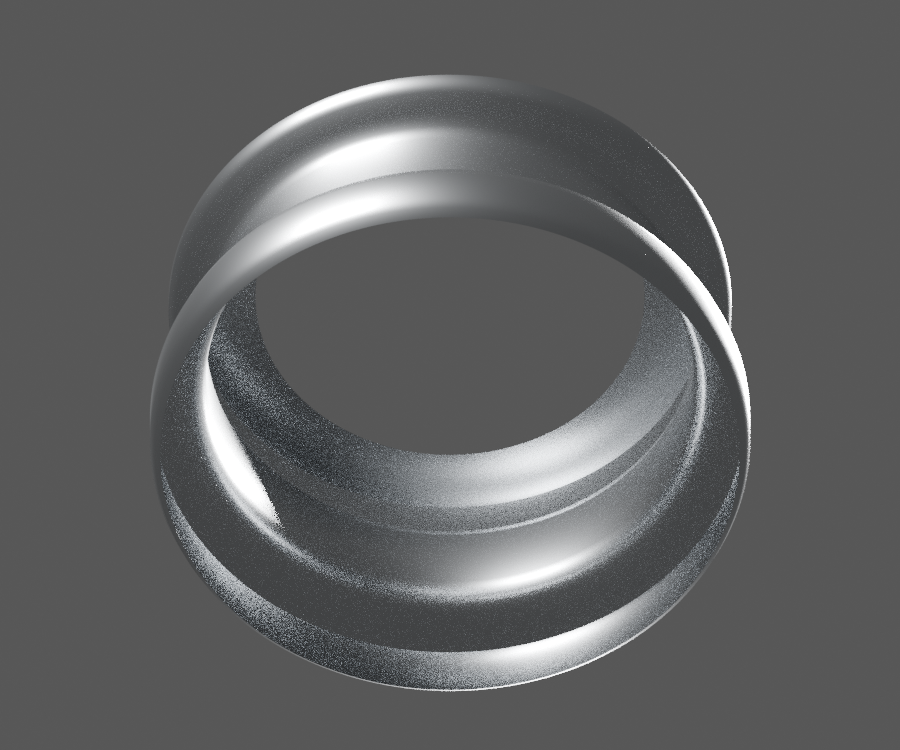
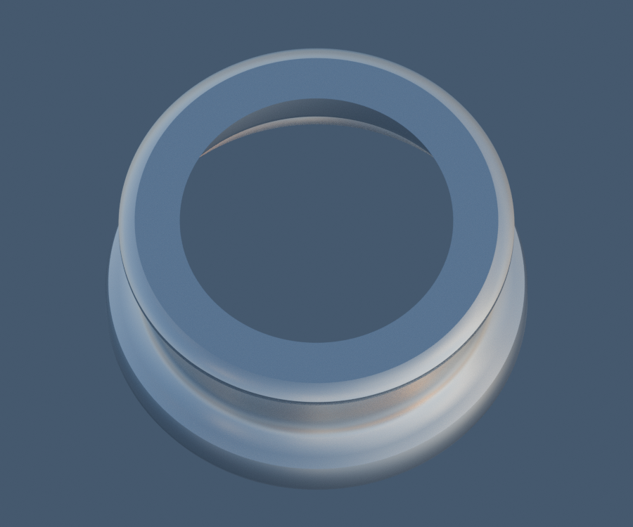

# P06 — CL201023 stepped metal bulb-base exterior envelope

[Source Blender](../../../assets-src/moto-components/front-completion-p06-bulb-base-front16-v1/bulb-base-material.blend) · [GLB](../../../assets-src/moto-components/front-completion-p06-bulb-base-front16-v1/bulb-base-material.glb) · [Dossier](../../../creative/research/front-completion-p06-bulb-base-front16-v1-coordination-v1/G0-G2-plan-v1.json) · [Étude auteur](../front-completion-p06-bulb-base-front16-v1/delivery.json)

[Source rouverte](source-geometry-check.json), [export réel](export-buffer-check.json), [rendus96 associés à la source figée](render-report.json), [EXR FLOAT32](raw-render-check.json), [quatre vues Babylon de coordination](inspection-v5/engine-check.json), [lecture réelle](coordinator-review.json), [manifestes](production-manifest.json). Les images et rapports auteur restent inchangés. Leur association à la source est vérifiée dans le lot figé. Une éventuelle vue indépendante `coordination-neutral` est identifiée séparément avec sa provenance ; elle ne modifie pas la source.

Base métallique d’ampoule CL201023 : enveloppe externe étagée relue en trois natifs96 et Babylon. Deux coupes de revue ; rebord de sertissage local non résolu reste omis. Ni contacts, isolant, capsule ni jonction cachée ou interface montée ne sont reçus.

Les dimensions et interfaces restent estimées. Aucune réception artistique ou qualification matérielle n’est transmise. Le paquet reste ouvert pour ses enfants et raccords manquants.
