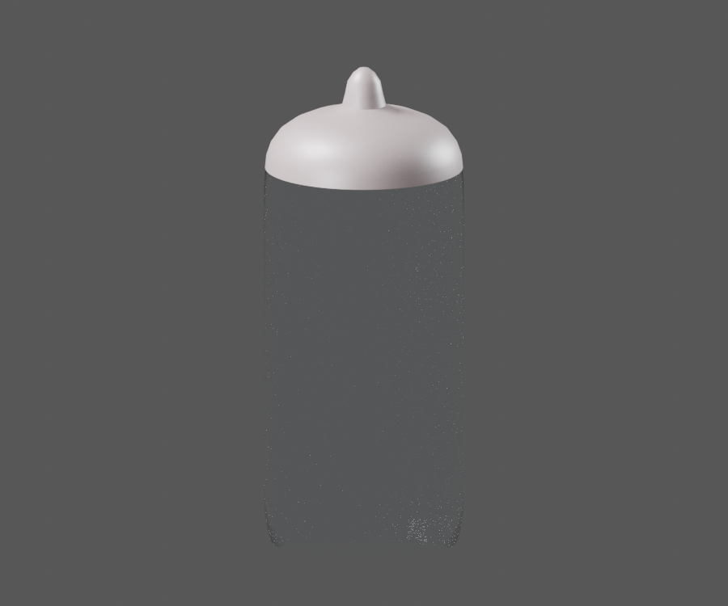
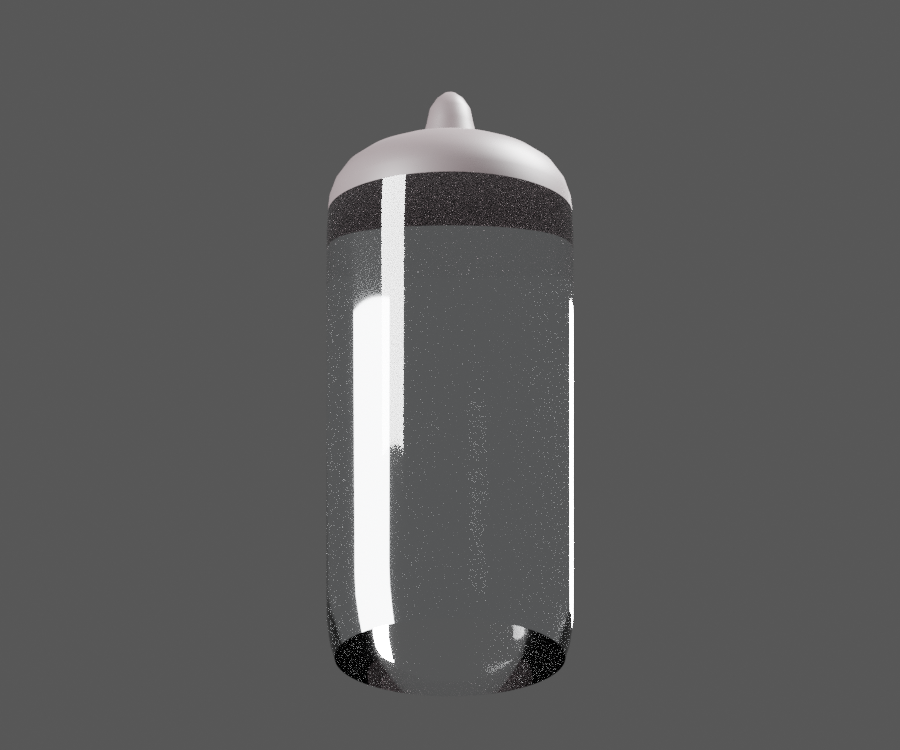
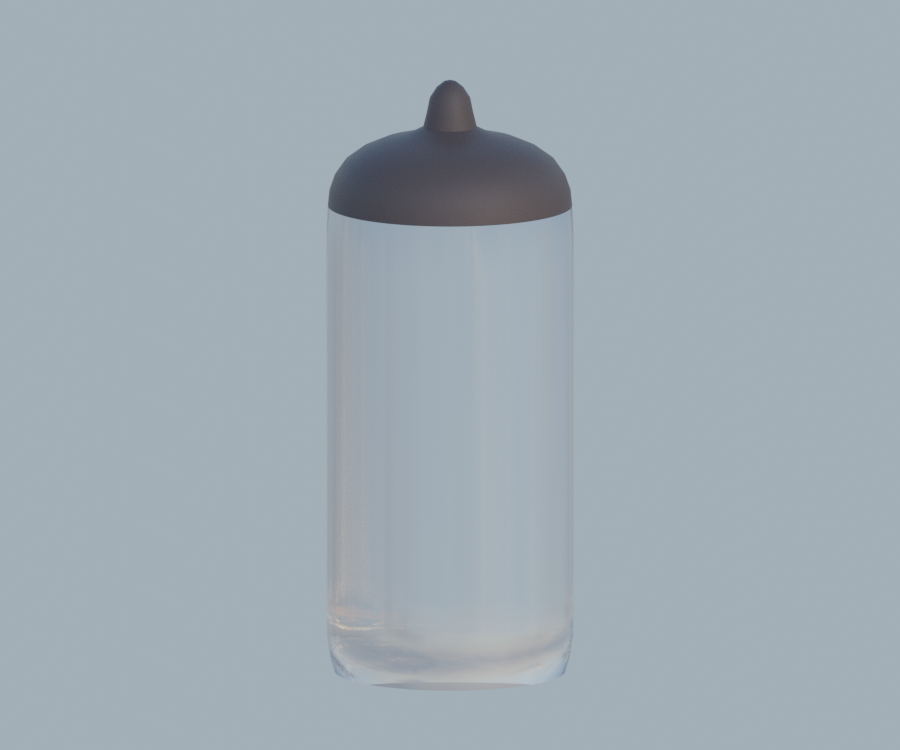

# P06 — CL201023 HS1 observed capsule exterior with opaque tip

[Source Blender](../../../assets-src/moto-components/front-completion-p06-bulb-capsule-front15-v1/bulb-capsule-material.blend) · [GLB](../../../assets-src/moto-components/front-completion-p06-bulb-capsule-front15-v1/bulb-capsule-material.glb) · [Dossier](../../../creative/research/front-completion-p06-bulb-capsule-front15-v1-coordination-v1/G0-G2-plan-v1.json) · [Étude auteur](../front-completion-p06-bulb-capsule-front15-v1/delivery.json)

[Source rouverte](source-geometry-check.json), [export réel](export-buffer-check.json), [rendus96 associés à la source figée](render-report.json), [EXR FLOAT32](raw-render-check.json), [quatre vues Babylon de coordination](inspection-v5/engine-check.json), [lecture réelle](coordinator-review.json), [manifestes](production-manifest.json). Les images et rapports auteur restent inchangés. Leur association à la source est vérifiée dans le lot figé. Une éventuelle vue indépendante `coordination-neutral` est identifiée séparément avec sa provenance ; elle ne modifie pas la source.

Capsule CL201023 : silhouette du tube, coiffe opaque et pointe relues dans trois natifs matière96 et Babylon. Verre presque invisible et bruité dans un studio ; neutre lisible, Babylon plus sombre. Cet écart de matériau/éclairage reste ouvert, sans parité photométrique ni réceptionG4. Une seule peau extérieure, sans paroi interne ou filament inventé ; coupe basse de revue, pas une ampoule complète.

Les dimensions et interfaces restent estimées. Aucune réception artistique ou qualification matérielle n’est transmise. Le paquet reste ouvert pour ses enfants et raccords manquants.
