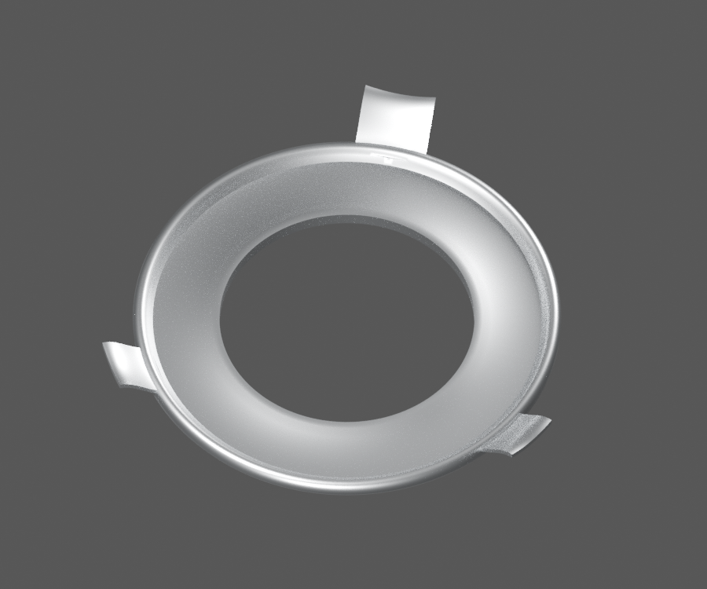
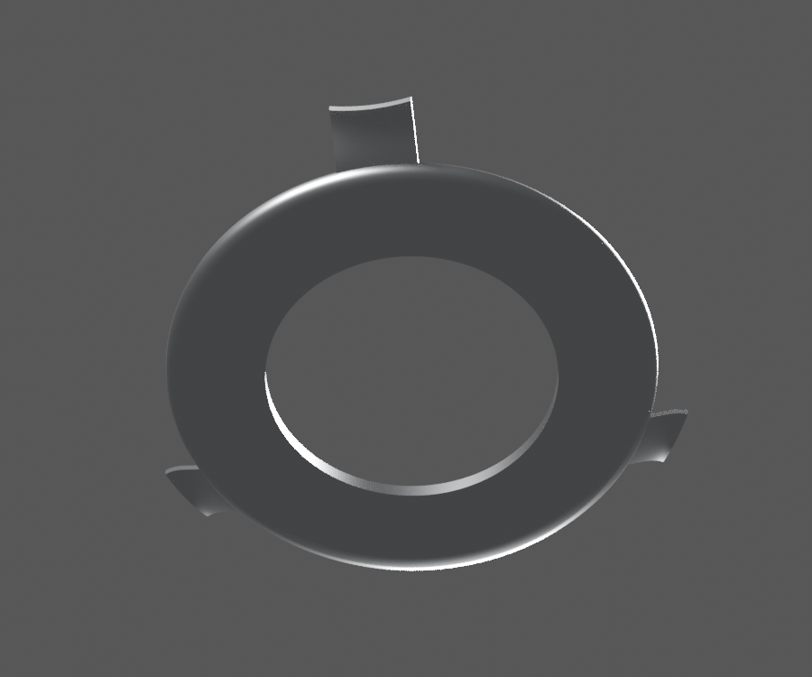
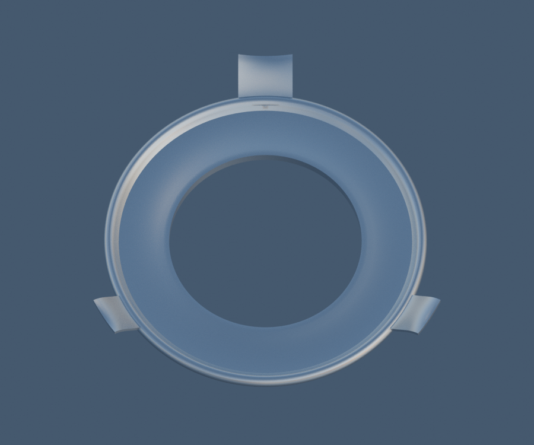

# P06 — CL201023 HS1 bulb three-ear stamped locating flange

[Source Blender](../../../assets-src/moto-components/front-completion-p06-bulb-flange-front15-v2/bulb-flange-material.blend) · [GLB](../../../assets-src/moto-components/front-completion-p06-bulb-flange-front15-v2/bulb-flange-material.glb) · [Dossier](../../../creative/research/front-completion-p06-bulb-flange-front15-v2-coordination-v1/G0-G2-plan-v1.json) · [Étude auteur](../front-completion-p06-bulb-flange-front15-v2/delivery.json)

[Source rouverte](source-geometry-check.json), [export réel](export-buffer-check.json), [rendus96 associés à la source figée](render-report.json), [EXR FLOAT32](raw-render-check.json), [quatre vues Babylon de coordination](inspection-v5/engine-check.json), [lecture réelle](coordinator-review.json), [manifestes](production-manifest.json). Les images et rapports auteur restent inchangés. Leur association à la source est vérifiée dans le lot figé. Une éventuelle vue indépendante `coordination-neutral` est identifiée séparément avec sa provenance ; elle ne modifie pas la source.

Collerette CL201023/HS1 : trois oreilles différentes avec courbures de travail, lèvre roulée et annulus déprimé relus dans les trois natifs matière96 et Babylon réel. Les vues grises seulesv1 restent refusées. Capsule, contacts, filament et raccord au socket ne sont pas livrés ; cotes, jauge et rayons ne sont pas OEM.

Les dimensions et interfaces restent estimées. Aucune réception artistique ou qualification matérielle n’est transmise. Le paquet reste ouvert pour ses enfants et raccords manquants.
