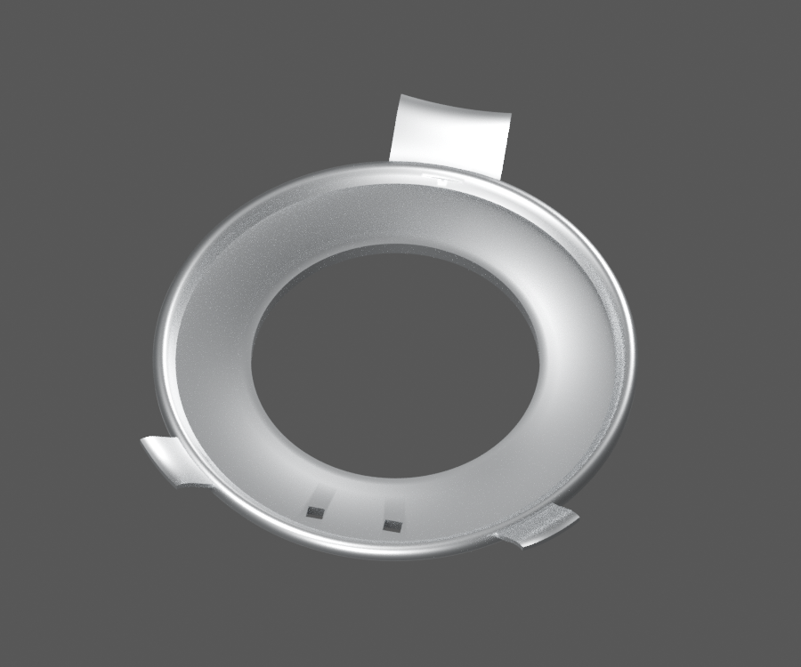
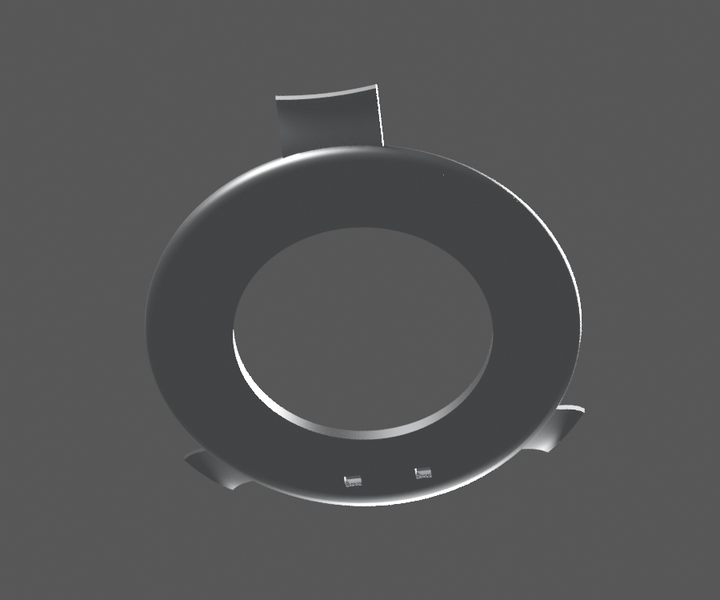
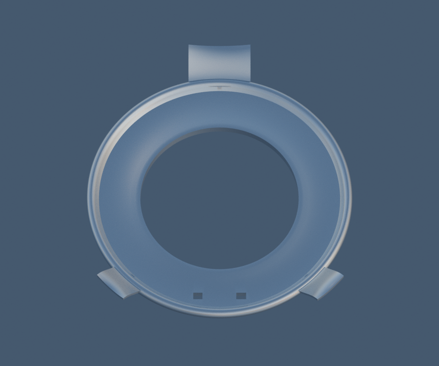

# P06 — CL201023 HS1 bulb three-ear stamped locating flange

[Source Blender](../../../assets-src/moto-components/front-completion-p06-bulb-flange-front15-v4/bulb-flange-material.blend) · [GLB](../../../assets-src/moto-components/front-completion-p06-bulb-flange-front15-v4/bulb-flange-material.glb) · [Dossier](../../../creative/research/front-completion-p06-bulb-flange-front15-v4-coordination-v1/G0-G2-plan-v1.json) · [Étude auteur](../front-completion-p06-bulb-flange-front15-v4/delivery.json)

[Source rouverte](source-geometry-check.json), [export réel](export-buffer-check.json), [rendus96 associés à la source figée](render-report.json), [EXR FLOAT32](raw-render-check.json), [quatre vues Babylon de coordination](inspection-v5/engine-check.json), [lecture réelle](coordinator-review.json), [manifestes](production-manifest.json). Les images et rapports auteur restent inchangés. Leur association à la source est vérifiée dans le lot figé. Une éventuelle vue indépendante `coordination-neutral` est identifiée séparément avec sa provenance ; elle ne modifie pas la source.

Collerette réviséev4 : oreilles90/225/315degrés, grande clé et deux petites, plus deux fenêtres réellement ajourées, relues en trois natifs96 et Babylon. V2 aux oreilles presque120degrés demeure figée mais dépassée pour cette géométrie. La vue de classe CEC HS1/PX43t corrige la répartition ; elle ne certifie ni cintrage, jauge, dimensions exactes ni appairage du donneur actuel.

Les dimensions et interfaces restent estimées. Aucune réception artistique ou qualification matérielle n’est transmise. Le paquet reste ouvert pour ses enfants et raccords manquants.
