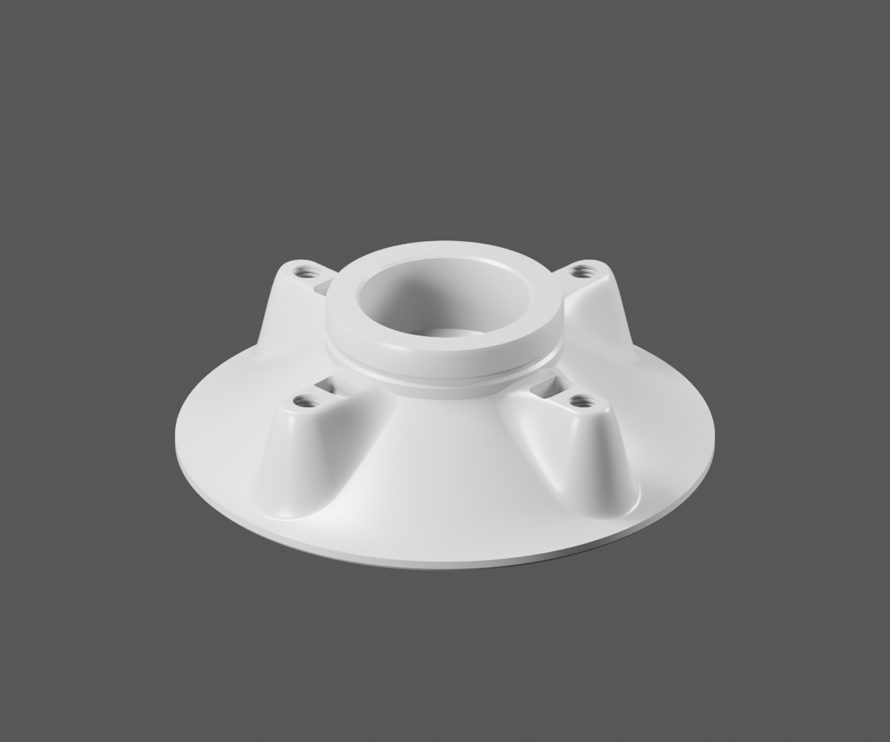
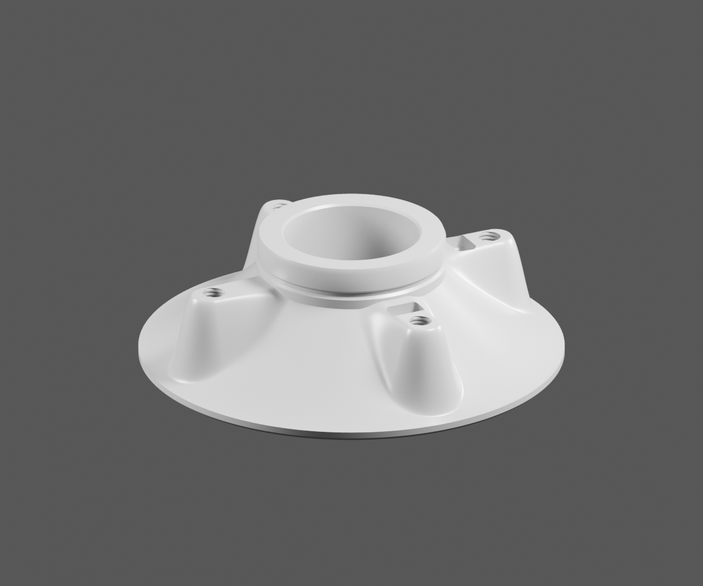
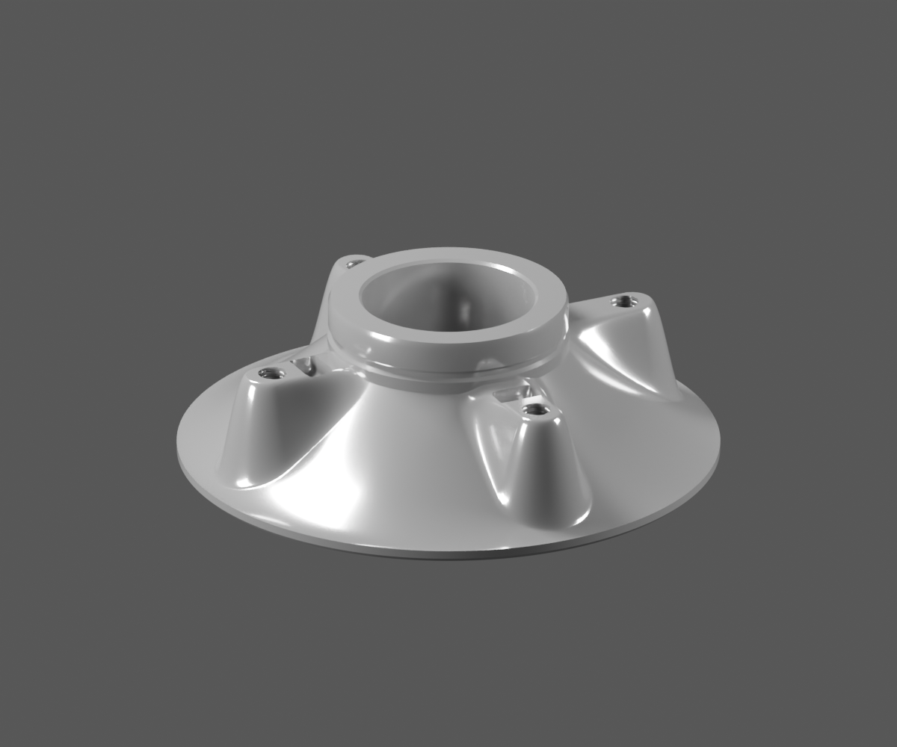
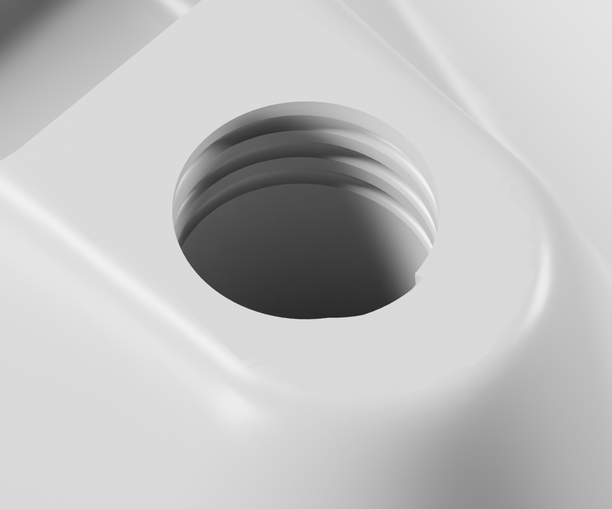

# P21 — MOTO-REAR-CARRIER-DS151068-STUDY-001

[Source Blender](../../../assets-src/moto-components/front-completion-p21-carrier-v3/carrier-gray.blend) · [GLB](../../../assets-src/moto-components/front-completion-p21-carrier-v3/carrier-gray.glb) · [Dossier](../../../creative/research/front-completion-p21-carrier-v3-coordination-v1/G0-G2-plan-v1.json) · [Étude auteur](../front-completion-p21-carrier-v3/delivery.json)

[Source rouverte](source-geometry-check.json), [export réel](export-buffer-check.json), [rendus96 associés à la source figée](render-report.json), [EXR FLOAT32](raw-render-check.json), [quatre vues Babylon de coordination](inspection-v5/engine-check.json), [lecture réelle](coordinator-review.json), [manifestes](production-manifest.json). Les images et rapports auteur restent inchangés. Leur association à la source est vérifiée dans le lot figé. Une éventuelle vue indépendante `coordination-neutral` est identifiée séparément avec sa provenance ; elle ne modifie pas la source.

Étude G3 grise du porte-couronne DS151068 apparenté: coupelle, quatre bossages, trois poches lisibles et relief des bouches relus. La vue appelée gray-reverse montre l’autre trois-quarts avant, pas le revers réel. Revers et interface roue non produits; matière v3 retenue en G4 rework, non admise comme matière finie.

Les dimensions et interfaces restent estimées. Aucune réception artistique ou qualification matérielle n’est transmise. Le paquet reste ouvert pour ses enfants et raccords manquants.
