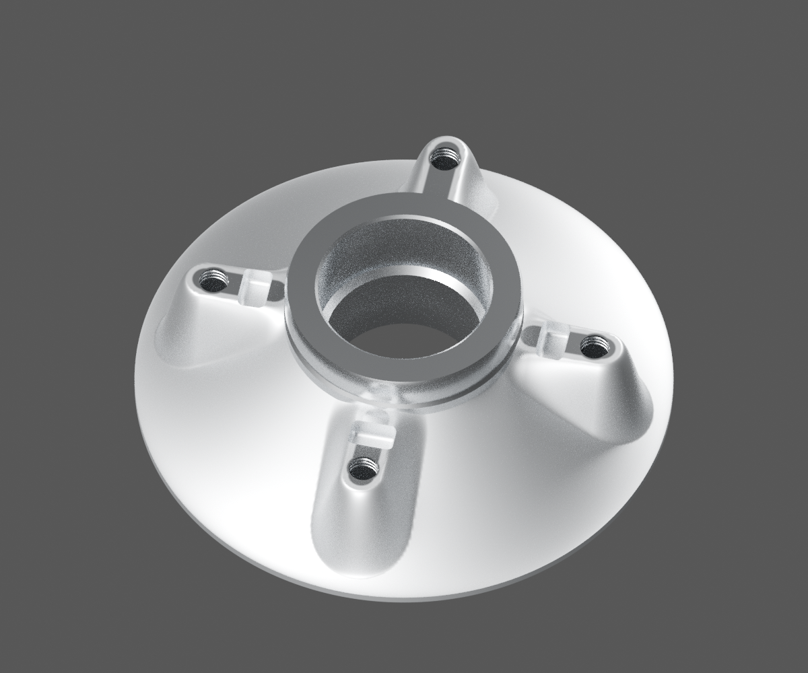
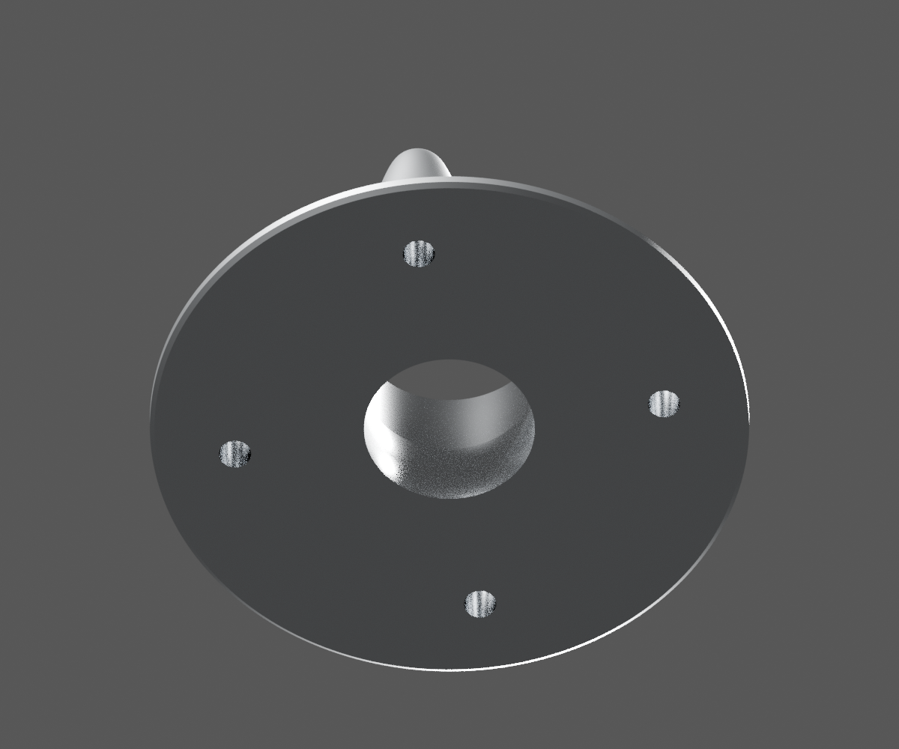
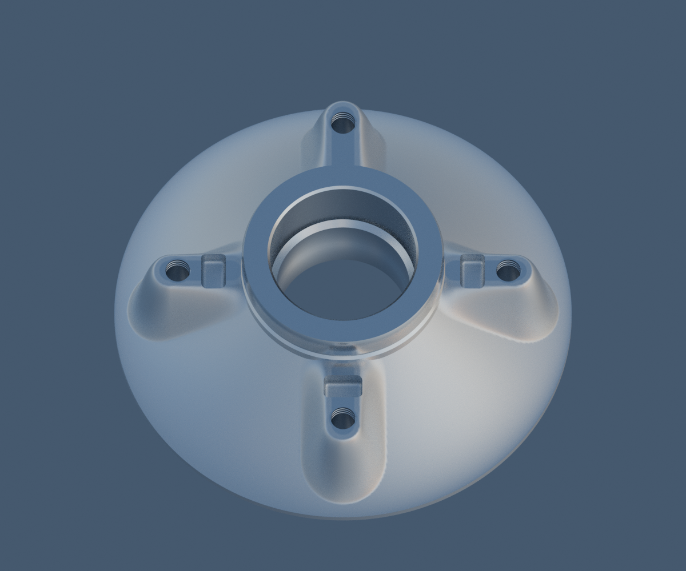
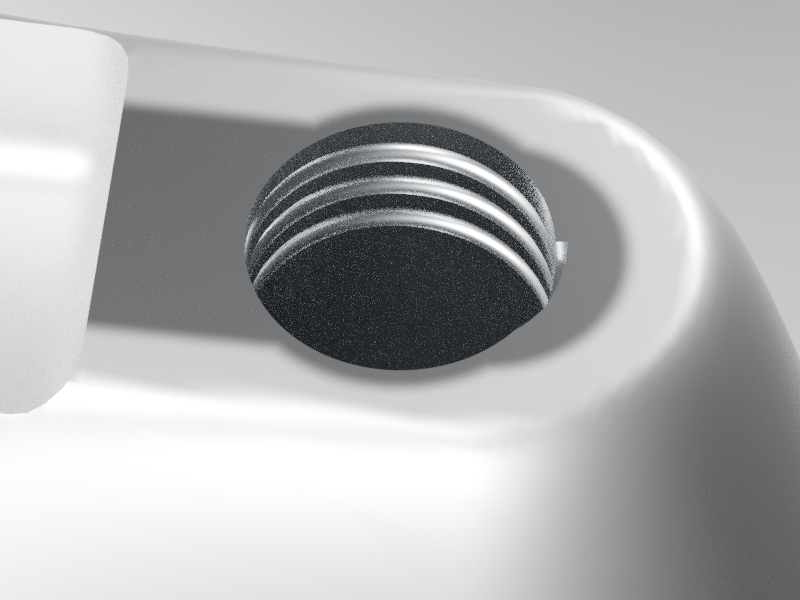
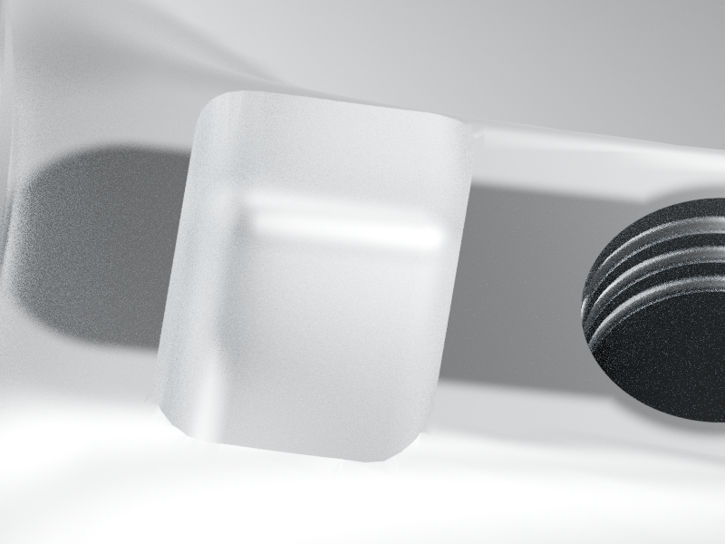

# P21 — Existing related DS151068 front: source normal and scalar roughness correction candidate

[Source Blender](../../../assets-src/moto-components/front-completion-p21-front-material-front10-v5/carrier-material.blend) · [GLB](../../../assets-src/moto-components/front-completion-p21-front-material-front10-v5/carrier-material.glb) · [Dossier](../../../creative/research/front-completion-p21-front-material-front10-v5-coordination-v1/G0-G2-plan-v1.json) · [Étude auteur](../front-completion-p21-front-material-front10-v5/delivery.json)

[Source rouverte](source-geometry-check.json), [export réel](export-buffer-check.json), [rendus96 associés à la source figée](render-report.json), [EXR FLOAT32](raw-render-check.json), [quatre vues Babylon de coordination](inspection-v5/engine-check.json), [lecture réelle](coordinator-review.json), [manifestes](production-manifest.json). Les images et rapports auteur restent inchangés. Leur association à la source est vérifiée dans le lot figé. Une éventuelle vue indépendante `coordination-neutral` est identifiée séparément avec sa provenance ; elle ne modifie pas la source.

Face avant existante : nouvelle correction de normales et atlas scalaire de rugosité, sans refaire les positions. Entrées de filet et reliefs relus en macro ; une mince face source d’environ1µm conserve trois faibles produits normales/faces, documentés par l’auteur. Front-material-v4 refusé et ancienne matière-v3 en reprise restent conservés. Pas de réception de matière, montage ou coût mobile.

Les dimensions et interfaces restent estimées. Aucune réception artistique ou qualification matérielle n’est transmise. Le paquet reste ouvert pour ses enfants et raccords manquants.
