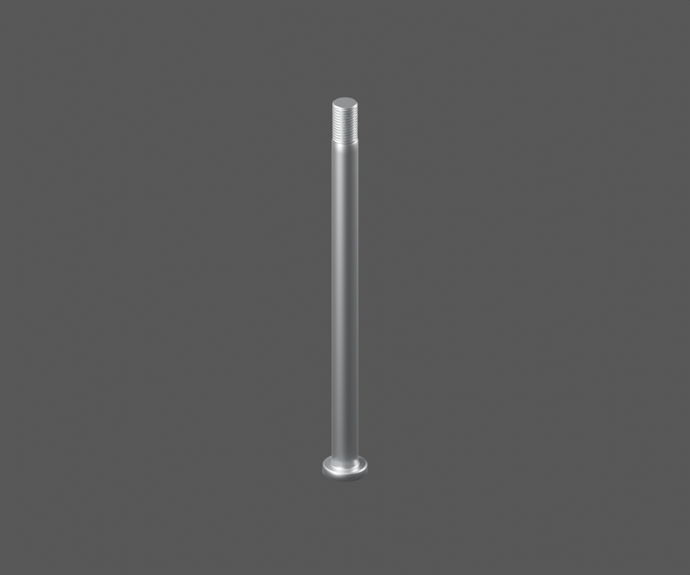
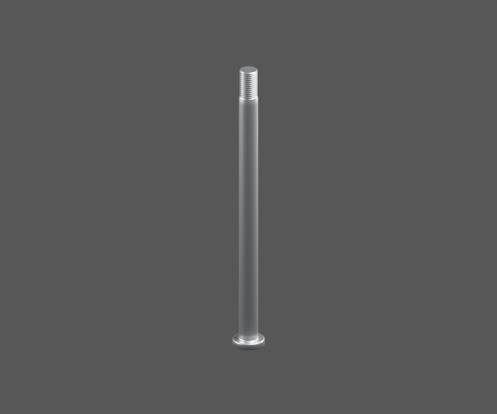
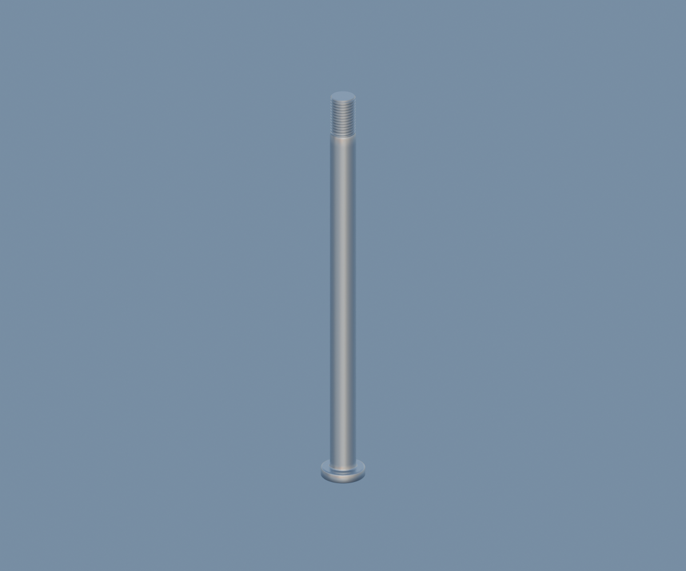

# P24 — front-completion-p24-axle-material-v1 — bounded appearance study

[Source Blender](../../../assets-src/moto-components/front-completion-p24-axle-material-v1/material.blend) · [GLB](../../../assets-src/moto-components/front-completion-p24-axle-material-v1/material.glb) · [Dossier](../../../creative/research/front-completion-p24-axle-material-v1-coordination-v1/G0-G2-plan-v1.json) · [Étude auteur](../front-completion-p24-axle-material-v1/delivery.json)

[Source rouverte](source-geometry-check.json), [export réel](export-buffer-check.json), [rendus96 associés à la source figée](render-report.json), [EXR FLOAT32](raw-render-check.json), [quatre vues Babylon de coordination](inspection-v5/engine-check.json), [lecture réelle](coordinator-review.json), [manifestes](production-manifest.json). Les images et rapports auteur restent inchangés. Leur association à la source est vérifiée dans le lot figé. Une éventuelle vue indépendante `coordination-neutral` est identifiée séparément avec sa provenance ; elle ne modifie pas la source.

Axe extérieur DJ151041 apparenté, corps cylindrique, collerette et hélice relus. Pas, diamètre et longueur restent estimés; branche DZ151012 et montage RDC non résolus. Face cachée de tête sans empreinte inventée.

Les dimensions et interfaces restent estimées. Aucune réception artistique ou qualification matérielle n’est transmise. Le paquet reste ouvert pour ses enfants et raccords manquants.
