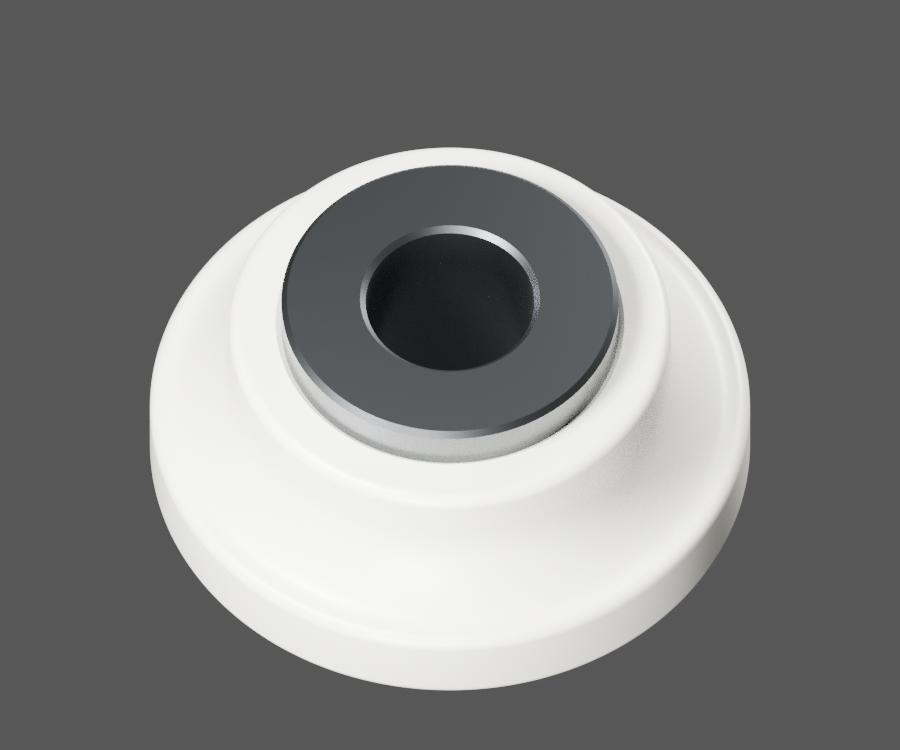
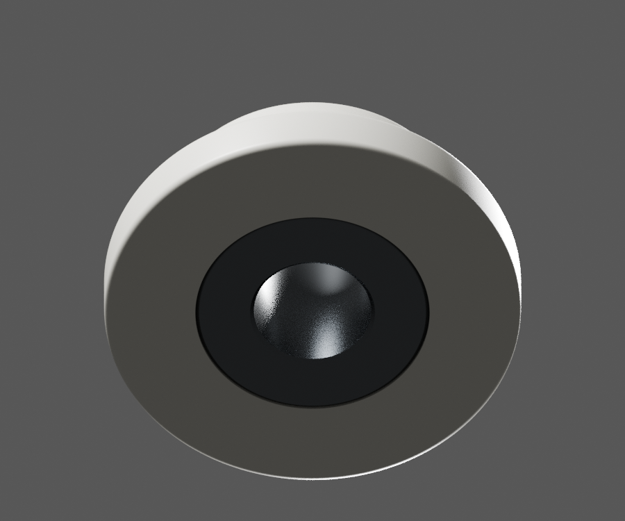
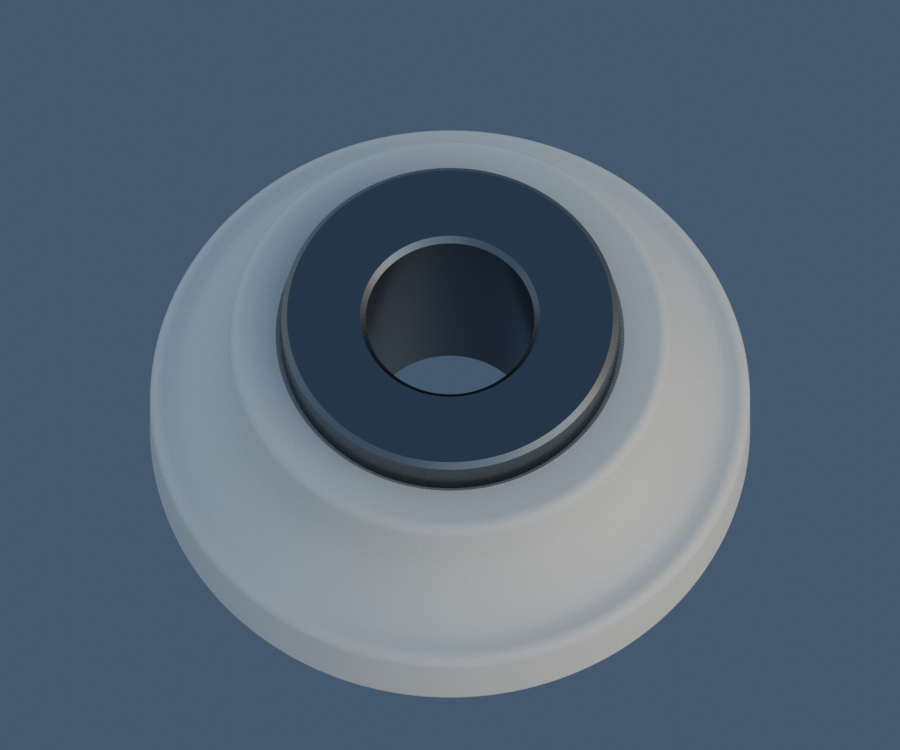

# P24 — Related4gear DU151005 collar and exposed sleeve exterior

[Source Blender](../../../assets-src/moto-components/front-completion-p24-related-collar-front12-v1/front-collar-material.blend) · [GLB](../../../assets-src/moto-components/front-completion-p24-related-collar-front12-v1/front-collar-material.glb) · [Dossier](../../../creative/research/front-completion-p24-related-collar-front12-v1-coordination-v1/G0-G2-plan-v1.json) · [Étude auteur](../front-completion-p24-related-collar-front12-v1/delivery.json)

[Source rouverte](source-geometry-check.json), [export réel](export-buffer-check.json), [rendus96 associés à la source figée](render-report.json), [EXR FLOAT32](raw-render-check.json), [quatre vues Babylon de coordination](inspection-v5/engine-check.json), [lecture réelle](coordinator-review.json), [manifestes](production-manifest.json). Les images et rapports auteur restent inchangés. Leur association à la source est vérifiée dans le lot figé. Une éventuelle vue indépendante `coordination-neutral` est identifiée séparément avec sa provenance ; elle ne modifie pas la source.

Collier DU151005 apparenté quatre rapports : deux matériaux et passage axial visibles. Ne remplace pas la référence UG DS151061 ; sections et empilage montés ouverts.

Les dimensions et interfaces restent estimées. Aucune réception artistique ou qualification matérielle n’est transmise. Le paquet reste ouvert pour ses enfants et raccords manquants.
