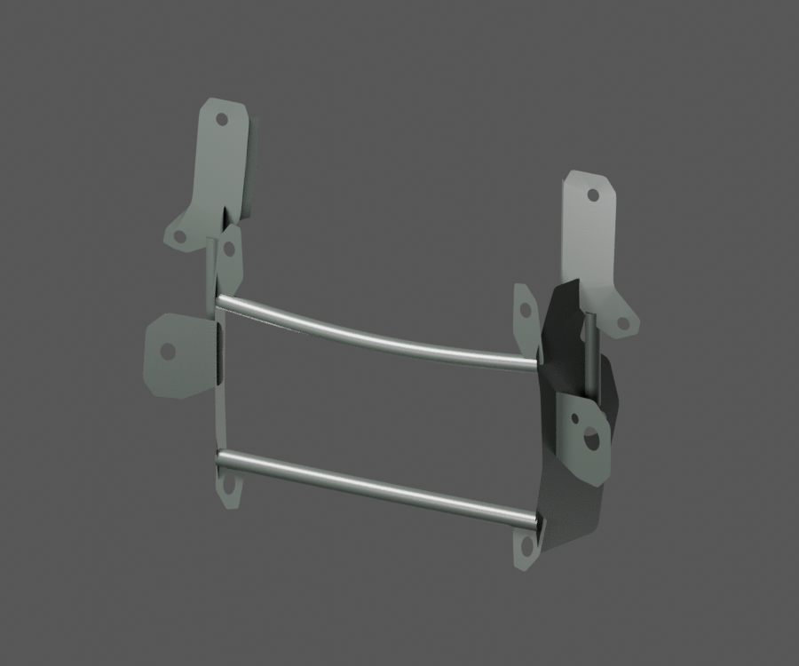
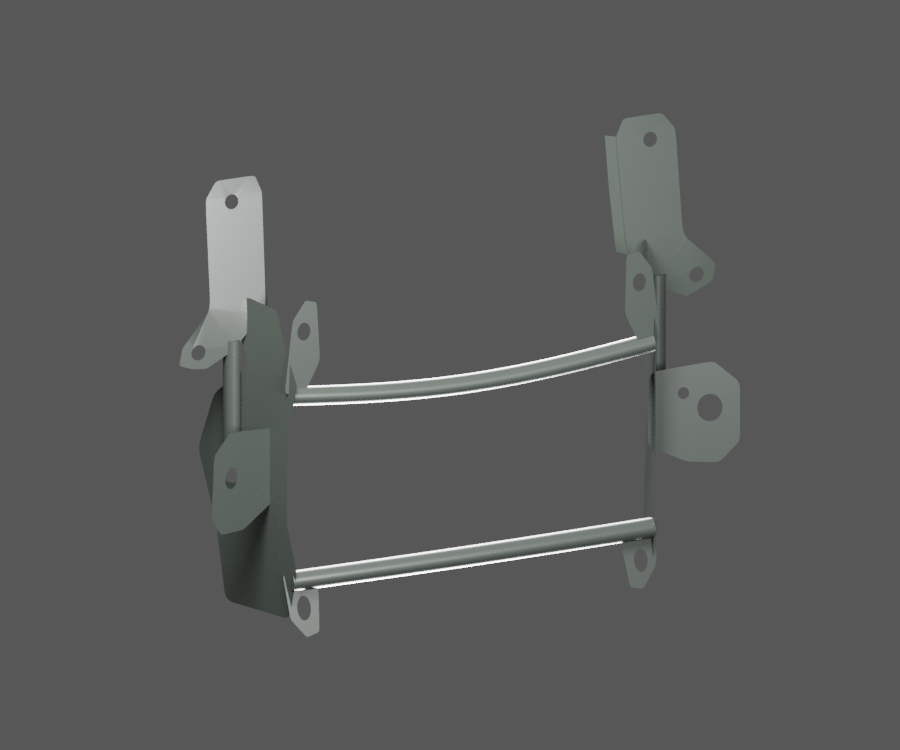
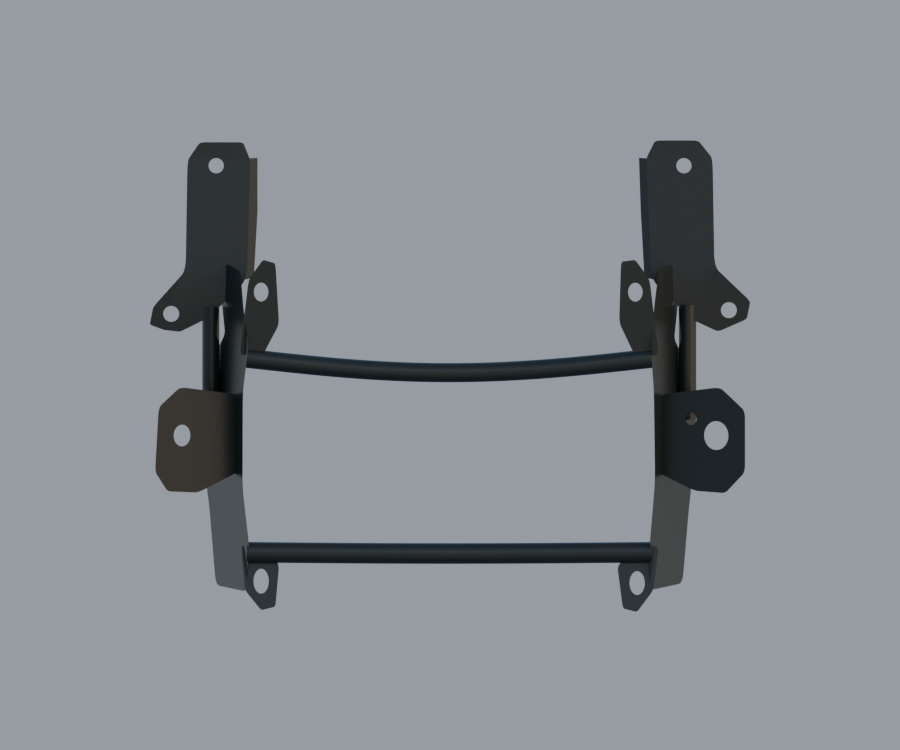
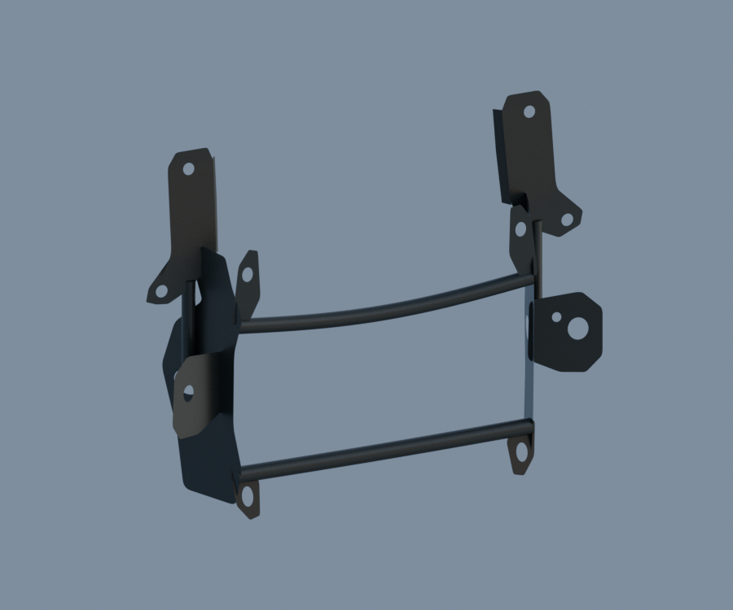

# P25 — PF121025 visible fairing structure two-pose exterior study

[Source Blender](../../../assets-src/moto-components/front-completion-p25-fairing-structure-front20-v2/fairing-structure-material.blend) · [GLB](../../../assets-src/moto-components/front-completion-p25-fairing-structure-front20-v2/fairing-structure-material.glb) · [Dossier](../../../creative/research/front-completion-p25-fairing-structure-front20-v2-coordination-v1/G0-G2-plan-v1.json) · [Étude auteur](../front-completion-p25-fairing-structure-front20-v2/delivery.json)

[Source rouverte](source-geometry-check.json), [export réel](export-buffer-check.json), [rendus96 associés à la source figée](render-report.json), [EXR FLOAT32](raw-render-check.json), [quatre vues Babylon de coordination](inspection-v5/engine-check.json), [lecture réelle](coordinator-review.json), [manifestes](production-manifest.json). Les images et rapports auteur restent inchangés. Leur association à la source est vérifiée dans le lot figé. Une éventuelle vue indépendante `coordination-neutral` est identifiée séparément avec sa provenance ; elle ne modifie pas la source.

Structure PF121025 : deux traverses observées dont celle du haut courbe, pattes et plis visibles indépendants, véritables ouvertures. Quatre natifs96 dont deux neutres et Babylon relus. Les vues studio éclaircissent fortement le noir ; les vues neutres en permettent une meilleure lecture, sans finition mesurée. Les tôles restent des surfaces visibles sans dos ni épaisseur cachée inventés ; visualisation double face ne vaut pas preuve du revers. Pas de soudure masquée, grommet, boulon ni montage certifié au support PF121024 ou au carénage RDC. Candidat distinct et complémentaire, pas un remplacement de024.

Les dimensions et interfaces restent estimées. Aucune réception artistique ou qualification matérielle n’est transmise. Le paquet reste ouvert pour ses enfants et raccords manquants.
