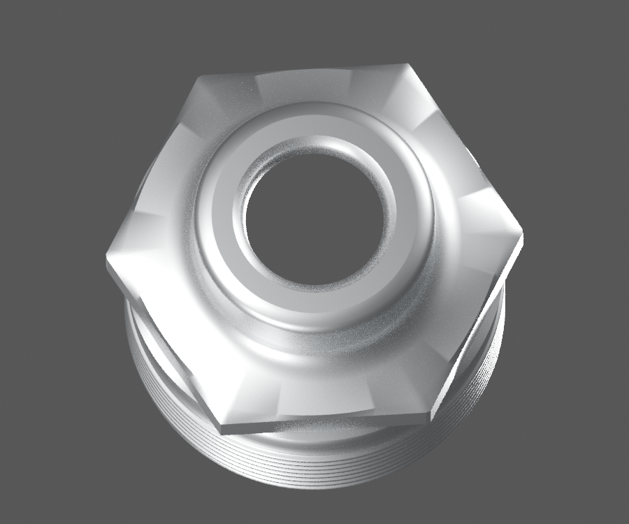
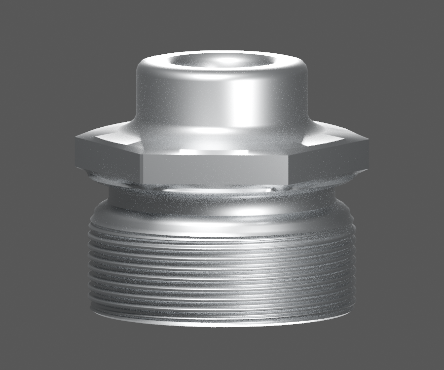
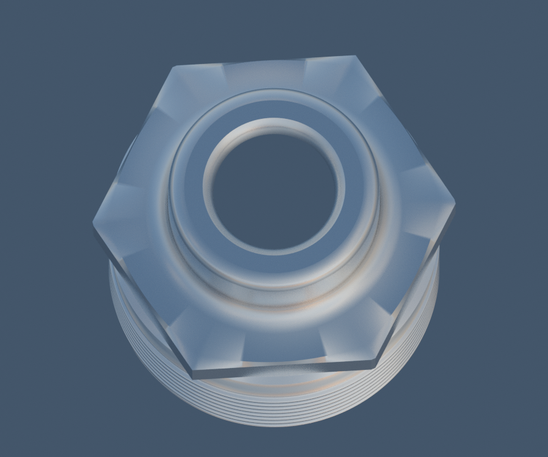

# P25 — DS181012 single fork-leg shouldered plug visible exterior study

[Source Blender](../../../assets-src/moto-components/front-completion-p25-fork-plug-front21-v2/fork-plug-material.blend) · [GLB](../../../assets-src/moto-components/front-completion-p25-fork-plug-front21-v2/fork-plug-material.glb) · [Dossier](../../../creative/research/front-completion-p25-fork-plug-front21-v2-coordination-v1/G0-G2-plan-v1.json) · [Étude auteur](../front-completion-p25-fork-plug-front21-v2/delivery.json)

[Source rouverte](source-geometry-check.json), [export réel](export-buffer-check.json), [rendus96 associés à la source figée](render-report.json), [EXR FLOAT32](raw-render-check.json), [quatre vues Babylon de coordination](inspection-v5/engine-check.json), [lecture réelle](coordinator-review.json), [manifestes](production-manifest.json). Les images et rapports auteur restent inchangés. Leur association à la source est vérifiée dans le lot figé. Une éventuelle vue indépendante `coordination-neutral` est identifiée séparément avec sa provenance ; elle ne modifie pas la source.

Bouchon épaulé DS181012 : relief hélicoïdal extérieur, gorge, épaulement hexagonal, col réduit et entrée courte de bouche réellement représentés. Quatre natifs96 et Babylon relus. Un exemplaire seulement ; dos, siège de ressort et filetage femelle/engagement masqués non inventés. Pas/pas de vis/main, sections et cotes sont des hypothèses, pas un filetage industriel certifié. Nominaux de tube/plaque/capuchon encore à réconcilier ; aucune déformation de parent ou pose reçue. DS181015, vis/rondelle59040006 et joint30181029 restent des articles distincts.

Les dimensions et interfaces restent estimées. Aucune réception artistique ou qualification matérielle n’est transmise. Le paquet reste ouvert pour ses enfants et raccords manquants.
