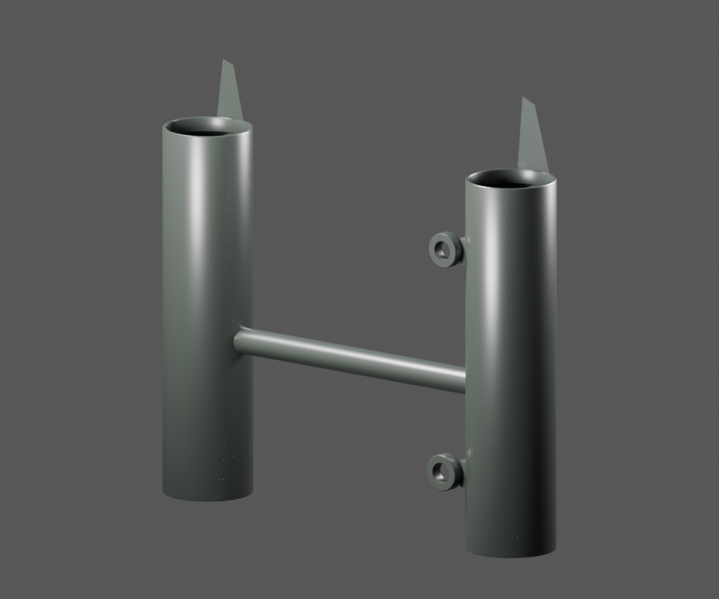
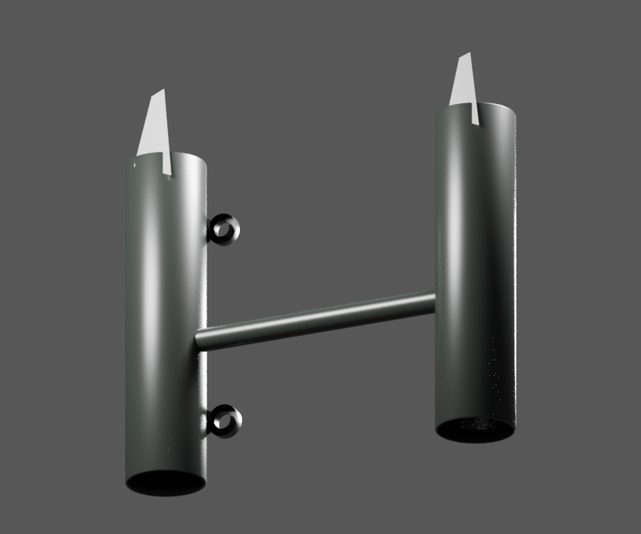
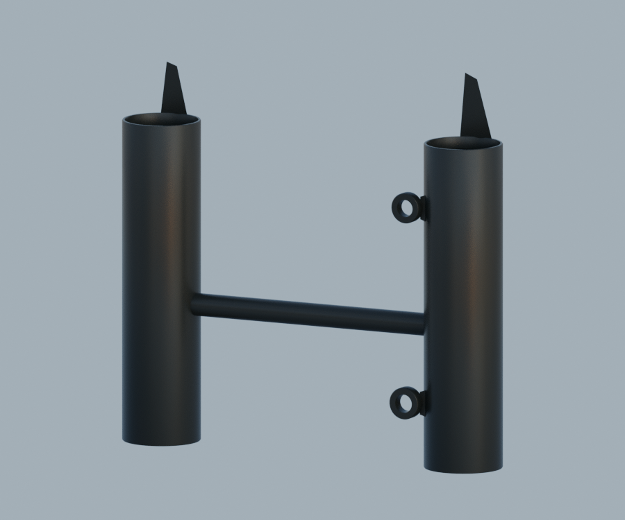

# P25 — PF121024 observed two-sleeve headlamp carrier exterior

[Source Blender](../../../assets-src/moto-components/front-completion-p25-lamp-frame-front18-v2/lamp-frame-material.blend) · [GLB](../../../assets-src/moto-components/front-completion-p25-lamp-frame-front18-v2/lamp-frame-material.glb) · [Dossier](../../../creative/research/front-completion-p25-lamp-frame-front18-v2-coordination-v1/G0-G2-plan-v1.json) · [Étude auteur](../front-completion-p25-lamp-frame-front18-v2/delivery.json)

[Source rouverte](source-geometry-check.json), [export réel](export-buffer-check.json), [rendus96 associés à la source figée](render-report.json), [EXR FLOAT32](raw-render-check.json), [quatre vues Babylon de coordination](inspection-v5/engine-check.json), [lecture réelle](coordinator-review.json), [manifestes](production-manifest.json). Les images et rapports auteur restent inchangés. Leur association à la source est vérifiée dans le lot figé. Une éventuelle vue indépendante `coordination-neutral` est identifiée séparément avec sa provenance ; elle ne modifie pas la source.

Support PF121024 : deux manchons observés indépendamment, traverse et surfaces exposées des pattes/œillets. Trois natifs96 et Babylon relus. La finition noire reste une hypothèse ; les faces arrière des pattes et les racines masquées sont laissées ouvertes. Ne comprend ni structure de carénage PF121025, ni douilles, ni montage reçu sur la moto. Variante RDC et cotes non certifiées.

Les dimensions et interfaces restent estimées. Aucune réception artistique ou qualification matérielle n’est transmise. Le paquet reste ouvert pour ses enfants et raccords manquants.
