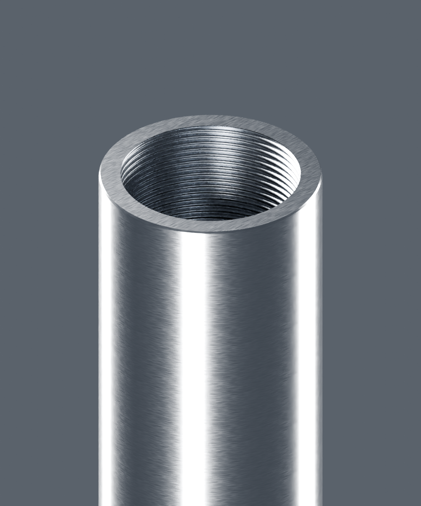
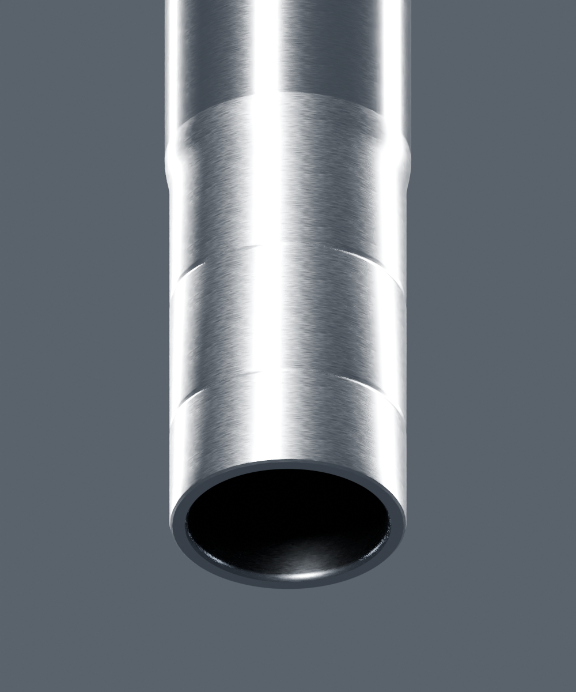

# Tube de fourche — candidat isolé v1

Un seul tube PF121017 liéBM150/X ; diamètre31mm seulement lié au libellé du jointD04/D15, longueur et section estimées. Aucune conformité actuelleRDC ni montage assemblé.

Rendus réels Blender4.3.2/Cycles96+OIDN, sans conducteur. Les [contrôles source](source-geometry-check.json), les [vrais buffers](geometry-check.json), les [paramètres de matière](material-build-report.json) et les [pixels embarqués](material-buffer-check.json) accompagnent la revue. Les [sources et inconnues](../../research/front-fork/inner-tube-v1.json) distinguent observation et estimation. Aucun contrôle automatique ne vaut réception artistique.

La pièce possède une paroi fermée continue autour du passage central ouvert ; l’existence du volume ne signifie pas que le filet est mécaniquement qualifié. Pas de bouchon ni d’orifice caché inventé. La source détaillée ne constitue pas un LOD mobile reçu ; la comparaison moteur et Safari physique restent des étapes distinctes.
