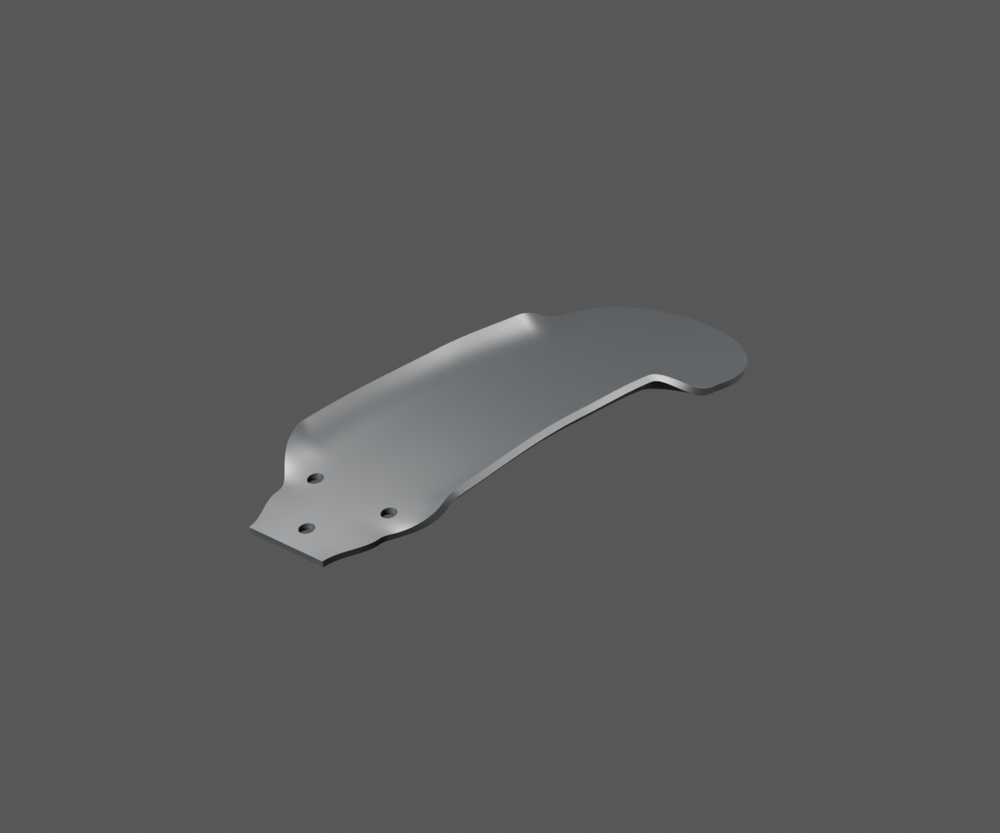
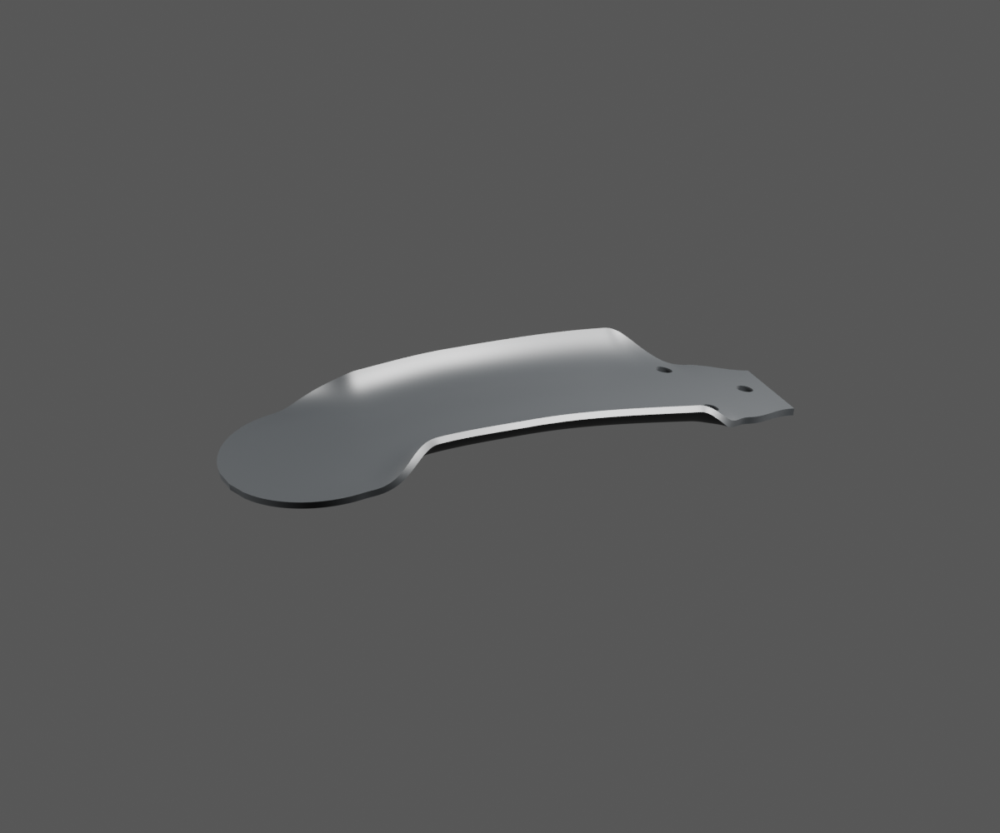
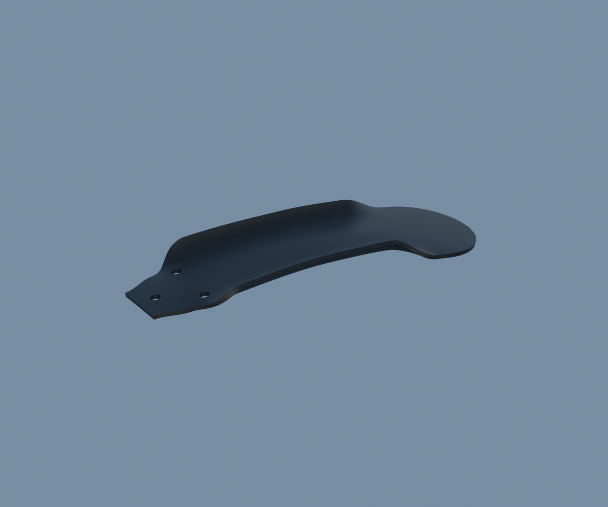

# P03 — bavette avant apparentée, revue de coordination

[Source Blender](../../../assets-src/moto-components/front-completion-p03-flap-material-v2/flap-material.blend) · [GLB](../../../assets-src/moto-components/front-completion-p03-flap-material-v2/flap-material.glb) · [Dossier](../../research/front-mudflap-coordination-v1/G0-G2-plan-v1.json) · [Étude auteur](../front-completion-p03-flap-material-v2/delivery.json).

La langue supérieure et ses trois perçages, le canal et ses épaules ainsi que la palette arrondie sont fabriqués. La référence est une variante Boxer150 apparentée : sa correspondance RDC et ses dimensions ne sont pas certifiées. Le revers et la courbure sans charge restent estimés ; la marque moulée illisible n’est pas inventée.

[Source rouverte](source-geometry-check.json), [contrôle GLB réel](export-buffer-check.json), [rendus96 associés au lot figé auteur](render-report.json), [trois EXR FLOAT32](raw-render-check.json), [quatre vues Babylon de coordination](inspection-v5/engine-check.json), [manifestes](production-manifest.json). Les rendus auteur sont conservés sans modification ; l’association exacte à la source figée est consignée, sans prétendre à un second rendu indépendant.

Trois rendus natifs et la vue Babylon trois-quarts ont été ouverts. Le gris métallique apparent du studio est un reflet sur le shader noir non métallique ; la lecture sous ciel neutre est sombre. Aucune couleur/rugosité mesurée. P03 reste ouvert pour la coque, les supports, fixations et jeux roue/fourche. Aucun montage qualifié, aucune réception artistique ni mesure iPhone.
