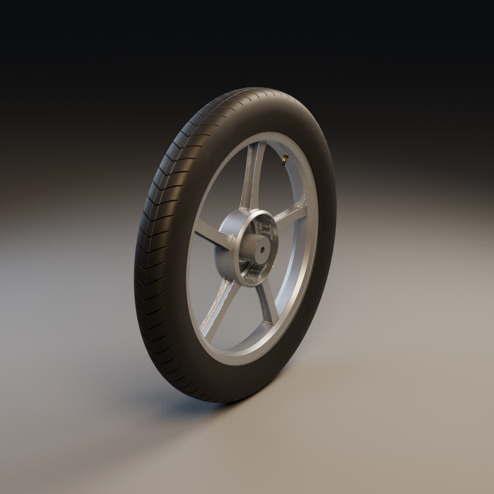

# Jante avant — revue isolée et raccord au pneu

20 octobre 2026. [Source Blender](../../../assets-src/moto-components/front-rim/README.md), [fiche de fabrication](../../workflow/records/moto-rim-front-001.json), [direction cinématographique choisie](../../GRAPHIC_STYLE.md). Candidat à reprendre, aucune réception artistique utilisateur.

## Vues réelles Blender

- `isolated-side.png` : cinq branches, jante seule de côté.
- `isolated-quarter.png` : volume et ouverture du moyeu.
- `joint-close.png` : raccords de moulage et section des branches.
- `tyre-fit-neutral.png` : contrôle du raccord au pneu existant sous lumière neutre.
- `tyre-fit-cinematic.png` : mêmes pièces sous une lumière chaude.

Ces images proviennent de Blender, pas du générateur d’images. La [moto seule portant WEWA](../../direction/motorcycle-wewa-style-02-generated-reference.png) est une **cible artistique générée** ; elle ne démontre pas que la moto complète existe en 3D.

## Corrections et limites

| Contrôle | Constat / correction | Encore ouvert |
|---|---|---|
| Raccords de branches | Taches de normales au premier essai ; unions et correction de surface reprises | Rayons de moulage et silhouette multivue à comparer |
| Talons | Largeur voisine 35,56 mm incompatible avec séparation estimée des talons ; largeur de travail 44 mm utilisée explicitement | Section exacte RDC et étanchéité non connues ; comparaison visuelle seulement |
| Export | Export Blender sans évaluation pouvait omettre les unions ; copie évaluée et réduite exportée avec contrôle des cinq branches dans les vrais buffers | Réduction non qualifiée comme LOD mobile |
| Matière | Peinture argent et surfaces usinées de travail | Aspect photographique, échelle des détails et comparaison moteur à recevoir |
| Affectation matière | Le remeshing supprimait le matériau usiné ; réaffectation géométrique et vérification des faces réelles ajoutées | Finition de surface encore candidate |
| Frein | Logement creux intégré au moulage | Flasque, roulements et axe séparés encore à fabriquer |

`geometry-check.json` vérifie le format, les dimensions de travail, le volume orienté et les dix intersections de bord correspondant aux cinq branches dans le GLB. `engine-rim-check.json` et `engine-wheel-check.json` consignent le chargement effectif dans Babylon.js et Chromium. Aucune de ces vérifications ne remplace la comparaison aux photos ou la réception utilisateur. Aucun test sur iPhone physique, aucune nouvelle intégration publique.

## Suite

Comparer les profils et les raccords aux vues documentaires, résoudre ou borner les écarts puis travailler le flasque de frein et l’axe. Le pneu reste candidat avec sa sculpture non confirmée. La moto seule précède toujours le conducteur.
