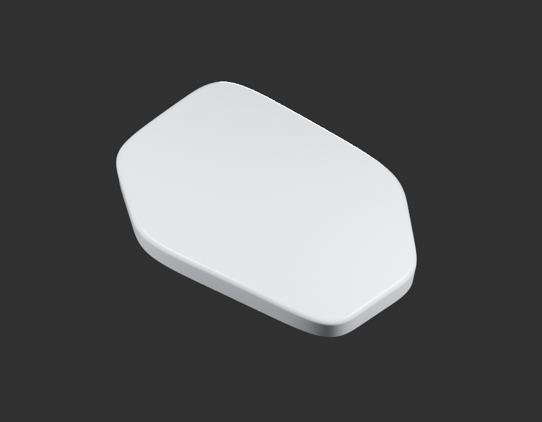
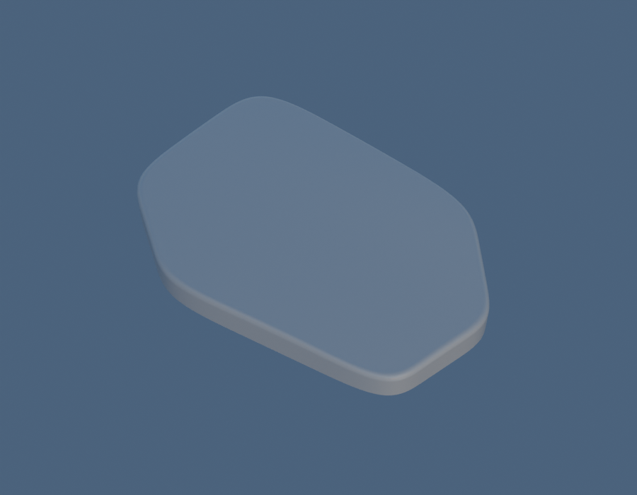
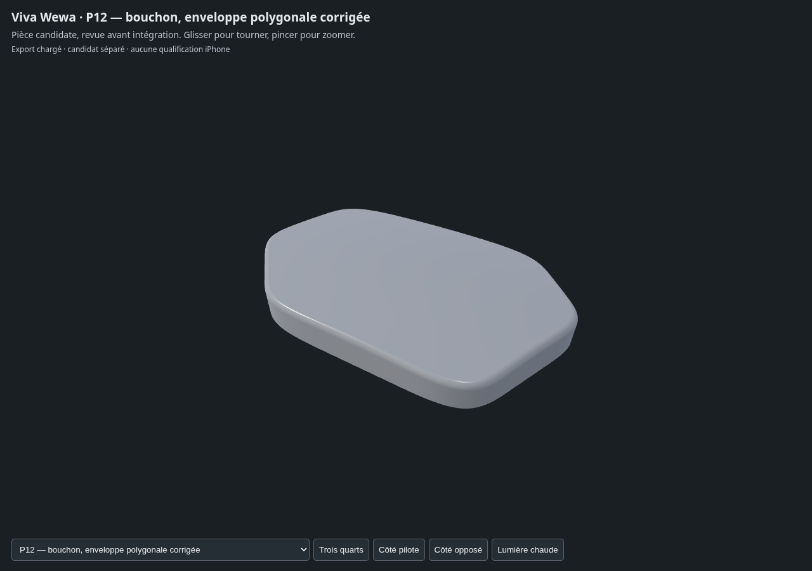

# P12 — fuel-cap-exterior-envelope-v2

**Un enfant candidat, pas un paquet terminé ni réceptionné.** Related DS141009 low rounded-polygon cap exterior envelope only; working68x47mm and6mm return. Corner controls preserve straight outline runs; no key-slot, hinge, underside or exact tank interface invented.

[Sources Blender/GLB et paramètres](../../../assets-src/moto-components/fuel-cap-exterior-envelope-v2/README.md) · [Dossier documentaire](../../../creative/research/fuel-cap-exterior-envelope-v2/G0-G2-plan-v1.json).

Gris réellement relus : [face](gray-front.png), [trois-quarts](gray-quarter.png), [revers](gray-reverse.png), [décision](gray-review.json). Aperçus : [studio](preview-studio.png), [neutre](preview-neutral.png), [décision](preview-review.json).

[Triangles/normales/UV/topologie réels](independent-export-check.json), [transfert source](source-geometry-check.json), [rendus96](render-report.json), [canaux EXR](raw-render-check.json), [quatre vues Babylon](inspection-v3/engine-check.json), [revue](coordinator-review.json), [manifestes](production-manifest.json).

Exposition0, gamma1, AgX Medium High Contrast et HDRI artistique0,65 ; pas d’étalonnage colorimétrique. Dimensions, sections et interfaces restent estimées. Aucune réception artistique, pose certifiée ou mesure iPhone.
