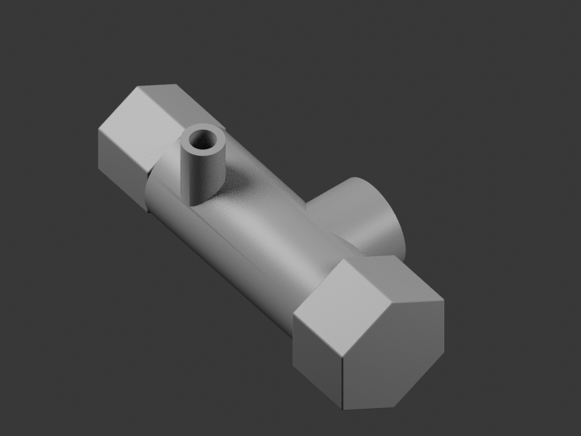
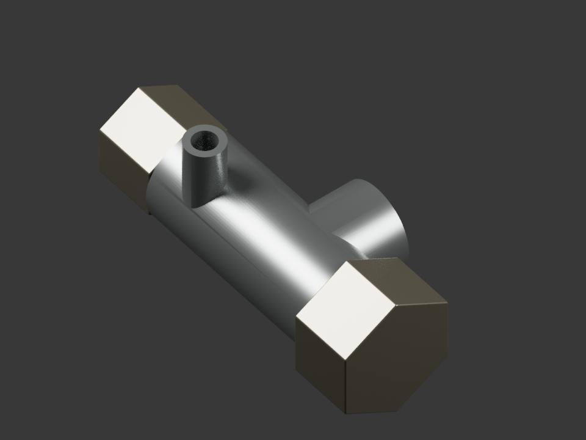
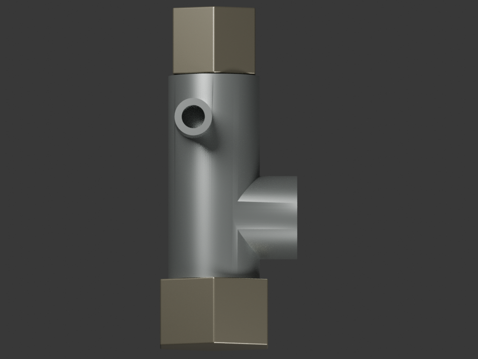
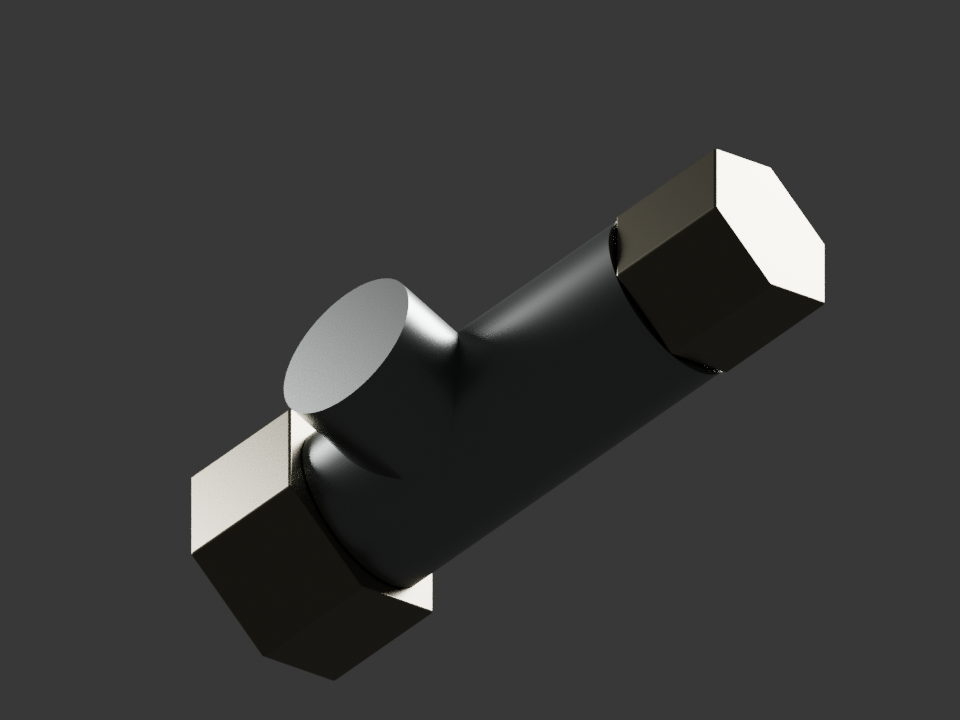

# P12 — corps extérieur visible du robinet PF171800

Trois corps extérieurs séparés sont construits : carter avec bossage de sélecteur et bouche de sortie, hexagone terminal et hexagone côté filtre. Le levier reste la source indépendante existante. Cette étude apparentée complète l’apparence visible ; la variante RDC exacte, le montage et la fonction ne sont pas qualifiés.

[Source grise](../../../assets-src/moto-components/fuel-tap-visible-body-v1/child-gray.blend) · [source matière](../../../assets-src/moto-components/fuel-tap-visible-body-v1/child-candidate.blend) · [GLB](../../../assets-src/moto-components/fuel-tap-visible-body-v1/child-candidate.glb) · [plan, source et plages d’estimation](../../research/fuel-tap-visible-body-v1/plan.json) · [fiche de fabrication](../../research/fuel-tap-visible-body-v1/record.json).

La photo commerciale Crosland PF171800 a été téléchargée et effectivement examinée ; son URL et son SHA256 sont consignés. Son fichier reste documentaire privé et n’est ni publié ni utilisé comme texture. L’échelle de travail provient de l’étude du levier, sans étalonnage photographique : longueur de corps 81,2 mm, plage 55–105 mm. Les profondeurs, fermetures arrière et couleurs métalliques sont des propositions bornées. Le filtre blanc dans le réservoir, les filetages, joints, passages internes et inscriptions illisibles sont exclus. Le bouchon d’un autre fournisseur n’est pas fusionné à cette pièce.

Le [contrôle natif](source-geometry-check.json) vérifie trois surfaces fermées, des volumes positifs et l’absence de triangles dégénérés. Le [contrôle indépendant des buffers](export-buffer-check.json) retrouve les **3 602 triangles**, des normales unitaires et zéro erreur glTF. Les raccords internes ainsi fermés sont des terminaisons de revue, sans prétention de fonctionnement hydraulique.

Le gris est rendu à 16 échantillons ; les trois vues matière à 96 échantillons, sans débruitage. [Rapport gris](gray-render-report.json), [rapport matière](candidate-render-report.json) et [EXR FLOAT32](raw-render-check.json). Les reflets striés d’un premier lissage ont été corrigés dans la source, avant l’export final.

[Corps dans Babylon, isolé](../motorcycle-exterior-v5/isolation/fuel-tap-visible-body.png) · [levier séparé](../motorcycle-exterior-v5/isolation/fuel-tap-visible-lever.png) · [contexte de montage estimé](../motorcycle-exterior-v5/context/fuel-tap-visible-body.png). Les preuves de cette pièce sont incluses dans le [manifeste v5](../motorcycle-exterior-v5/production-manifest.json). G0–G4 sont exécutés dans ce périmètre estimé ; G5 reste bloqué sur les interfaces. Les captures moteur sont des contrôles techniques indépendants, sans passage automatique de G6–G8.
