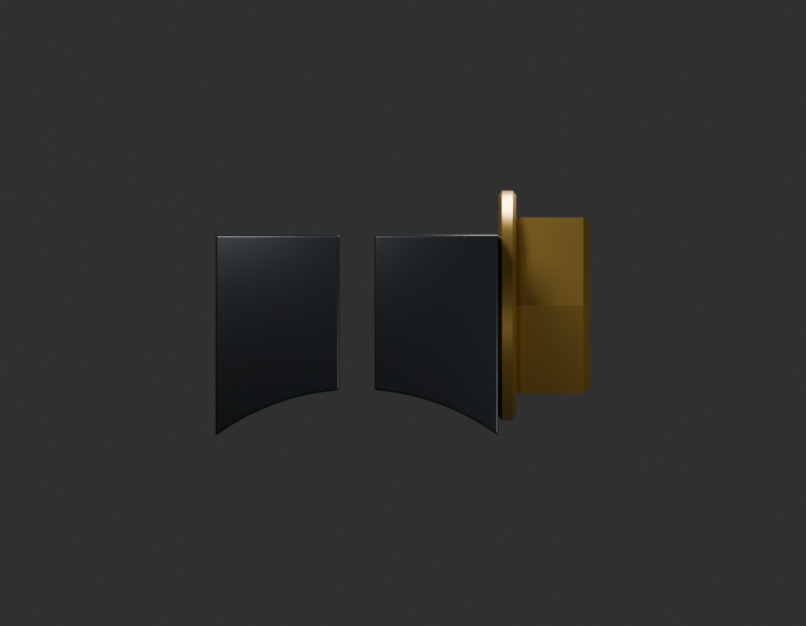
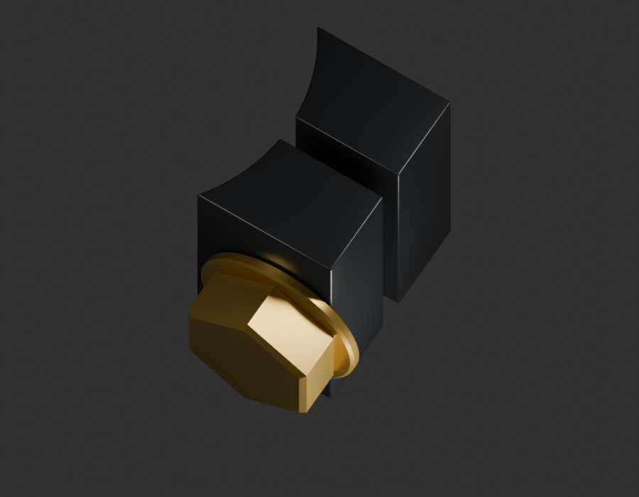
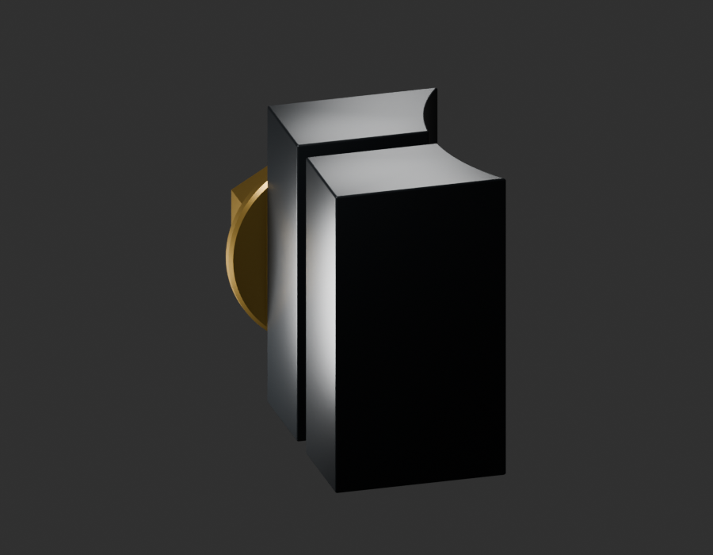
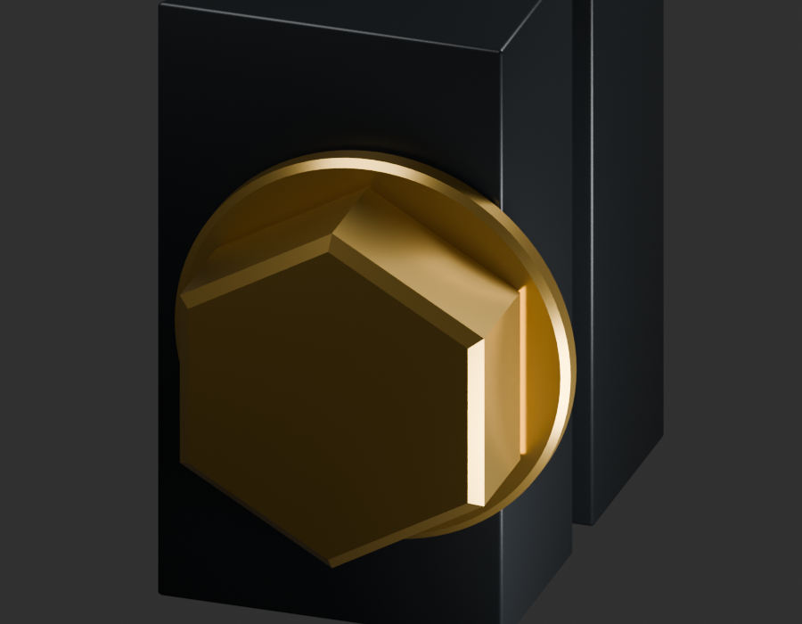

# P14 — MOTO-GEAR-SELECTOR-CLAMP-EARS-VISIBLE-HEAD-001 — bounded exterior candidate

[Source Blender](../../../assets-src/moto-components/gear-selector-clamp-ears-visible-head-v1/child-candidate.blend) · [GLB](../../../assets-src/moto-components/gear-selector-clamp-ears-visible-head-v1/child-candidate.glb) · [Dossier](../../../creative/research/gear-selector-clamp-ears-visible-head-v1-coordination-v1/G0-G2-plan-v1.json) · [Étude auteur](../gear-selector-clamp-ears-visible-head-v1/delivery.json)

[Source rouverte](source-geometry-check.json), [export réel](export-buffer-check.json), [rendus96 associés à la source figée](render-report.json), [EXR FLOAT32](raw-render-check.json), [quatre vues Babylon de coordination](inspection-v5/engine-check.json), [lecture réelle](coordinator-review.json), [manifestes](production-manifest.json). Les images et rapports auteur restent inchangés. Leur association à la source est vérifiée dans le lot figé. Une éventuelle vue indépendante `coordination-neutral` est identifiée séparément avec sa provenance ; elle ne modifie pas la source.

Oreilles de bridage du sélecteur JZ561415 et tête extérieure réellement observée. Quatre natifs96 dont neutre et macro et Babylon relus. La fente et le relief de tête sont visibles ; les racines cachées, corps de vis, filets, écrou opposé et cannelures internes ne sont pas inventés. Profils, cotes et métal jaune restent estimés ; source de même lot marqué, pas certification de variante RDC ni montage reçu. Ne reconstruit pas les bras et patins existants.

Les dimensions et interfaces restent estimées. Aucune réception artistique ou qualification matérielle n’est transmise. Le paquet reste ouvert pour ses enfants et raccords manquants.
