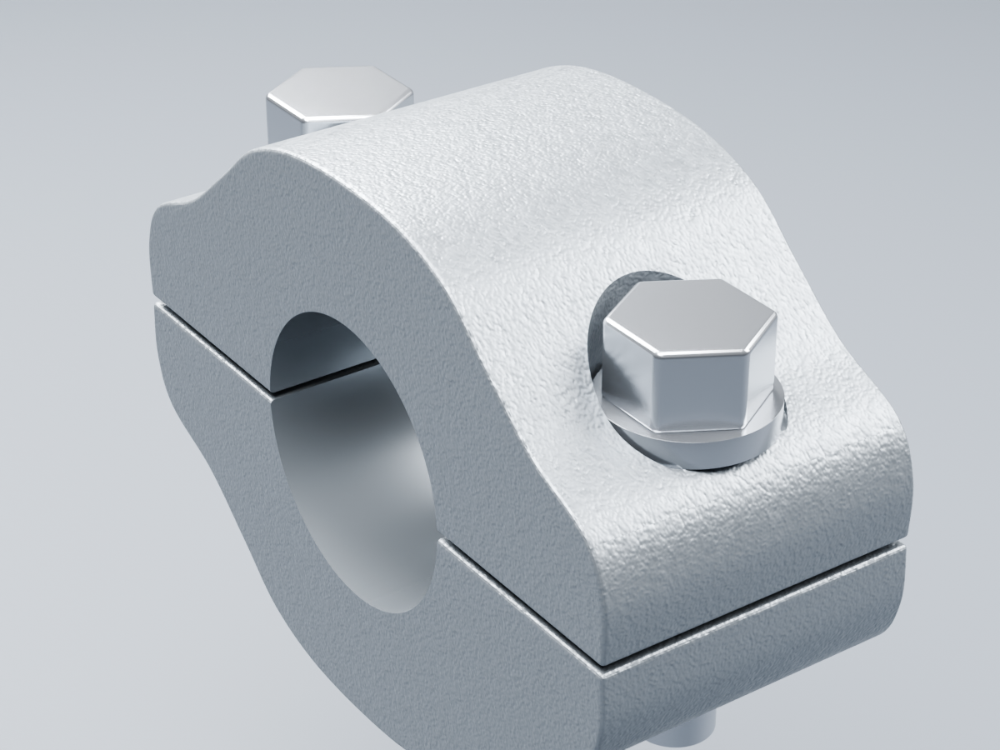

# Pontets — revue isolée v1

**Rendus réels Blender/Cycles96 avec OpenImageDenoise**, du candidat36DS1801 voisin, non reçu.

Les demi-coquilles sont réellement séparées et profilées ; leurs alésages ne sont pas peints. Les ouvertures du tube et des boulons sont contrôlées sur la source et sur les buffers glTF. Les huit volumes sont fermés et positifs.

[Contrôle source](source-geometry-check.json) · [contrôle export](geometry-check.json) · [paramètres et limites](../../../assets-src/moto-components/handlebar-clamps/README.md).

Les sections moulées, le pas/longueur du goujon, les emplacements, le revêtement et les tolérances ne sont pas mesurés. Les filetages femelles, amortisseurs et la pile inférieure restent absents. La compatibilité OEM RDC, le serrage, la précharge et la réception artistique restent ouverts.

Correction avant gel : profil YZ lissé pour enlever les cassures de couronne de la première prévisualisation ; petite dépression du berceau inférieur ajoutée depuis Matriz. La courbure transversale exacte du corps reste ouverte. Les deux images ci-dessus servent à examiner la continuité et les ouvertures ; elles ne valident pas les cotes OEM.

G4 : reprise des cartes originales de normale tangentielle et rugosité/metal, avec échelle estimée explicite ; [paramètres](material-build-report.json), [pixels réellement embarqués](material-buffer-check.json), [contrôle strict des tangentes, sans réparation export](tangent-buffer-repair.json). Le premier shader lisse est conservé en historique privé et ne vaut pas finition reçue.

La source a été nettoyée après congé : sommets coïncidents soudés au seuil0,1µm, sans déplacement d’un sommet retenu ; fermeture, volume, aire et ouvertures sont recontrôlés. Le candidat final ne contient plus de triangle d’aire quasi nulle au seuil10⁻¹⁸m². Les corrections de vecteurs expérimentées pendant le diagnostic ne font pas partie de l’export final.

Les secteurs de normales d’origine sont préservés séparément de la géométrie soudée : la source propre recalcule les mêmes pondérations par secteur. La revue des aperçus a confirmé des reflets continus dans le berceau et des faces planes, après rejet du premier recalcul qui mélangeait ces secteurs. Le shader de micrograin ne sert pas à cacher ce défaut.

La portée cylindrique est distinguée du revêtement extérieur : finition satinée sans carte de grain, rugosité0,27 choisie visuellement et non mesurée. Cette correction répond à PHOTO-CLAMP-04. La [comparaison des vrais buffers](geometry-preservation-check.json) établit que positions, triangles orientés, normales et matrices restent identiques à l’état précédent malgré le regroupement par matières. Deux vues finales servent à juger cette correction ; aucune réception artistique n’est déduite de ce contrôle.
